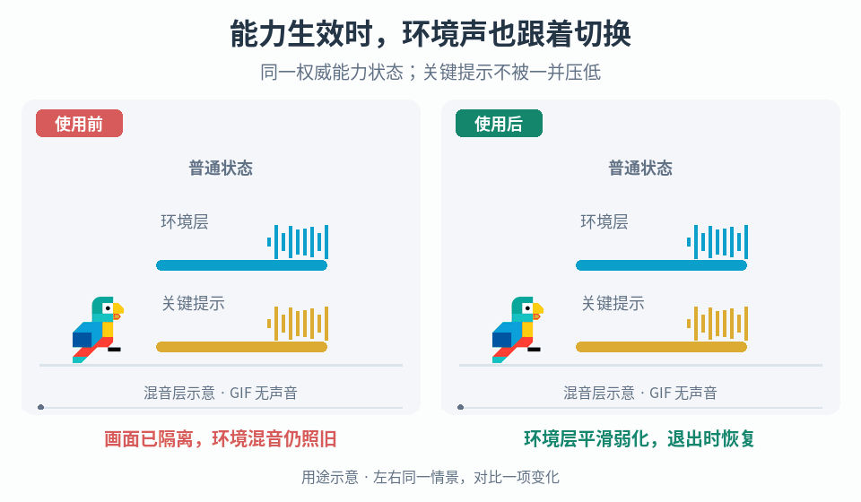

# 能力状态驱动的环境混音

## 效果预览

同一能力开启与退出，右环境总线参数平滑切换和恢复，关键提示波形不变；不把主音量静音。声音变化以图形示意。

左侧为使用前，右侧为使用后；4 秒循环，用途示意（非引擎实测）。

## 触发与前置输入

当感知、扫描或视觉隔离能力已经改变画面，但环境声音仍维持普通状态，使用本页为能力添加对应的混音层。先取得能力系统的权威激活/失效状态及状态变更通知、现有音频混音器与路由、普通混音基线、暂停和场景切换约定，以及必须保持可辨认的声音清单。能力尚未实现时，只准备音频适配接口，不用按键按下、动画播放或音频过渡完成来决定能力是否生效。

需要项目明确哪些环境层要弱化，哪些提示、对白、危险信号或交互反馈要保留。缺少路由或保留清单时先检查并提出最小分组方案；不要直接对整个主输出静音或加统一滤波。

## 实施流程

1. **建立路由和控制权。** 列出受能力影响的环境声音及其实际输出组，追踪父组、发送/返回和旁路路径；将需保留的重要声音置于不会被该能力错误削弱的控制范围，沿用已有合适路由。若改路由会影响其他混音功能，先限定修改范围。查清现有暂停、受伤、菜单或场景混音控制者，选择复用现有混音协调器或建立一个统一写入点，避免多个组件同时抢写同一组参数。
2. **制作两个明确的目标状态。** 在目标项目的普通混音基础上建立普通和能力激活两个快照，或使用项目已有等效混音状态。激活态只调整选定环境层，可采用低通等滤波和必要的层级增益变化；截止频率、滤波配置及增益均按素材和场景试听选择。逐项比较两个状态的差异，防止无意保存了主音量、用户设置或无关总线参数。只保护预定的重要信号，不把“过滤环境”实现为停止所有声音实例。
3. **连接权威状态。** 音频适配器订阅能力状态，并在初始化、重新启用和恢复时主动读取当前状态。维护当前请求态、解析后的目标混音和过渡标识；仅当解析后的目标改变时提交一次过渡。重复通知不得从头重启淡变。视觉表现与音频共同消费同一权威状态，不互相通过完成回调触发；若能力有预备阶段，明确哪个状态才应改变混音。
4. **由单一所有者过渡。** 通过项目引擎版本支持的快照过渡接口，从当前实际混合状态前往解析后的目标。进入和退出可各设项目选定时长，并明确暂停时过渡使用的时钟。快速开关、能力取消或新目标到来时替换旧目标，从当前混合值继续，而不是硬跳回起点；旧过渡回调不得覆盖新目标。若现有接口无法中途重定向，选择能保持连续性的协调方案，并明确该限制，不用多个并行淡变补救。
5. **解决重叠而非盲目恢复。** 存在多个能力使用者或其他混音状态时，由同一协调器收集当前有效请求，按项目明确的优先级、互斥规则或可组合参数范围解析目标。每个请求绑定其所有者并可单独撤销；一个能力退出不能撤销仍有效的另一请求。能力退出时回到当前场景和剩余状态共同决定的基线，而非进入时缓存的一份过期全局快照。不自动相乘滤波或不断叠加衰减。
6. **完成恢复和清理。** 暂停恢复时重新读取能力和混音请求，按约定继续或重定向未完成过渡。死亡、能力失效、组件禁用和场景卸载时撤销本能力的请求、移除订阅并使旧回调失效，再由协调器重算目标；不要由被销毁组件强行写普通快照。场景重新进入或存档恢复后根据实际能力状态初始化，确认环境音未因上次退出而遗留滤波。用户音量和无关混音设置保持其原有控制权。

## 调参与故障恢复

先使用一套固定场景核对状态事件和路由，再比较两个静态目标，随后调进入/退出过渡，最后覆盖不同环境与重叠状态。先查重要声音是否走错组或被父组/返回路径影响，再调整滤波；不要靠把所有关键声音大幅增益来抵消错误路由。

- 能力画面退出但环境仍受抑制：查权威状态订阅、请求是否残留及旧过渡是否回写，不先添加延迟恢复计时器。
- 快速切换发生爆音或跳变：查是否重置混合起点、重复启动过渡或存在多个写入者，再调平滑时间。
- 同一设置在某环境效果过弱或过闷：检查实际声音路由和频谱差异，按项目选择局部调节或场景化目标，不假设一组滤波常数适合所有环境。
- 取消能力后菜单/受伤混音被清空：改为撤销本能力请求并重算剩余状态，禁止无条件恢复全局普通快照。
- 缺少快照或路由无效：停止本能力的混音修改并报告配置缺项，保留现有可听混音与能力玩法，不静音作为回退。

## 验收

- [ ] 普通 → 激活 → 普通时，音频目标与权威能力状态一致；重复通知不重启过渡，初始化于已激活状态也能正确进入。
- [ ] 选定环境层产生预期的可听隔离效果，保留清单中的声音在各目标与过渡中均可辨认，用户音量和无关音轨不被重写。
- [ ] 快速开关、过渡中取消及重新激活不会跳回旧起点或被过期回调覆盖；记录请求、解析目标和过渡标识可解释最终结果。
- [ ] 多请求重叠时撤销任一请求不清空其余状态；切换场景基线后退出能力回到当前基线，不恢复过时快照。
- [ ] 暂停恢复、死亡、禁用、卸载和重新进入后没有残留滤波、重复订阅或悬挂请求；缺失配置有保留可听混音的回退。
- [ ] 在代表性安静与繁忙环境实际开启音频，对照视觉能力变化核听进入、保持和退出；只有状态日志或静音画面时，标记“控制流程已检查，听感待验收”。

## 机制边界

本页拥有能力状态到混音目标的适配与请求生命周期，不创建能力玩法、音源素材或通用混音架构。[物理阶段音频](../gameplay-physics-stage-audio/SKILL.md)按断裂、倒伏和撞地触发声音；[植被接触音](../gameplay-foliage-rustle-response/SKILL.md)依据有效接触与移动输入控制实例。它们的输出可经过本页选定的总线，但本页不替代其触发、变体或声部生命周期。

需要核对作者说明、观察范围与工程扩展时，读取[来源参考](references/sources.md)。
