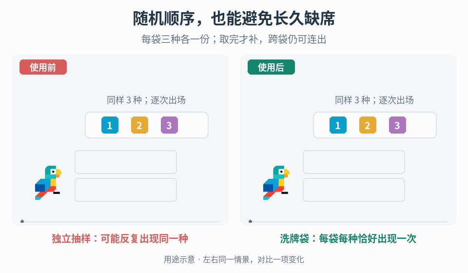

# 不放回洗牌袋与有界出场间隔

## 效果预览

同一三类型集合连续六次出场。左独立抽样样例有缺席，右两袋逐项消费且边界3连续；不声称无连出。

左侧为使用前，右侧为使用后；4 秒循环，用途示意（非引擎实测）。

## 触发与输入

项目明确希望在随机顺序中保证每一组都出现全部类型，例如有限形状或事件类型的出场序列。取得非空且互异的类型ID列表、实际消费事件、预览需求、重开/存档规则及随机种子策略。先确认允许改变分布：袋内抽取不独立，某种类出现后要等新袋才会再出现；这不是不改变规则的视觉优化。

## 实施流程

1. 固定一份含 N 个互异ID的类型集合。每袋只复制一份每种类型，不把重复ID当作权重；空集合拒绝配置。需要多份或加权方案时先另定义保证，不能沿用本入口的间隔上界。
2. 新袋创建时将完整列表洗牌一次，使用目标运行时可靠的均匀排列实现（例如正确的 Fisher–Yates：从末尾往前，每步在尚未固定区间均匀选交换下标）。不要用随机排序比较器，也不要每次抽取都重新从全部类型挑选。
3. 用队列或列表加游标逐项消费。只有剩余数量为零才创建并洗牌下一袋；边界允许上袋最后一项与下袋第一项相同。若设计不允许邻接重复，需要单独改规则并重新验证分布，不悄悄重抽破坏已声明方案。
4. 让一次真正的生成/出场提交消费一次输出，动画重播、失败重试、多个监听器和UI刷新不额外抽取。需要预览时缓存已排定的队列或读取隔离状态，预览本身不能推进权威随机流。
5. 明确重开与持久化语义。要从完全相同的局面重放，应保存当前袋顺序、游标及用于未来补袋的随机状态/确定性序列位置；只保存初始种子不足以恢复中途状态。跨版本/平台一致性要固定算法与序列化契约，不能假定同名PRNG跨引擎一致。
6. 类型集合在一袋中途变化时，选择完成旧袋后应用新集合，或显式重置序列；记录该边界，并重新开始计算对应集合的保证。不要把旧集合未出现的类型算成新集合的欠账。
7. 同时验证袋完整性与玩家可见的间隔。对同一集合连续完整运行，两次同种输出之间至多有 2(N−1) 个非该种输出；N=7 时是12个“中间非目标项”，下一目标所在的输出序号距离至多13，不把两种计数混用。首次抽取前最多等 N−1 个非目标项。该保证不代表无连出、逐次独立或主观上一定公平。

## 调参和取舍

这里主要选择类型集合、重置边界和是否接受袋间邻接重复，不靠调整随机权重“优化”同一个算法。先与独立抽样作固定数量的序列对照，记录最大缺席、重复串和每袋完整性，再评估玩家是否更容易预测最后剩余类型。改变N或每袋份数就改变体验与数学保证，需另验。

## 验收与失败处理

- 连续按袋切分时，每段恰好包含全部类型各一次；缺项/重复先查游标、补袋时机与重复消费。
- 明确跨袋最坏情况：某类型在前袋第一、后袋最后时，中间有 2(N−1) 个其他输出；不要只在单袋内测间隔。
- N=1能持续输出同一类型且非目标间隔为零；空集合和重复ID被拒绝。邻接两次同种跨袋出现是合法结果，不误判为算法坏了。
- 多次预览不改变实际后续输出；保存/恢复、重开和类型变更符合声明策略，失败的生成提交按项目事务规则处理，不能随机多抽。
- 固定种子在固定实现/版本下可复现；普通性质测试不证明均匀性、密码学安全或某个商业游戏采用了同一实现。

## 可执行参考

需要快速验证算法语义时运行或适配 [Python参考类](scripts/shuffle_bag.py)，它提供 draw 与不消费状态的 peek；不是引擎集成，也不实现存档接口。算法性质测试位于 [仓库测试](../../tests/test_bag_randomizer.py)，可运行 python -m unittest discover -s tests -p test_bag_randomizer.py -v。迁移到目标引擎后重测事件消费、预览与持久化。

需要核对出处、12的原说明与上界推导范围时，读取[来源参考](references/sources.md)。
