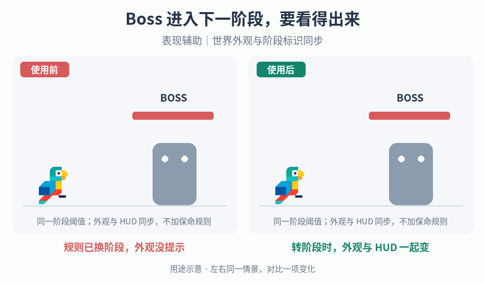

# Boss 入场、转阶段与终结

## 效果预览

规则已换阶段，外观没提示；转阶段时，外观与 HUD 一起变；表现辅助｜世界外观与阶段标识同步。

左侧为使用前，右侧为使用后；4 秒循环，用途示意（非引擎实测）。

## 触发与输入

用于 Boss 阶段缺少区分，或演出造成控制锁死、危险遮挡、奖励重复。取得 Boss 状态机、阶段阈值、入场与死亡事件、控制/镜头归属、检查点及奖励规则。

## 实施流程

1. 将入场、战斗、转阶段、死亡与退出列为显式状态；每个状态声明是否可操作、是否可受伤及其退出条件。演出只消费这些状态，不另判胜负。
2. 入场按铺垫→局部揭示→完整角色→交还镜头组织节奏。通过从脚到脸的取景表达尺度；只在既定规则要求时封路。
3. 转阶段同步世界变化、角色外观与 HUD 阶段标识。选择裂缝、火翼等与新能力相关的视觉语汇；真实阈值先确认，演出不得擅改生命或增加假胜利。
4. 战斗中的危险提示复用[攻击可读性](../gameplay-attack-readability/SKILL.md)。若调整屏障外观，单独检查中心遮蔽、破碎边缘和不同高度裁切；本入口不提供通用屏障 shader。
5. 死亡事件只提交一次，依次组织致命确认、节奏强调、崩解/熄灭和胜利/掉落显示。真正发奖由权威事件负责；只有进入整关结果时才接[完成收尾](../gameplay-completion-sequences/SKILL.md)。
6. 为项目支持的跳过、打断、重开定义收尾函数，统一释放控制、镜头、临时音效和表现对象；跳过不得漏掉必需状态提交或重复奖励。

## 调参

分别调整铺垫、揭示、控制交还和死亡尾声的时长。先保持危险区清楚，再增加镜头/粒子层次；普通阶段与关键转场保持强弱对比。屏障透明度与边缘噪声只改变显示，不改变阻挡范围。

## 验收与失败处理

- 入场、阶段越阈值和死亡各触发一次，连续伤害跨阈值不叠播互斥序列。
- 中断、跳过、检查点重开后控制与镜头归属正确，奖励不重复。
- HUD、危险区和实际阶段一致；屏障高低视角无误导裁切。
- 遇到状态重入时先停止旧序列并执行统一收尾，不继续叠加锁定。

## 组合

按需复用[停顿](../gameplay-hitstop/SKILL.md)、[冲击视觉](../gameplay-impact-visuals/SKILL.md)、[镜头反馈](../gameplay-camera-feedback/SKILL.md)与[血条](../gameplay-health-damage-ui/SKILL.md)。

需要核对机制出处、示例参数或证据边界时，读取[来源参考](references/sources.md)。
