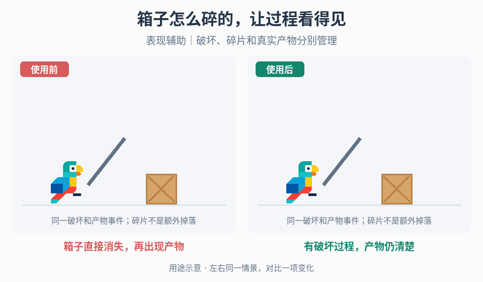

# 破坏、死亡与采集产物过程

## 效果预览

箱子直接消失，再出现产物；有破坏过程，产物仍清楚；表现辅助｜破坏、碎片和真实产物分别管理。

左侧为使用前，右侧为使用后；4 秒循环，用途示意（非引擎实测）。

## 触发条件

- 木箱、敌人或采集目标直接消失，破坏原因、过程和产物的关系难读。
- 需要组织对象终态与碎片清理，而不是宝箱揭示、奖励吸附或背包入账。

## 输入与前置条件

对象完整/受损/破坏状态、真实致命或采集完成事件、接触方向、既有碰撞/占用规则、产物生成事件、重载/中断与一次性处理约定。

## 实施步骤

1. 建立完整、受损、正在终结、已终结四个对象状态；将终结与产物生成绑定一次性的真实致命/采集完成事件。
2. 为所选对象制作一个可读中间过程：木箱先接触压缩再飞散木板；爆炸桶从既有预警进入膨大火球再衰减为烟；敌人死亡可用短膨胀、碎裂或残留。只选择符合材质和项目风格的层。
3. 采集对象不要立即替换为产物：在完成事件后先表现倾斜/倒伏，再按既有产物事件显示分段材料。视觉倒伏不自动增加刚体、砸伤或阻挡。
4. 把纯视觉碎片与可拾取产物分开管理。碎片有数量/寿命预算，产物由经济系统决定唯一身份与生成结果，动画结束不得再次发放。
5. 中断、卸载和重入时恢复已确认终态；保留真实产物，清理失效表现。需要奖励揭示或领取时接对应工作流，不在此重复结算。

## 黑化与噪声消隐的死亡表现分支

用于已确认死亡后希望保留短暂轮廓再消失的角色，不改死亡判定或奖励发放。

1. 进入既有终结状态时固定本次表现身份，保留项目选定的死亡动画或姿态；本分支不自动改成布娃娃。为目标网格创建可独立控制的材质参数，避免一只死亡让共享材质的所有角色一起消失。
2. 用归一化进度驱动原外观向黑色轮廓过渡，再逐步以噪声遮罩挖去表面。显式检查进度起点完整、终点全隐及中段单调收缩；遮罩阈值正反由实际材质约定决定，不凭参数名猜公式。噪声坐标要稳定在角色/所选空间，避免动画中纹理无意游动。完整着色器缺失时先制作可调原型，不能只复制陌生节点数值。
3. 在同一表现事件上添加少量黑色小团粒子，匹配角色消失风格；生成位置、持续时间和速度由项目视觉选择，保持粒子与网格寿命独立。末段网格隐藏不等于必须截断已有粒子尾部，尾部也不能永久占用对象。
4. 死亡动画、材质进度和粒子统一由一个表现调度驱动，但真实产物只消费原有权威事件一次。碰撞/导航何时撤销沿用玩法约定，不用某像素消失或粒子结束决定角色是否可击中。
5. 中断/卸载停止旧进度与发射；对象池复用恢复材质、可见性和参数，不能带着上次黑化或半透明状态复活。取消终结若玩法支持，按项目回退而不是只反放粒子。

先检查起点/终点和同材质多对象隔离，再调噪声尺度、黑化与消隐的相位、进度曲线和团粒数量。对照单次死亡、同帧多对象死亡、镜头远近及重用：无悬留残片、全局串色、双奖励或超预算残留。此分支提供表现编排，不承诺完整噪声shader或物理尸体实现。

## 调参顺序

分别调受击到终态的视觉延迟、碎片方向/数量、火球扩张与烟尘衰减。先保证终态和产物清楚再增强冲击；以对象尺寸和场景密度控制碎片预算，不设通用帧数。

## 失败处理

重复受击导致双产物时先修终结事件幂等性；倒伏穿地按是否真实物理分流到接触/突出部流程；粒子遮住掉落物时缩短烟尘或降低覆盖，不隐藏真实产物。

## 验收

- [ ] 重复受击、同帧多伤害、中断和重载不重复死亡、采集结算或生成产物。
- [ ] 倒伏过程若项目已有碰撞/占用，分别测试玩家、地形和邻近物体；只改视觉时不新增砸伤/阻挡。
- [ ] 碎片和余烟有清理预算，危险区/产物不被长期遮挡；表面痕迹按其 owner 清理。
- [ ] 对象终态、产物生成与拾取成功分开验证，不凭图标或地面木料认定库存已变化。

## 组合与边界

- 终态后的纯视觉碎片/痕迹若需较长保留，复用[残留寿命与预算](../gameplay-impact-visuals/SKILL.md)；真实产物、拾取和主体终态仍由本页与对应领取流程管理，不能当作同类装饰实例清理。

- 已有物理倒伏但首次触地前姿态/重量感不合目标时，使用[重心与施力诊断](../gameplay-prop-toppling-dynamics/SKILL.md)；只缺倒伏中间态不等于需要新增物理调参。

- 倒伏后突出部穿地使用[突出部接触](../gameplay-prop-appendage-contacts/SKILL.md)；切开后缺面或内外材质错位使用[切割新表面](../gameplay-cut-surface-rendering/SKILL.md)。两者不改变本页的终态/产物职责。

- [压缩拉伸](../gameplay-motion-deformation/SKILL.md)、[命中停顿](../gameplay-hitstop/SKILL.md)、[冲击粒子](../gameplay-impact-visuals/SKILL.md)、[镜头反馈](../gameplay-camera-feedback/SKILL.md)负责表现组件。
- 本页只拥有对象从受击到终态/产物的过程，持久痕迹、结果揭示和实际领取分别由独立 owner 处理。

- 宝箱、传说卡、合并和升级的结果表现：[奖励与结果揭示](../gameplay-reward-reveal/SKILL.md)。
- 金币生成、吸附、可达性与实际拾取确认：[掉落物拾取](../gameplay-loot-pickup/SKILL.md)。

需要核对案例、参数出处或证据边界时，读取[来源参考](references/sources.md)。
