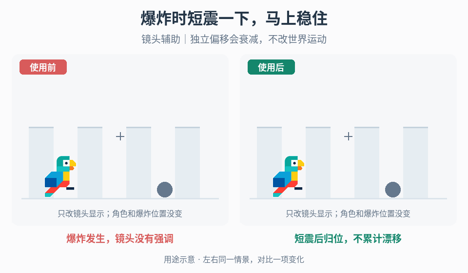

# 镜头冲击与短促聚焦

## 效果预览

爆炸发生，镜头没有强调；短震后归位，不累计漂移；镜头辅助｜独立偏移会衰减，不改世界运动。

左侧为使用前，右侧为使用后；4 秒循环，用途示意（非引擎实测）。

## 触发条件

击打、落地、后坐或爆炸缺重量，或现有临时震动漂移、遮挡准星。

## 输入与前置条件

基础跟随/瞄准驱动，事件方向/强度，重复频率，屏幕比例和减少运动设置；区分视觉偏移与玩法后坐。

## 实施步骤

1. 在基础相机输出之后建立独立临时偏移层，保存其基准；每帧从基准加当前偏移，不累计写回世界位置。
2. 用事件方向组织冲击：落地、后坐、击打各选可读的平移/旋转方向；稀有重击可用短促推近，但不把所有事件都变成缩放。
3. 为幅度、频率、衰减和持续时间分别配置；同帧多目标选择最高强度或预算合成，连续触发有总量上限。非线性强度映射只是可测试选项。
4. 先对照无、小、大单一效果，再合并粒子与停顿；优先选择能确认事件的最小强度。
5. 结束、取消、切场或控制权变更时撤销本层，不覆盖新活动镜头；持续速度 FOV 和终点镜头交接由各自入口负责。

## 参数调整

以准星、危险边界和下一路径为约束调幅度；延长衰减会拖尾，先降低重触发累积再改频率。减弱/关闭选项同时控制位移、旋转与推近。

## 验收与失败处理

- [ ] 连击、同帧多目标、重复推近不无限累积，打断后不漂移。
- [ ] 减少运动设置有效，弹球/高速场景能追踪下一接触点。
- [ ] 视觉后坐开关不改变实际瞄准、伤害或碰撞；失败先隔离偏移层定位。

## 按需组合

- [速度镜头](../gameplay-speed-camera/SKILL.md)
- [完成事件组合](../gameplay-completion-sequences/SKILL.md)
- [表面感知相机上方向](../gameplay-surface-camera-up/SKILL.md)
- [接触停顿](../gameplay-hitstop/SKILL.md)
- [攻击预警与反制可读性](../gameplay-attack-readability/SKILL.md)

需要核查出处、示例参数或证据限制时，读取[来源参考](references/sources.md)。
