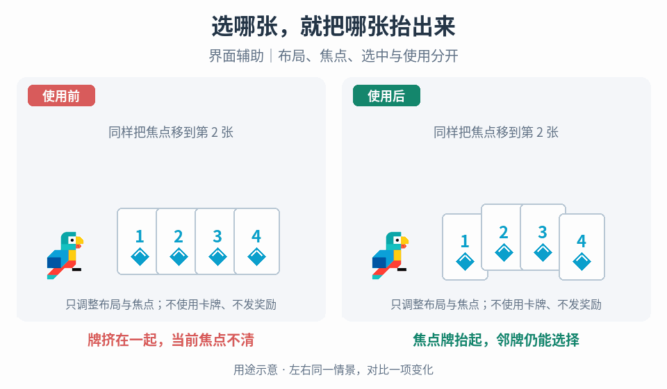

# 手牌布局与卡牌选择

## 效果预览

牌挤在一起，当前焦点不清；焦点牌抬起，邻牌仍能选择；界面辅助｜布局、焦点、选中与使用分开。

左侧为使用前，右侧为使用后；4 秒循环，用途示意（非引擎实测）。

## 触发与输入

用于手牌布局、焦点、翻面、选中与提交结果混淆。取得卡牌稳定 ID、顺序、牌数、输入设备、焦点/选中状态、真实提交事件和绘制层级。

## 实施流程

1. 分离布局、悬停/焦点、选中、提交中、成功与移除状态；只有业务确认成功才能应用选牌结果。
2. 按牌数计算扇形目标位置/角度，以稳定 ID 绑定每张牌的当前位置与目标；重排时从当前姿态过渡，不重新按数组下标认牌。
3. 焦点牌抬高/放大并提高层级，非焦点牌回到布局目标。选择效果可用描边与倾斜，确保邻牌可选区域仍可达。
4. 翻面采用缩窄→在最窄处切换显示面→展开；取消或中断后明确落在正面或背面，不停留在不可见中间态。数据面与视觉面分别管理。
5. 提交成功后才播放烧蚀/退出等结果动画；失败回到可选择状态，取消清除选中，不让重复点击重复应用效果。

## 调参

随牌数调扇形半径、张角与重叠量，再调焦点抬升、倾角及跟随时间。过密优先调整可点击覆盖，不一味缩小文字。翻面总时长与换面时点分开调；减少运动时可直接换面并保留清晰选择标记。

## 验收与失败处理

- 少量/大量牌、快速跨牌焦点、手柄/指针适用设备下，焦点唯一且邻牌仍可选。
- 翻面中取消、重排、移除及重复提交后牌面、层级与业务结果正确。
- 关闭重开按最新集合重建布局；失效目标立即移出焦点，不能保留悬空高亮。

## 组合

[交互状态](../gameplay-contextual-ui/SKILL.md)管理确认，[奖励揭示](../gameplay-reward-reveal/SKILL.md)管理稀有卡获得，不在布局动画中发奖。

需要核对机制出处、示例参数或证据边界时，读取[来源参考](references/sources.md)。
