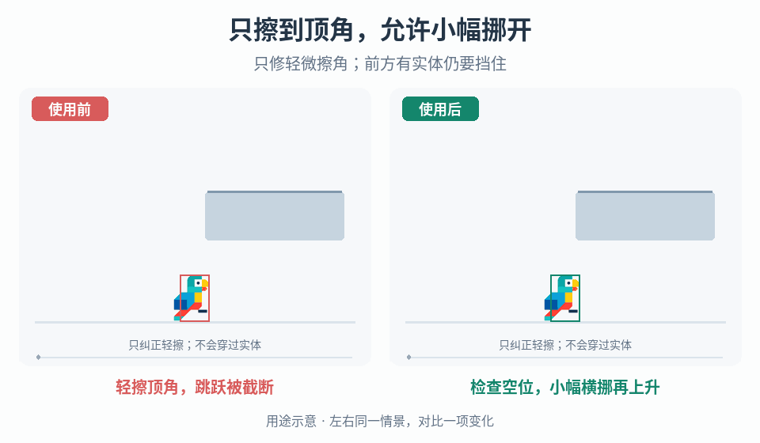

# 上升碰撞的顶角宽容

## 效果预览

同一上升路线头部轻擦悬空块角；右侧有限横移到合法空位继续上升，左侧撞顶落下。

左侧为使用前，右侧为使用后；4 秒循环，用途示意（非引擎实测）。

## 触发条件

- 上升时仅头部边缘擦到悬空障碍角落，跳跃被截断，但设计上希望容许有限横向纠偏。
- 已有角落修正会穿墙、选错侧、在窄缝反复弹移或改变过多关卡路径。

## 输入与前置条件

真实角色碰撞体、上升方向/速度、接触面与障碍几何、允许修正距离及单位、目标空间碰撞检查、移动平台/斜面支持范围。明确这是玩法碰撞规则变更，不是改变精灵形状或输入缓冲。

## 实施步骤

1. 在碰撞调试中区分上升顶角轻擦、正中撞顶、侧墙和低顶，只开放明确允许纠偏的上升顶角情形。
2. 在角色碰撞尺度内定义有限横向预算和选侧规则，搜索能避开角落的候选位置；预算使用项目世界单位并记录与角色宽度的比例。
3. 移动前验证候选位置及整段修正路径无实体阻挡。两侧均无合法解时维持普通撞顶，不先穿透再纠正。
4. 明确修正应用在本物理步的哪个阶段，以及垂直速度和剩余移动如何处理；单次上升接触只允许规定总预算，防止逐帧累计挪过墙。
5. 保留严格碰撞开关，以同输入回放比较可达路径变化；移动平台/斜面仅在已实现相应参照与扫掠支持时启用。

## 调参顺序

由小到大增加横向预算，测试轻擦改善与关卡捷径的边界。分别调候选搜索分辨率、选侧优先级和每次接触总预算，不能将像素数直接当世界距离。

## 失败处理

无合法位置或几何类型不受支持时回退正常阻挡。出现无限横移、免费增高或窄缝弹移时停止纠偏并检查预算重置与本帧速度处理，不放宽碰撞体。

## 验收

- [ ] 轻微擦角在允许预算内按约定纠偏；正中撞顶、大幅重叠和侧墙碰撞仍被阻挡。
- [ ] 相邻实体、低顶、狭缝及两侧都不通时没有穿透或无条件选侧；目标位置与路径均合法。
- [ ] 多帧持续接触不会无限横移、夹入墙内或免费增加跳高；不同帧率下纠偏总预算一致。
- [ ] 支持的移动平台/斜面及高速移动分别验证；未支持情形有明确回退，关卡可达性变化经项目确认。

## 组合与边界

- [离地宽限](../gameplay-jump-forgiveness/SKILL.md)与[早按跳跃缓冲](../gameplay-jump-input-buffer/SKILL.md)处理时间，不改变障碍几何。
- [事件形变](../gameplay-motion-deformation/SKILL.md)只管理视觉层；不得把可见拉伸当真实碰撞体位移。

需要核对案例、参数出处或证据边界时，读取[来源参考](references/sources.md)。
