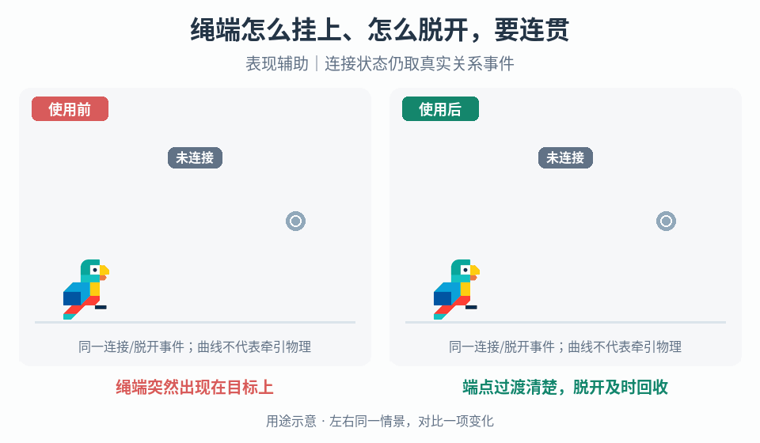

# 连接关系与挂脱轨迹

## 效果预览

绳端突然出现在目标上；端点过渡清楚，脱开及时回收；表现辅助｜连接状态仍取真实关系事件。

左侧为使用前，右侧为使用后；4 秒循环，用途示意（非引擎实测）。

## 触发与输入

用于绳端/挂钩突然跳到终态或与真实关系不同步。取得两端锚点、真实连接和解除事件、可连接条件、取消/失败事件，以及关节、牵引与显示各自职责。

## 实施流程

1. 划分未连接、连接中、已连接、脱开中状态，规定何时实际关节生效；画面抵达目标不能自行认定连接成功。
2. 为连接中配置端点运动轨迹，并逐帧读取有效目标锚点。需要弧形时使用项目已有曲线表达，明确它仅为显示还是也控制实体路径；不要默认抛物线或绳索物理。
3. 已连接后令两端跟随真实锚点；仅需下垂外观时，从端点距离驱动可调垂度，短绳逐渐减弱下垂，避免端点相近仍生成大环。
4. 收到真实脱开后关闭关系提示，再按项目定义收回或移除显示。取消/失败不得进入已连接态，移动或销毁目标须使过渡失效。
5. 重复触发先结束旧过渡并释放对象，再按当前真实关系重建，防止两条绳同时指向旧锚点。

## 调参

分别调整连接轨迹高度、过渡时间、曲线段数、最大垂度和短绳阈值。段数只解决折线可见性，不解决关节稳定性；大垂度不得让视觉暗示错误连接点。

## 验收与失败处理

- 移动两端、连接失败、取消、脱开和重复挂接后显示与真实关系一致。
- 短距离、远距离和目标销毁不残留旧绳；无效锚点立即停止过渡并清理。
- 纯显示调整不改牵引/碰撞；若关节时机改变，独立测试控制与物理。

## 组合

[交互状态](../gameplay-contextual-ui/SKILL.md)负责成功确认；[视觉形变](../gameplay-motion-deformation/SKILL.md)只作可选表现。

需要核对机制出处、示例参数或证据边界时，读取[来源参考](references/sources.md)。
