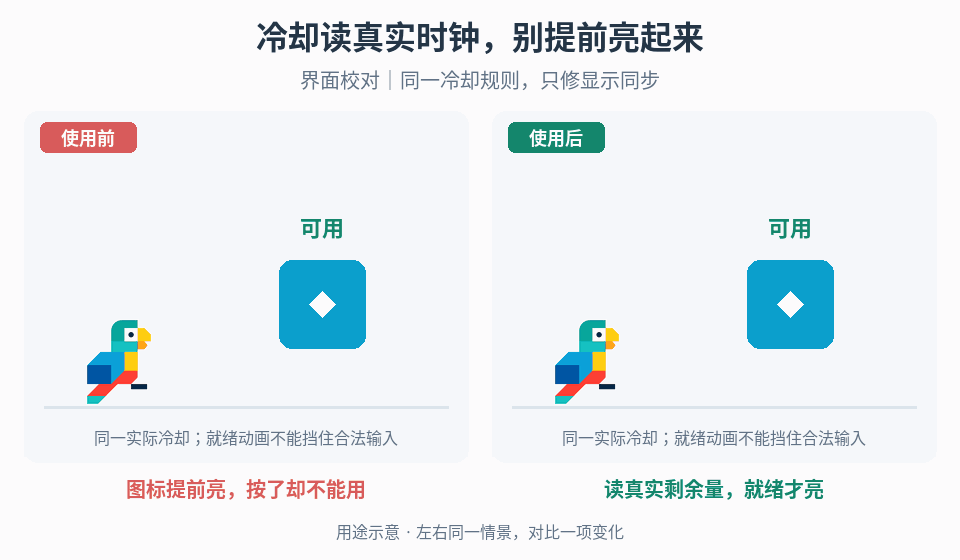

# 冷却时钟与就绪反馈

## 效果预览

图标提前亮，按了却不能用；读真实剩余量，就绪才亮；界面校对｜同一冷却规则，只修显示同步。

左侧为使用前，右侧为使用后；4 秒循环，用途示意（非引擎实测）。

## 触发与输入

用于倒计时、填充与真实可用时刻不一致。取得权威剩余时间/截止时间、总冷却、其他可用条件、暂停/慢动作时钟规则，以及重置和界面生命周期。

## 实施流程

1. 从技能系统读取剩余时间，不在 UI 再创建独立冷却。明确暂停/慢动作是否影响规则时钟。
2. 将剩余比例映射到扫过填充与变暗，统一开始/结束方向；数字按项目取整规则显示，不能显示为零就自行认定可用。
3. 以权威状态从不可用转为可用的边沿触发一次就绪确认。冷却结束但资源不足等其他条件不满足时，区分“冷却完毕”和“可施放”。
4. 允许合法操作立即生效，就绪闪光不能作为输入门禁。重置/延长/缩短时取消旧确认，按新剩余量更新。
5. 关闭重开与切场重新读取当前状态，不重放过时的就绪事件；销毁时清理 UI 动画订阅。

## 调参

先定数字精度与零边界，再调填充方向、亮度和就绪确认时长。极短冷却可减少数字跳动，但不能隐藏未就绪状态；读数与装饰动画采用不同更新策略时仍应共享权威目标。

## 验收与失败处理

- 极短/极长、刚好结束、修改总时长后数字/填充与真实状态一致。
- 暂停、慢动作、重置与关闭重开不出现假就绪或重复确认。
- 若出现漂移，移除 UI 自计时，检查时钟与订阅生命周期，不能用额外延迟补齐。

## 组合

[资源读数](../gameplay-resource-ui/SKILL.md)负责资源量，[按住交互](../gameplay-contextual-ui/SKILL.md)负责保持/释放，不混入冷却计时。

需要核对机制出处、示例参数或证据边界时，读取[来源参考](references/sources.md)。
