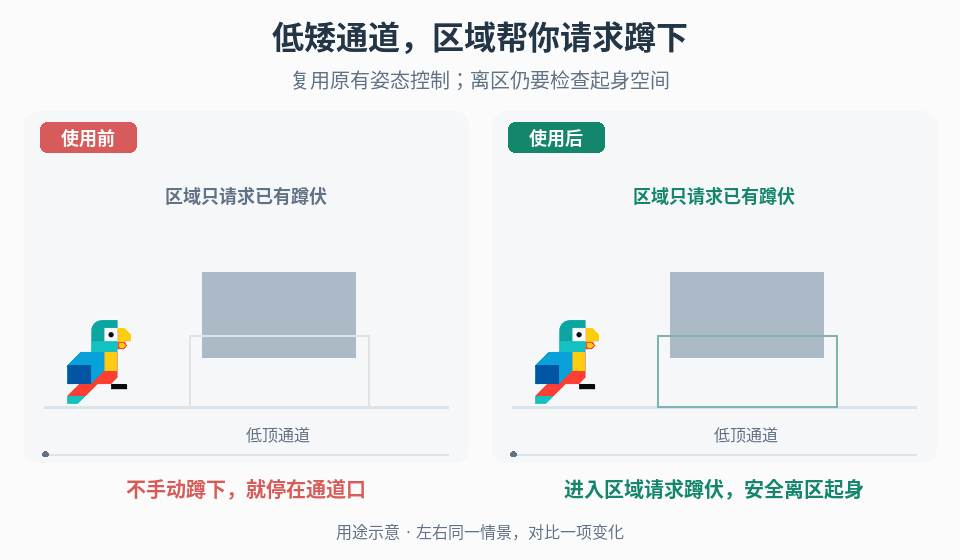

# 碰撞区域辅助蹲伏

## 效果预览

相同向右移动意图，右区域提前贡献蹲伏请求，通过低顶后撤销；原鸟等比缩放/旋转作为姿态示意，不宣称新增动画控制器。

左侧为使用前，右侧为使用后；4 秒循环，用途示意（非引擎实测）。

## 触发与前置条件

玩家需要连续经过低矮通道，希望关卡区域代为表达已有蹲伏操作，而不是另建动画或移动控制器。先确认项目已有可工作的蹲伏输入、姿态/碰撞体转换及起身空间检查；缺失时先补齐或修复这些基础能力，不让区域脚本直接缩放角色冒充蹲伏。

需要输入：玩家识别方式、目标通道与区域体积、现有蹲伏是按住还是切换、允许蹲伏的移动状态，以及手动操作是否可取消区域辅助。默认保留手动意图，不由离开区域清除它；若项目指定手动优先，明确它的作用范围和恢复条件。

## 实施流程

1. 在需要蹲伏的通道布置可编辑碰撞检测区域，仅识别目标玩家。区域负责贡献蹲伏请求，原控制器继续负责实际姿态、碰撞体、速度和动画。不要新增一套区域专属蹲伏动画控制逻辑。
2. 分开保存手动蹲伏意图与区域请求。按角色维护有效区域集合，或正确去重的重叠计数；多碰撞体应记录该区域内的有效重叠对，最后一对离开或查询确认完全离开后才移除该区域；重复回调不能重复累加，离开一个区域只移除它自己的贡献。集合仍非空时保留辅助请求。
3. 把区域请求接到已有蹲伏输入的语义入口。按住模式提供持续的请求状态；切换模式先将手动按键边沿解析为手动意图，再与区域意图合成，不每帧模拟一次切换按键，也不在区域退出时盲发一次切换。若接口只收边沿，适配器须比较期望意图与控制器已请求的目标意图，而非实际姿态；每次变化只发一次边沿。若无法读取目标意图，锁存待确认请求，收到接受/拒绝后按明确重试策略处理。起身受阻或过渡未完成不能导致逐帧重发切换，也不能覆盖手动切换记忆。
4. 常规合成以“手动想蹲或有效区域要求蹲”得到目标请求，再交原控制器的状态许可判定。若设计允许手动覆盖，单独记录覆盖状态，明确是本次区域停留还是持续生效；覆盖不能绕过起身安全检查。
5. 退出最后区域只撤销辅助请求。手动仍想蹲则保持；否则向原控制器请求起身，由其检查头顶与站立碰撞体空间。空间不足继续蹲伏，空间足够后正常恢复，不以区域边界当作可站立证明。
6. 传送、重生、角色销毁或区域禁用/卸载时，清理失效的区域贡献；传送或重新启用后按实际重叠重新同步。清理不等于强制站起，仍经相同意图合成和控制器安全路径。

## 调参顺序与失败恢复

先用真实碰撞体和最大目标通行速度调整入口提前量，让蹲伏生效后再进入低顶；再调整出口范围和接缝，避免边界反复进出。以实际姿态转换延迟定范围，不设通用尺寸。

- 到入口仍撞头：核对检测层、区域提前量和控制器是否允许蹲伏，不先加第二套动画。
- 边界姿态抖动：检查重叠集合及切换边沿；只在必要时增加项目可调的边界容差，不靠持续按键切换掩盖问题。
- 离区后一直蹲：区分手动意图、失效区域残留和真实头顶阻挡，分别修复，不无条件清空全部状态。
- 离开一个重叠区便起身：恢复按来源释放，检查玩家多碰撞体的去重和配对。

## 验收

- [ ] 同一角色在普通场景手动蹲伏与辅助蹲伏走同一控制器路径，姿态和实际通行能力一致。
- [ ] 从两端以目标速度进入、倒退离开和重复进出均稳定，区域内无需反复切换姿态。
- [ ] 按住与切换模式分别测试；先手动蹲再进区、区内操作及离区后均不丢失约定的手动意图。
- [ ] 两区重叠、接缝、多角色和多碰撞体不会互相清除请求或留下错误计数。
- [ ] 离区后仍有低顶时不穿顶起身，移到足够空间后恢复；手动覆盖也不能绕过此约束。
- [ ] 区域禁用/卸载及角色传送/重生后无陈旧贡献，目标地点仍有区域时能重新建立请求。

## 边界与组合

本流程只拥有“关卡区域贡献已有蹲伏请求”的生命周期，不升级为通用输入注入框架或 NPC 行为系统。[移动交互的停留与接续](../gameplay-traversal-transitions/SKILL.md)处理边缘停住、抓杆与离开选择，不拥有此区域请求的合成与释放。

需要核对作者机制、未知参数或工程护栏的证据归属时，读取[来源参考](references/sources.md)。
