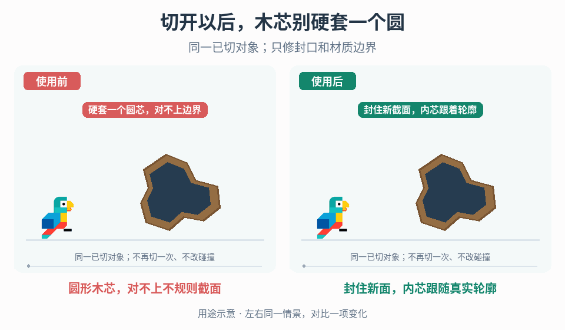

# 切割新表面的封口与材质边界

## 效果预览

同一不规则截面先显示开放面，右封口并内外材质跟随边界，左套圆芯留下错误材质区域。

左侧为使用前，右侧为使用后；4 秒循环，用途示意（非引擎实测）。

## 触发条件

- 游戏中的切断已发生，但新截面敞开、看起来中空，或被错误地铺上全部外皮。
- 已有截面填面，但内部材质仍是固定圆形，不能跟随分叉等不规则边界。

## 输入与前置条件

切割系统实际输出的截面边界与新面、需要封口的对象/面、内外材质分配、当前法线/UV/顶点色数据、支持的切割形状范围。先查实际几何，明确支持的边界排序、三角化与材质数据接口。

## 实施步骤

1. 调试显示切割输出的新面与边界，依次定位缺封口、材质归属错误、内外过渡错误，不用纹理掩盖开放截面。
2. 验证边界有效性、闭合与绕序，在项目支持的轮廓范围内调用填面算法。中心扇形只在适合的轮廓条件下使用；凹形、多环或孔洞必须由支持它们的算法处理或明确拒绝。
3. 将新暴露面分到独立材质职责，绑定实际子网格/材质槽而非硬编码“槽 0 是外皮”。检查法线朝向、UV 尺度与原表面接缝。
4. 需要木芯/树皮等过渡时，用顶点颜色把真实轮廓传给材质。可为项目约定 R=0 表示外皮、R=1 表示内芯：边界顶点写 0，内部顶点按离截面边界的距离/目标边宽写入并限制到 0–1，材质读取插值后的 R 混合外皮与内芯。先显示红黑权重调试图，再切回纹理；该通道与距离映射是本项目可选约定，不要求所有资产沿用。不要用到中心点的圆形距离替代到实际不规则边界的距离；顶点过稀导致过渡失真时增加必要内部顶点或改用能表达边界距离的数据表示。
5. 对分叉、斜切、再次切割和退化小面逐项测试。视觉封口与碰撞体/物理断裂分别验收，不让修材质再次触发切断或产物生成。

## 调参顺序

分别调边缘过渡宽度、内材质 UV 比例和权重插值；先用纯色分区确认面归属，再启用纹理。过渡宽度应与截面尺度协调，不以固定圆半径代替边界。

## 失败处理

边界无效或填面算法不支持时保留可诊断失败而非输出错误扇形。反面消失查绕序/法线，错贴外皮查槽映射，圆芯残留查权重依据；不要把视觉无缝等同流形或封闭碰撞。

## 验收

- [ ] 在明确支持的形状和观察方向内，新暴露面无意外缺口、反面消失或明显接缝；不支持的凹形/多环输入有明确处理，而不是默认成功。
- [ ] 内外材质只作用于目标面，原外表面未被覆盖；材质槽变动或再次切割不会错误沿用面索引。
- [ ] 不规则轮廓/分叉的内部材质和边缘跟随真实截面，不残留硬套的圆芯；过渡宽度与贴图比例由项目对照决定。
- [ ] 几何、法线/UV 和材质问题分开诊断；视觉修复不重复触发切断、产物结算或无意改变碰撞。

## 组合与边界

- [几何事件对齐](../gameplay-geometric-event-alignment/SKILL.md)决定何时发生切断；本页从已产生的新表面开始，不复制触发条件。
- [破坏与采集过程](../gameplay-breakables-loot/SKILL.md)组织对象终态和产物，本页只处理可见截面。
- [表面余效](../gameplay-surface-aftermath/SKILL.md)把新增效果贴到承载地形，不负责切开物体自己的封口拓扑。
- [状态驱动表面动画](../gameplay-state-driven-surface-motion/SKILL.md)处理运行状态到材质运动；共用子网格工具不等于同一任务。

需要核对案例、参数出处或证据边界时，读取[来源参考](references/sources.md)。
