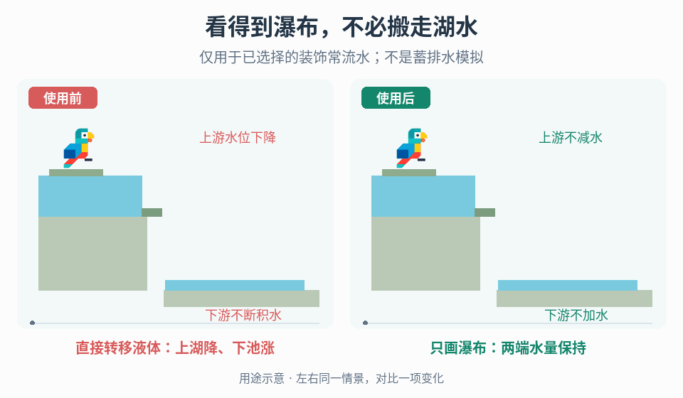

# 不消耗水源的装饰瀑布

## 效果预览

同一湖缘半砖和落段；左真实转水导致上游下降、下游上升，右仅绘制落水，水量固定。

左侧为使用前，右侧为使用后；4 秒循环，用途示意（非引擎实测）。

## 何时使用

场景需要湖边持续落水，但直接释放模拟液体会抽干上游并淹没下方谷地。仅在设计明确接受“可见落水不等于液体转移”时使用；若需要蓄水、排水、灌溉或守恒流量，应保留真实液体系统，不用装饰效果替换。

## 输入与前置条件

取得权威液体数据的只读访问、源湖接触边、半砖形状和方向、边缘外侧空域、地形/接收面查询、世界或区块边界，以及项目允许的查询预算与视觉范围。确认是否已有独立游泳、碰撞或伤害规则；此效果本身不创建这些规则。明确半砖到出水口的几何映射，不把“半砖”当成世界长度单位。

## 实施流程

1. **先隔离权威状态。** 在启用效果前记录源湖与下游液体量及更新路径。建立独立的瀑布表现实例，禁止它写入液体格、向源湖扣水或向落点加水；不要用不断补水抵消流失。
2. **判定合格出水口。** 检查湖水确实接触项目指定的半砖边缘、几何方向允许向外落水，且出口后有可绘制空域。普通实心块边、未接触水的半砖、封闭出口不能因“附近有湖”而触发。项目若扩展到其他几何，另列规则和测试，不默认为任何边缘都成立。
3. **计算有界落段。** 从合格出口向下确定空域与首个有效接收边界。先设世界/区块边界、最大查询范围及预算，保证找不到地面时仍终止；选择隐藏或在明确的视觉边界截断，不无限搜索或穿过未知区块。使用项目现有空间查询方式即可，地面识别与渲染裁剪必须采用一致几何。
4. **只绘制有效空段。** 在出口至接收面的范围内生成流动外观，贴合半砖出水位置，裁掉进入地形的部分。实现可用现有视觉表示；不得借生成真实液体、碰撞体或伤害区来获得瀑布外形。落点可表现为接触，但不因此生成下游蓄水。
5. **维护有效性。** 为源水撤除、半砖移除/转向、出口被填满、下方地形增删和区块卸载制定重算规则。先撤销失效显示，再以当前数据重建或缩短落段；无空域时不保留旧瀑布。以出口身份管理实例，避免连续重算叠出多条流。
6. **清理并验证隔离。** 禁用、卸载和销毁时释放表现与查询缓存。重新启用从当前源水和地形重算，不恢复过期长度；在开关效果的对照运行中检查液体状态没有新增差异。

## 调参顺序

先验证半砖接触条件、出口偏移和地面截断，再调视觉宽度、流动速度及层级。按地图规模确定查询范围、更新时机与预算，不能把性能上限误当成已找到地面。较长落段需检查遮挡和裁剪，改视觉细节不能改变液体量。所有数值由项目画面和性能目标确定。

## 验收与失败恢复

- 同一初始状态下，关闭/开启效果并持续运行：源湖不因瀑布减少，下游不因瀑布增加；已有真实液体系统的独立变化应在对照中一致。
- 合格半砖接水且外侧为空时有落水；干半砖、错误方向、普通不合格边与被封出口不误触发。
- 在下方添地形后立即按项目更新契约缩短；移除地形后重新确定边界；移除源水后停止。不能悬留旧流或穿过新地形。
- 无地面、地图边缘与未加载区块均在预算内结束，结果符合预定隐藏/截断策略，不伪造落点。
- 只开关此效果，角色碰撞、游泳、伤害和液体数据不变；若原项目已有独立玩法效果，分别验证其既有契约，不由可见水柱推导新规则。
- 抽干/积水时追查表现路径的液体写入并移除，不以补水或排水遮掩；穿地时修正接收边界与裁剪；重复流时查出口身份及旧实例清理。

## 与相邻机制的边界

- [表面余效](../gameplay-surface-aftermath/SKILL.md)处理事件后水洼等效果的贴地采样、边界与网格，不负责湖缘持续落水或源液体隔离。只有另外需要落地余效时才组合。
- [状态驱动表面动画](../gameplay-state-driven-surface-motion/SKILL.md)处理机器权威运行状态到局部表面运动的映射，不负责半砖出水口、空中落段或液体体积。使用某种纹理动画不代表两者属于同一工作流。

需要核对案例机制、实现选择与证据界限时，读取[来源参考](references/sources.md)。
