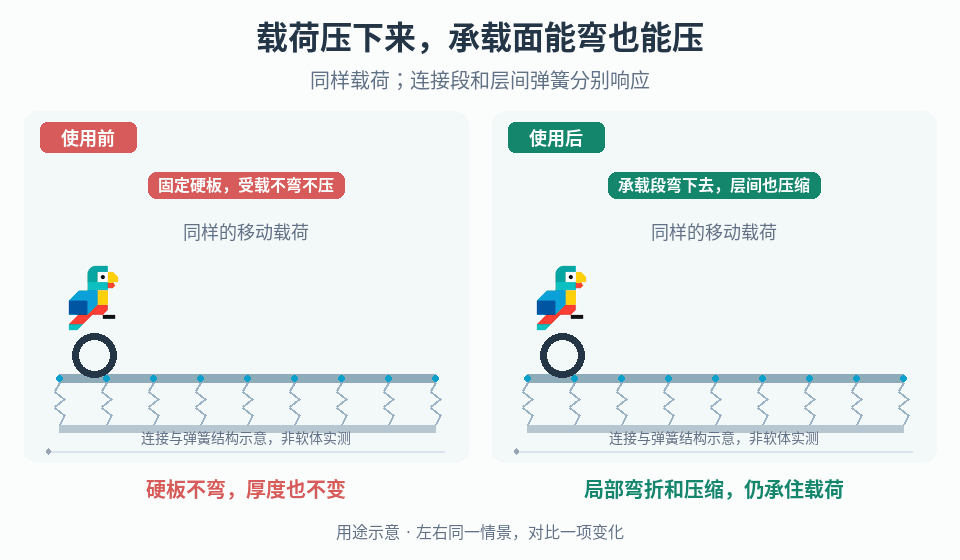

# 可弯曲与压缩的交互承载面

## 效果预览

同一移动载荷压在分段层上；右侧层内弯折、层间弹簧压缩，载荷同步下沉并保持接触，离开后恢复。

左侧为使用前，右侧为使用后；4 秒循环，用途示意（非引擎实测）。

## 触发与输入

用于载荷需要真实压弯/压缩承载面，或分段面出现穿落、接缝分离与振荡。取得尺寸、目标载荷/速度、物理步长、质量、连接自由度、边界支撑、碰撞过滤和预算。只需外观压扁时改用[视觉形变](../gameplay-motion-deformation/SKILL.md)。

## 实施流程

1. 建立中心、边缘和接缝加载的最小场景，固定载荷与轮胎形状；先声明需要弯曲、厚度压缩或两者。
2. 先做单层分段刚体，用项目支持的关节连接相邻段，明确允许转动/位移与边界固定方式。验证载荷传递和接缝后再增加层数。
3. 需要压缩时添加第二层，以层间弹簧连接对应段，设置初始间距、压缩限位与恢复目标；层内弯折和层间压缩分开观察。
4. 配置相邻段碰撞过滤，避免互相持续顶开，同时保留载荷与承载面的真实接触。缓慢加载、移动、卸载，记录下陷和恢复。
5. 在完整速度/载荷范围验证后，再将连续视觉网格绑定到物理段；同时保留调试接触面，不能靠外观遮挡物理缝隙。

## 调参

固定质量与步长后，分别调关节自由度、弹簧刚度、阻尼和限位。分段变密先测约束成本与接触稳定性；刚度升高出现抖动时检查解算预算和质量比，不只继续增加阻尼。网格尺寸不是固定配方。

## 验收与失败处理

- 中心、边缘、接缝受载不断开、不穿落；卸载后回到允许范围，无累积漂移。
- 不同速度、质量和步长下无不受控弹飞，目标平台成本有记录。
- 出现穿落先检查接触覆盖与连接，出现振荡先回到单层最小场景；不以全局放宽穿透容差修补。

## 组合

[轮胎接触表示](../gameplay-locomotion-contacts/SKILL.md)处理载荷侧几何，[接触响应](../gameplay-contact-response/SKILL.md)处理已接触后的反应，不替代层状承载结构。

需要核对机制出处、示例参数或证据边界时，读取[来源参考](references/sources.md)。
