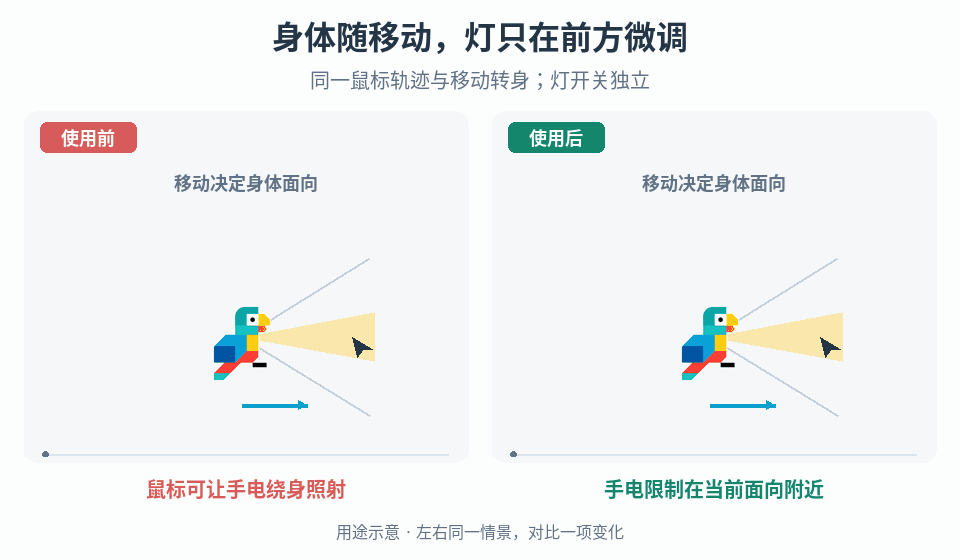

# 面向相对的受限手电控制

## 效果预览

鼠标移到背后，再移动转身；右按当前面向约束灯角度，最后独立关灯且身体不变。角域是图解参数。

左侧为使用前，右侧为使用后；4 秒循环，用途示意（非引擎实测）。

## 触发与输入

角色应随移动转向，而手电允许鼠标微调、不能独立绕身照射。取得移动意图与现有面向控制器、鼠标到游戏平面的映射、灯的旋转锚点与本地前轴、开关输入及灯输出接口。

先确定移动坐标基、离散或连续面向、初始及静止时面向、转身期间采用实际还是目标面向、允许的左右角界、无效鼠标方向的回退及暂停/锁向优先级。这些是项目输入，不猜角度或默认静止行为。

## 实施步骤

1. 分开保存角色面向、灯的相对角及开关状态。由既有移动控制器更新面向，鼠标不能回写身体方向，也不能接管武器或移动向量。若需改动静止或转身规则，先明确控制契约。
2. 把鼠标位置转换到角色所在游戏平面，以灯的瞄准锚点求方向；面向与鼠标向量必须处于同一坐标系。鼠标与锚点重合或投影无效时，使用约定的上次有效相对角或中性方向，不归一化零向量。
3. 求鼠标相对当前约定面向的有符号角，将其限制在左右允许角界。对背后鼠标的正负半周分界明确选边规则，例如保持上次侧别并设置小滞回；不让浮点噪声在两端来回切换，也不靠自动转身消除歧义。
4. 面向变化时在新的面向基下重新求角。若增加平滑，明确平滑的是相对角还是世界方向，并在平滑之后按本帧面向再次限制最终输出；快速转身也不能让旧方向暂时逸出角域。只有符合控制契约的面向变化才移动角域。
5. 开关用一次按下事件翻转，不按持续按键每帧翻转。关闭只禁用灯输出，不重置角色面向；明确关闭期间是否继续更新瞄准，重新打开时先按当前面向限制方向再显示，避免闪出过期方向。
6. 灯组件只消费最终方向与开关状态，校对本地前轴和父级翻面。暂停、恢复或控制权变化时清掉过期输入并重建有效方向，不顺带新增阴影、碰撞或命中逻辑。

## 调参

先关闭平滑验证映射、转身与角界，再分别调左右范围、背后选边滞回和响应速度。范围决定可照方向，光锥宽度只决定照明覆盖，两者不要混调。限制过紧时先核对面向基与轴向偏移；跟随迟缓时检查平滑，不放宽角域掩盖越界。

## 验收与失败处理

- 静止移动鼠标、只移动、同时操作、停下和快速反向均符合面向契约；鼠标不转身体，灯开关不改移动。
- 每个支持的面向扫过左右界、背后半周分界及锚点，最终相对角始终在界内，无零向量异常或边界抖动。背后跨侧的切换符合显式规则，不要求未经设计的连续绕身。
- 在转身和平滑进行中检查最终输出；若越界，检查更新顺序和末次限制，不只验证目标角。
- 长按开关键只翻转一次；关闭时移动和瞄准后再打开、暂停恢复及父级翻面不出现旧方向闪帧。记录项目实际检查结果，不把待验收项当已通过。

## 边界与组合

[分件瞄准姿态](../gameplay-aim-pose/SKILL.md)处理外形与持握，[移动观察解耦](../gameplay-movement-look-decoupling/SKILL.md)处理镜头与移动控制权；本流程仅拥有面向相对的灯方向约束及独立开关。它不提供自由 360 度照射、自动身体转向或武器瞄准。

需要核查来源或采用可选二维角度计算时，读取[来源与工程参考](references/sources.md)。
