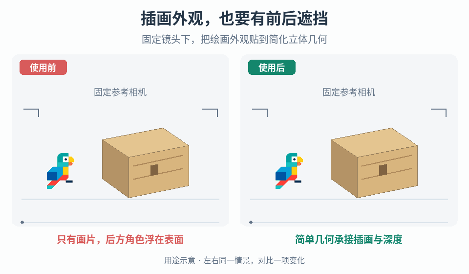

# 固定视角插画与简单几何

## 效果预览

同一盒体外观、锁定视角与角色路径；右用简化深度体遮挡后方角色，经过前方仍在前。

左侧为使用前，右侧为使用后；4 秒循环，用途示意（非引擎实测）。

## 触发条件

需要从指定游戏视角呈现绘画式环境物体，同时用少量立体几何参与深度遮挡；能够限制观察相机与资产的相对视角。若要求任意绕看、物体任意转动或背面同样完整，停止沿用单视角资产，改用完整多视角资产方案。

## 输入与前置条件

- 插画及有效图像区域、透明背景处理方式、需要对齐的轮廓和内部结构点。
- 参考相机的位置、旋转、透视/正交模式、视场角或正交尺寸、宽高比与裁切方式；不要仅凭“等距风格”推断正交相机。
- 资产尺寸、世界变换、应有的接地/遮挡关系，以及项目既有碰撞体。绘画细节不自动成为实体几何或碰撞。
- 运行时相机契约：完全锁定，还是允许明确范围的平移、缩放、震动与画幅变化；资产是否可移动。未限定范围时先以锁定参考构图制作，不承诺移动兼容。

## 实施步骤

1. **先锁相机，再对几何。** 保存参考相机和画幅，放置插画叠加预览。用轮廓角点、顶面边缘与接地点对齐盒体或圆柱；先校相机/尺寸，再局部改几何，避免靠纹理拉伸掩盖错位。插画自身透视无法用单个相机匹配时，调整插画或把资产拆为明确的局部部件，不宣称自动恢复真实形状。
2. **只建必要深度。** 从参考视角匹配外轮廓，再检查物体前后、顶侧面和地面关系。增加会改变剪影或遮挡的结构，不为纯绘制花纹增加网格。用前后穿行测试对象检查深度；凸起画在纹理里但没有几何时，不应承诺它会挡住角色。
3. **选定映射路径。** 运行时投影适合需要继续调整参考相机的制作流程：对接收表面世界位置使用独立保存的参考 view-projection 变换，做透视除法并按引擎坐标约定映射到图像 UV。用带标记的测试图检查上下翻转、镜像和裁切。不要误用每帧游戏相机，否则相机移动时纹理会在几何上滑动。若选离线烘焙，则把参考投影采样结果转存到资产普通 UV 的纹理中，检查接缝和边缘留白后移除运行时投影依赖；不是直接把少数顶点的投影 UV 当成精确烘焙。
4. **限制接收区域。** 只给指定物体/面应用插画。参考相机后方、近远裁剪面之外及图像有效矩形之外的采样使用明确的基础材质或遮罩，不靠纹理重复/边缘拉伸补全。依据引擎投影约定判定齐次坐标和深度范围，透视除法前排除无效位置。用面朝向或显式面选择排除背面；开启双面渲染不能补出背面图案。重叠接收面若出现重复图案，用可见面划分或投影深度遮挡限制接收，不让同一图案穿透多个物体。
5. **接入场景材质。** 插画已画光影时，比较不受光照或受控光照方案，避免再叠一层强光导致原图失真；材质选择按项目要求确定。保留正确深度写入与透明边缘策略，检查透明排序、轮廓黑边和背景泄漏。不要为了贴图而整体关闭深度测试或改碰撞。
6. **执行相机契约。** 保存映射使用的参考变换和运行时允许范围。参考相机/几何/插画任一修改后重新对齐或烘焙；只改变输出分辨率与改变画幅/视场角分开处理。相机震动、缩放、跟随和过场切换都必须在允许范围测试，超出范围时限制镜头、切换专用资产或回到完整三维制作，不临时让投影追随镜头来遮掩问题。

## 参数调整

- 轮廓不齐：按相机投影模式与画幅 → 物体变换 → 几何轮廓 → 图像裁切顺序定位。不要同时改所有变量。
- 顶面/侧面细节拉伸：检查参考相机、接收面斜率和插画透视；新增必要结构或修图，不盲目细分整个网格。
- 细节糊或闪烁：按实际屏幕占比调整纹理分辨率、过滤与 mip 策略，烘焙路径另查 UV 接缝及 padding。提高分辨率不能修复投影错位。
- 简模不等于更快：分别测量几何、材质采样、纹理内存和透明开销，与相同视图和画质目标的项目基线比较后再取舍。

## 验收与失败恢复

- [ ] 参考相机下叠加插画检查：轮廓、顶面边界、关键图案和接地点在项目允许误差内；测试图无镜像/翻转/意外裁切。
- [ ] 测试对象从资产前后经过时深度遮挡合理；绘制阴影/凸起不被误作真实碰撞或几何。
- [ ] 视锥外、相机后、背面与重叠接收面不出现重复、拉伸或穿透图案；不支持的面呈现明确回退材质。
- [ ] 在约定的有限平移、缩放、震动、画幅及分辨率组合中检查裸露面、边缘泄漏和纹理滑动；完全固定方案则验证镜头确实锁定。范围内失败时修资产或缩小已协商范围，不能以单张截图代替检查。
- [ ] 对越界镜头测试能明确识别限制，未把单视角资产交付为自由环绕资产；重新载入后参考变换和烘焙结果一致。

本入口不拥有镜头震动逻辑；接入[镜头冲击与短促聚焦](../gameplay-camera-feedback/SKILL.md)时，让其输出服从这里的观察范围。

需要作者署名、原始观察或实现推导边界时，读取[来源参考](references/sources.md)。
