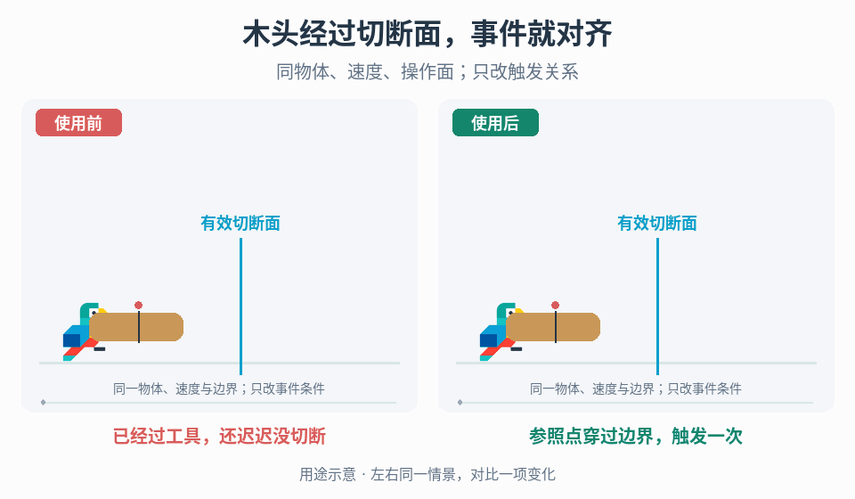

# 几何边界与离散事件触发对齐

## 效果预览

同一木材标记点穿越明确竖直操作面，左等待远处旧触发范围，右在过面时调用一次切断并显示分离。

左侧为使用前，右侧为使用后；4 秒循环，用途示意（非引擎实测）。

## 触发条件

- 木材等移动物体已经经过工具，却仍未发生切断/分离，或事件在尚未到达有效边界时提前发生。
- 大范围 trigger 的进入/离开与真正操作位置不一致，需要检查规则几何而非加快表现动画。

## 输入与前置条件

操作边界的定义、工具与物体的实际几何参照、坐标空间、运动方向/范围、事件前后对象状态、现有触发规则与更新时钟。若要做数学检查，必须补齐构造的向量、参考轴/平面、单位和比较语义；缺少这些信息时先完成项目几何定义，再写公式与阈值。

## 实施步骤

1. 同时记录物体跨过操作边界、真实操作事件和可见分离的时刻，区分判定误差与表现延迟。
2. 在场景中显示有效操作平面/轴、物体参照点、有效范围和旧 trigger，明确所有量使用同一坐标空间。先定义“何时算经过工具”，再选择数学判定。
3. 平面穿越任务可在项目明确定义平面点、法线和物体参照后计算有符号距离；沿轴任务则定义轴与比较范围。点积只是工具，不能只给两个位置就假定触发语义，侧向/工具有效范围需单独检查。
4. 保存前一物理步的关系，按允许方向检测从待触发侧到目标侧的穿越；高速可能跨过边界时检查整段运动，边界上静止不能每帧重触发。
5. 将一次有效穿越锁定为已处理，再调用既有切断/结果事件。反向送入、传送、重置和重复操作的许可由显式状态控制。
6. 同几何下改变送入速度、物体长度/姿态和步长，记录早晚偏差、漏判及重复次数；网格切割与碎片生成独立验收。

## 调参顺序

分别确定边界容差、支持运动方向和侧向有效范围，以项目几何尺度和步长测试。调容差前先修坐标/参照错误；不以 HUD 速度或转速数值作为触发阈值。

## 失败处理

参照/公式语义缺失时先补项目定义，不编造“正确点积”。若跨步漏判改查扫掠/穿越；若触发后仍晚，查事件到显示链路而非继续提前规则边界。

## 验收

- [ ] 用可视化参照同时记录边界位置、权威事件和可见分离，区分规则与表现延迟；记录实际测量结果。
- [ ] 给出项目明确的向量/坐标/比较语义，再覆盖边界两侧、不同物体长度/姿态和适用范围；未满足前不编公式或通用阈值。
- [ ] 慢速/高速、更新步长变化、一次跨过边界及停在边界时，不漏触发或每帧重复触发；重复进入是否允许由项目状态定义。
- [ ] 反向、暂停恢复、传送、重载/重生及工具/物体销毁后，已触发与重新待触发状态正确；不在未授权方向产生切断或重复产物。
- [ ] 分离表现、真实对象终态和产物一次性处理一致，切割几何/碰撞另验；保留原方案对照和测量结果，不写“点积天然零延迟”。

## 组合与边界

- 事件时机已经正确、但新截面开放或材质不贴边时，转到[切割新表面的封口与材质边界](../gameplay-cut-surface-rendering/SKILL.md)，不再调整触发时机来掩盖显示缺陷。

- [动作响应相位](../gameplay-action-timing/SKILL.md)处理输入后冗余准备段，不决定本页空间边界。
- [机关驱动](../gameplay-mechanical-interactions/SKILL.md)绑定已确定触发状态到机械运动，本页先诊断事件条件何时成立。
- [破坏与采集过程](../gameplay-breakables-loot/SKILL.md)接收权威终态事件再组织结果，不以表现反推判定时机。
- [接触响应诊断](../gameplay-contact-response/SKILL.md)区分视觉与真实接触，本页不靠放宽碰撞穿入掩盖切断错误。

需要核对案例、参数出处或证据边界时，读取[来源参考](references/sources.md)。
