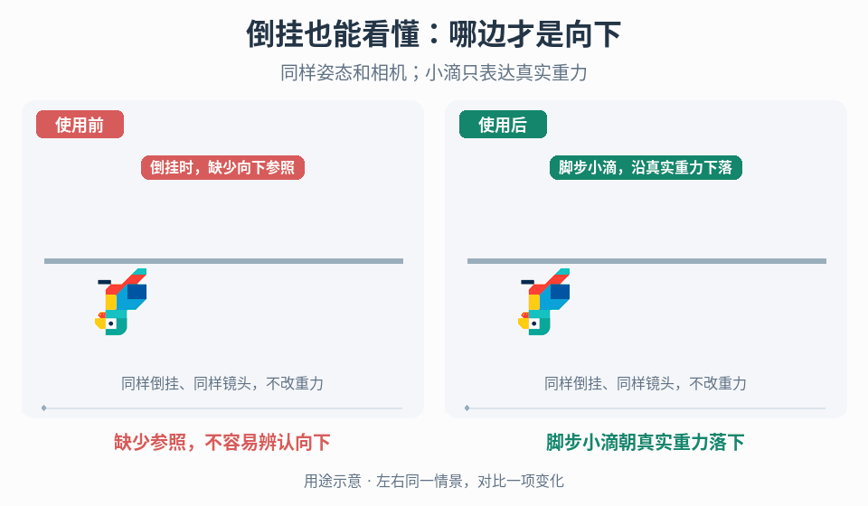

# 翻转视角下的重力方向线索

## 效果预览

同样倒挂移动；右脚步时发出少量小滴，生成后沿真实重力方向下降，不随角色再转向。

左侧为使用前，右侧为使用后；4 秒循环，用途示意（非引擎实测）。

## 触发条件

墙面、天花板或旋转相机让实际向下方向难辨，但不希望锁相机或改重力。

## 输入与前置条件

权威重力向量、脚步事件、相机/角色朝向、允许信息范围、粒子坐标空间与生命期。

## 实施步骤

1. 先区分世界重力、角色局部下方向和支撑面法线，在三种姿态可视化权威向量。提示只能表达实际向下，不表示可站地面或安全路线。
2. 将轻量小滴绑定真实脚步，而非每帧接触。若用随机触发，为概率与短时间空窗制定可接受目标；需要静止也能辨向时另选持续参照，不假设脚步方案覆盖静止。
3. 生成后让小滴运动受项目重力驱动，避免附着发射器旋转把旧粒子方向带走；检查初速度不会长期掩盖重力方向。
4. 在地面、墙面、天花板和旋转镜头下调尺寸/对比/寿命，既能识别方向又不似攻击或拾取物。
5. 重力改变时按项目选择更新存活粒子或清理重发，切场/切角色取消旧提示；不修改运动、接地或镜头控制。

## 参数调整

按实际视距调粒径和生命周期，再调脚步概率/密度；稀疏步频先测长空窗，高频先限同时粒子数。概率并不保证每个观察窗口都有提示。

## 验收与失败处理

- [ ] 各姿态提示沿真实重力运动，不固定屏幕轴或角色轴。
- [ ] 静止、低步频、随机长空窗和连续运动覆盖有记录。
- [ ] 让玩家指出向下方向进行无提示/候选对照；方向正确但读不懂时改可见性，不宣称解决眩晕。
- [ ] 切换和到期无误导残留，目标平台成本在预算内。

## 按需组合

- [表面感知相机 up](../gameplay-surface-camera-up/SKILL.md)
- [落地反馈](../gameplay-landing-feedback/SKILL.md)
- [世界目标发现性](../gameplay-world-readability/SKILL.md)
- [世界内操作指示](../gameplay-worldspace-indicators/SKILL.md)

需要核查出处、示例参数或证据限制时，读取[来源参考](references/sources.md)。
