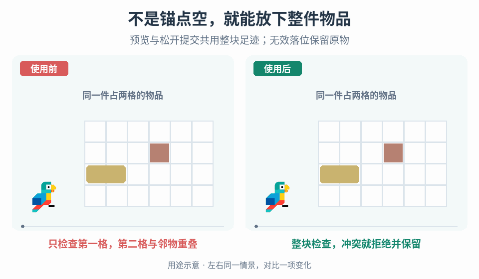

# 网格背包的足迹校验与拖放提交

## 效果预览

相同两格物品拖到第二格已占用处；左锚点校验误放重叠，右全足迹红色预览并在松开拒绝，原物不丢失。

左侧为使用前，右侧为使用后；4 秒循环，用途示意（非引擎实测）。

## 触发与范围

物品已在网格背包中，但拖动到边缘或其他物品上时预览与落位不一致；需要在松开前看到整块物品是否放得下。处理同一容器内已有物品的重新放置，输入移动、旋转意图，输出候选足迹、可放/不可放原因和一次权威移动结果。

只改变已批准的网格放置规则与表现。世界物品入账走[掉落物拾取](../gameplay-loot-pickup/SKILL.md)；手牌扇形布局走[卡牌交互](../gameplay-card-interaction/SKILL.md)。跨容器转移、自动整理/交换、堆叠、合成、装备和丢弃需要各自业务规则，不由拖放失败或菜单选项自动补造。

## 输入与前置条件

- 容器稳定 ID、网格列/行数、可用格掩码（如有）、布局坐标到格坐标的映射，以及权威占用查询和变更版本。
- 物品稳定实例 ID（池化对象含代次）、容器归属、当前位置/朝向、版本与可移动资格。每种朝向提供非空、去重的整数格偏移集合；矩形可由宽高生成，特殊形状必须有明确掩码，不能从精灵透明像素猜占格。
- 指针按下/移动/释放、取消、焦点丢失和面板关闭事件；拖动判定阈值、捕获归属和当前输入映射。旋转仅在项目允许时启用，先确定步长和抓取点约定。
- 同步原子移动接口，或能按请求 ID 查询最终结果的既有异步服务。接口必须能在同一事务中重验资格、占用和版本，再更新物品位置及占用；若尚无此接口，先补这个受限移动操作。不能由 UI 逐格写入并自行宣布成功。

缺少足迹、网格映射或权威移动契约时停在对应依赖，保留原有操作，不用图标大小或动画终点替代业务数据。

## 实施顺序

### 1. 建立足迹与占用的不变量

选择一个统一的整数锚点约定，例如旋转后足迹包围盒左上角。由 `cells(anchor, orientation)` 枚举物品所有实际占格；预览、校验、提交与调试叠层都调用同一函数。格集合不得为空、重复或含非整数坐标。

每个可用格最多归一个物品实例。占用表若是位置记录的缓存，必须带同一容器版本，并能从权威物品记录重建；发现冲突时禁用移动并报告数据错误，不静默覆盖一个物品。一次移动前后物品 ID 集合、数量与其他物品位置保持不变。

### 2. 把拖动会话与真实放置分开

按下有效物品时记录其 ID/代次、容器 ID、初始放置及物品版本、指针在物品足迹中的抓取格。达到项目拖动条件后捕获该输入，建立唯一会话；菜单操作与拖动互斥，第二个指针不得接管同一会话。

拖动时只生成候选数据和独立视觉代理，不清空原占用、不写真实位置，也不隐藏真实物品记录。原位置可绘制为淡化占位。这样取消不会需要重新抢回已经释放的格子，其他系统也不会把正在拖动的物品当成消失。

订阅权威变更并在输入处理前核对物品版本/归属。该物品被移动、删除或改形时取消尚未提交的会话并回读；只是其他格发生变化时，使旧预览失效并重算。取消、失焦、面板关闭或容器切换也清理未提交会话及其捕获，不补发 release。已发出请求走第 6 步的待定结果处理，不能当未提交取消。

### 3. 用输入坐标得到候选，不用滞后的精灵坐标

先把当前指针转换到网格内容局部坐标，再求指针所在格，减去抓取格偏移，得到候选锚点。无间隙均匀网格可对局部坐标除以单格尺寸并向下取整；有滚动、缩放、内边距或格间隙时复用布局的格拾取函数，明确间隙是否可吸附。布局改变后重算变换。

不要把候选锚点钳进网格，掩盖物品已越界的事实；指针离开允许投放区域时标为无目标。格边界采用一致的半开区间，负坐标不能用向零截断。若项目已有吸附滞回，预览与松开提交必须使用同一吸附结果。

视觉代理可以平滑跟随，但候选格和有效性仍跟随输入。使用项目稳定且不会大帧间隔过冲的平滑方式，例如在确认 `dt` 单位后按响应时间计算有界插值权重；减少运动模式可直接跟随。不要为了让精灵追上指针而延后权威位置或用旧预览提交。

### 4. 逐格校验并从同一结果绘制预览

实现唯一的纯校验函数，返回候选格集合、有效性、冲突格及原因：

1. 检查容器、物品身份和可移动资格仍有效。
2. 对每一个目标格先检查 `0 <= x < columns`、`0 <= y < rows`，再检查可用格掩码；越界时不得索引占用表。
3. 再查占用：空格或归当前同一物品实例的格允许，任何其他实例占用都拒绝。自重叠豁免只忽略该物品的旧占格，不能豁免同类型物品或其他容器对象。
4. 全部目标格通过才有效；锚点或包围盒角点通过不代表整块通过。有掩码的非矩形物品只检查实际占格，不把孔洞当实体。

用该结果绘制完整候选足迹和可放/不可放标记，越界部分即使被面板裁剪也保留明确原因提示。普通悬停高亮使用单独样式和状态，不把悬停当可放。颜色配合边框、图形或文字，不能只依赖红绿差别。

### 5. 可选旋转重新生成足迹与抓取偏移

只接受允许的旋转输入边沿，每次都重算候选并调用相同校验。若项目选择顺时针 90 度、左上锚点方案，可把当前宽高为 `w,h` 的局部格 `(x,y)` 变为 `(h-1-y,x)`，宽高交换；抓取格也执行同一变换，再由指针格减去新抓取格确定锚点。掩码格与精灵显示共用该朝向；其他枢轴方案沿用项目契约，不混用两套偏移。

旋转失败仅令候选不可放，不改原物品朝向、不挤开邻物。允许玩家继续移动到合法位置，或取消恢复真实显示。不要为了旋转成功自动移动别的物品或增加任意角度放置。

### 6. 松开时重新验证并一次提交

松开只发出一次移动意图，带会话/请求 ID、物品 ID/代次、预期物品版本、容器 ID、候选锚点与朝向。处理松开时的最新输入位置，而非上一帧缓存；无目标或无效候选直接结束预览，读取当前权威放置。

服务在同一个原子操作内读取最新状态，确认物品仍在该容器且版本/资格有效，重新生成整块足迹并校验，然后释放该物品旧格、写入新格、更新放置和版本，最后发一个结果。服务按请求 ID 保存该结果，同一请求重到只返回已有结果，不再次写入；UI 同样忽略已处理的结果回调。中间状态不对读者或另一移动可见。目的地等于当前放置时按无操作完成，不重复发移动/经济效果。其他物品抢占目标格时拒绝，不能信任先前绿色预览。

被拒绝时无部分写入，视觉回到服务确认的位置与朝向。没有外部变更时这就是拖动起点；有变更时必须采用新状态，不把初始快照写回以覆盖外部移动、移除或读档。成功后由权威结果结束代理并刷新占用显示，不让落位动画再次提交。

异步项目在等待期间锁住同一物品的第二次拖动。关闭面板只释放本会话输入和显示；请求生命周期由服务保存。超时或回调丢失时按原请求 ID 查询/协调结果，不能猜失败、回滚真实数据或换新 ID 重发。重开先回读当前数据及待处理请求，再允许操作。每个结果回调只消费终态一次，并且只能清理匹配会话/请求/物品代次的视觉代理，不能清除关闭重开后的新拖动；收到旧成功通知时按当前权威版本刷新，不能用旧结果中的位置覆盖后来已完成的移动。

### 7. 上下文菜单和数量只接已有业务状态

需要物品菜单时用稳定物品 ID 绑定目标，再把其网格位置转换为面板锚点并限制到可见区域。菜单开启和选择时都重查对象及动作资格；项目没有实现的装备、合成、丢弃动作不展示为可用。提交反馈复用[交互状态](../gameplay-contextual-ui/SKILL.md)，不能从点击或关闭菜单推断动作成功。

数量与已装备标记仅显示项目权威字段；数量变化后重绘，物品删除后关闭菜单并清理会话。显示数量不等于支持堆叠合并；拖到占用格仍按放置拒绝，除非另有明确的业务入口。

## 调参顺序

1. 关闭跟随平滑，用网格线、格编号、候选锚点和逐格原因确认坐标/占用正确，再调视觉。重点检查面板偏移、缩放、滚动和边界上的一格偏差。
2. 调单格可读尺寸、足迹描边、悬停与落位预览区别，再调拖动阈值。支持小格时确保抓取位置可预期，不用扩大占格掩盖操作困难。
3. 最后调视觉跟随时间和落位回弹，观察慢拖、快速跨格、低帧率和减少运动模式。若代理落后导致误读，缩短跟随或强调真实候选足迹，不改变校验结果。

## 可观察验收与失败恢复

先用测试夹具隔离放置逻辑，再在目标 UI 检查输入和显示。以下尺寸仅用于测试：5 列 × 4 行，A 为 2×2 物品、起点 `(0,0)`，B 占 `(3,1)`；无禁用格，坐标从 0 开始。每项从对应独立初态运行并记录结果事件与完整占用表。

- [ ] A 候选锚点 `(4,0)` 时锚点在界内但右列越界：不可放，松开后原 4 格仍归 A，无写入/成功事件；负坐标和下边界同样拒绝，不数组越界。
- [ ] A 候选 `(2,0)` 时锚点空闲但足迹含 B 的 `(3,1)`：不可放，B 与 A 的位置、数量、ID 均不变。禁用格位于非锚点格时也拒绝。
- [ ] A 候选 `(1,0)` 部分覆盖自身旧格：允许；提交后 A 恰占 `(1,0),(2,0),(1,1),(2,1)`，旧 `(0,0),(0,1)` 释放，B 不变，一次移动结果。
- [ ] 校验层另设 2×3 物品、固定锚点 `(3,0)`：原足迹可用，转成 3×2 后越界。UI 层再按声明抓取枢轴选择一个旋转后实际越界的输入场景，预览立即无效且原朝向不变；转满四次，足迹、抓取格和候选锚点回到初态。关闭旋转时输入无作用。
- [ ] 若项目提供非矩形掩码，用局部格 `{(0,0),(1,0),(0,1)}`：其他物品仅在孔洞 `(1,1)` 时可放，移到任一实际占格时不可放；验证并非直接用整个包围矩形代替足迹。
- [ ] 绿色预览后另一物品占用目标格，再释放：提交层拒绝，全部已有物品仍只有一份；重复 release/重复结果回调不重复移动。原位放下无额外结果副作用。
- [ ] 拖动中取消、失焦、关闭/重开、切换容器，或该物品被外部删除/移动：清除旧捕获、代理和菜单，显示当前权威状态；不得用拖动快照复活或搬回失效物品。
- [ ] 异步项目在发出请求后关闭、超时再重开：仍按同一请求查到成功/失败或保持明确待定，不出现两份物品或在结果未知时开启第二次移动。
- [ ] 请求 R1 在关闭重开后已协调完成并开始新拖动 R2，再收到 R1 延迟/重复回调：R2 的代理、捕获与最新位置保持不变，不复活已经删除或换代的物品。
- [ ] 快速拖动后立即松开、低帧率、滚动/缩放，以及直接跟随模式，均在最后输入对应的候选格提交；足迹标记与校验一致，悬停和无效状态不用颜色也可分辨。
- [ ] 菜单目标失效不能作用于新选中物品；数量更新来自业务事件，任何移动失败/取消均不触发装备、消耗、堆叠或丢弃。

出现丢物/重复占格时先禁用该容器移动，回读物品权威记录并重建可派生的占用缓存；若权威记录本身冲突，保留诊断并交给数据恢复流程，不删物“修复”。预览与结果分歧时依次核对格坐标映射、足迹/抓取偏移、会话版本和提交时重验；不要放宽占用检查消除红色提示。

需要核对机制出处、来源示例和工程扩展边界时，读取[来源参考](references/sources.md)。
