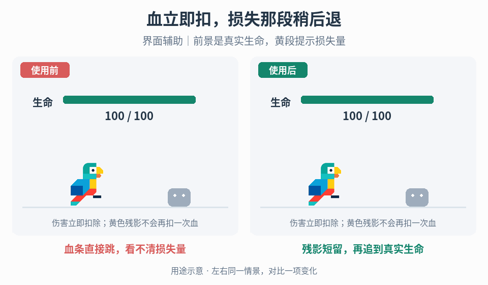

# 生命血条与损失残影

## 效果预览

血条直接跳，看不清损失量；残影短留，再追到真实生命；界面辅助｜前景是真实生命，黄段提示损失量。

左侧为使用前，右侧为使用后；4 秒循环，用途示意（非引擎实测）。

## 触发与输入

用于 HP 变化难读、残影排空混乱或复活后读数错误。取得真实 HP/最大 HP、事件顺序、显示值、残影值、等待/排空时长及 UI 动画归属。此入口只管理血条；浮字与结果总分见下方分流。

## 实施流程

1. 权威扣血立即提交；前景条只追随真实 HP，残影条暂留损失前值再追赶。显示更新不得再次扣血。
2. 将受击后的等待与开始排空后的持续时间分开。声明连续伤害是否重置等待、排空中是否从当前值重启；同一属性只保留一个有效驱动。
3. 治疗时按项目选择同步抬升两层或重新对齐，避免残影像再次损血；最大 HP 改变时重算范围并夹紧显示，死亡/复活清理旧延迟。
4. 使用双层进度条时统一范围、锚点和遮挡关系。在 Godot 可用主 TextureProgressBar 配置边框/进度纹理，并在其后放置第二层表示损失段；绑定同一生命状态。
5. 低生命分级读取真实 HP/最大 HP，而非仍在追随的显示值；最大 HP 必须有效，并将比值夹在合法范围。先检查最低、最危险区间，再检查较高阈值，明确边界是否包含等号，避免低血量先落入普通警告分支。颜色之外保留轮廓、图标或文字线索；这不改变实际伤害或减伤规则。
6. 受击确认可叠加短暂填充闪色与横向位移。保存布局基准位置，始终动画一个独立偏移并归零，不在当前x上反复减位移；停止时重取当前布局基准。闪色用临时覆盖层，结束后重新计算当前生命分级颜色，不能固定恢复绿色或白色而抹掉刚进入的危险色。快速连击采用明确重启/叠加上限，旧完成回调不得覆盖新事件。关闭/重开直接从当前生命重建，撤销旧tween；减少运动/闪光时保留数值和分级。

## 调参

分别调前景追随、残影等待和排空时长；连续受击下检查残影是否积压。生命分级阈值按项目危险程度设定，不与暴击提示混同。若读数太慢，先缩短残影而不是延迟真实 HP 更新。

## 验收与失败处理

- 连续扣血、等待中再受伤、排空中治疗、同帧治疗/伤害、死亡复活和上限变化后准确收敛。
- 单独调整等待/排空只改变对应阶段，无超上限、残留 tween 或重复损失表现。
- 在每个分级边界的稍高、等于、稍低值及零血量验证分支；闪色期间跨阈值，结束后仍显示正确危险级别。窗口重排及快速连击后位移归到新布局基准，不累计漂移。
- 低对比背景和减少动效时真实生命仍可读；显示与权威不符时检查事件顺序和驱动所有权，不改伤害公式补偿。

## 分流与组合

[浮字](../gameplay-floating-numbers/SKILL.md)、[结果计数](../gameplay-result-counting/SKILL.md)各有独立入口。[低血减伤](../gameplay-low-health-damage-reduction/SKILL.md)、[受击保护](../gameplay-post-hit-protection/SKILL.md)是伤害规则；[冲击视觉](../gameplay-impact-visuals/SKILL.md)只作确认。

需要核对机制出处、示例参数或证据边界时，读取[来源参考](references/sources.md)。
