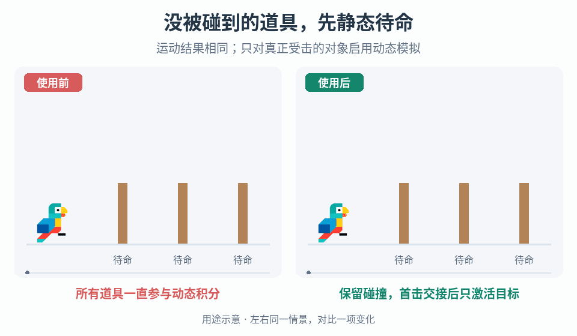

# 受击时才启用道具动态物理

## 效果预览

三道具相同几何和初态，首击同一棵并保留相同倾斜轨迹；动态标记展示资源参与差异，不虚构FPS收益。

左侧为使用前，右侧为使用后；4 秒循环，用途示意（非引擎实测）。

## 触发与输入

大量未被触碰的树木/道具长期参与动态模拟，而项目允许它们在真实受击前保持静态时使用。先确认它们不需要持续受风、重力、约束或邻物推动；若这些行为本来就存在，不能为了性能默默删除。

取得对象唯一身份、几何和世界变换、静态碰撞与受击查询规则、激活资格事件、动态刚体配置、既有生命/切割状态和施力接口。记录待命数、活动数与物理步耗时，先证明动态模拟确为需要处理的成本。

## 实施

1. **保持可击中的待命表示。** 待命对象不参与昂贵动态积分，但仍保留项目必需的阻挡和命中检测。静态不是不可交互，不要把接收伤害组件或查询碰撞一起关闭。
2. **选择一种交接方式。** 能在同一对象上安全切换动态状态时优先保持身份与组件；若项目使用静态/动态两种表示，建立同一逻辑身份的映射并预置动态表示。二者不能同时作为有效命中目标或产物来源。
3. **接收首个合法激活事件。** 保存事件 ID、接触点、方向和项目已有的伤害/冲量数据，将状态原子地从待命改为交接中。其他同帧事件排队或按原玩法合并，不再次创建动态对象。激活资格不等于致命命中或允许倒树。
4. **先复制状态，再启用模拟。** 在物理安全更新点保持世界姿态、缩放、几何、生命及归属；确认动态碰撞体没有意外穿入地形，质量/重心来自既定配置。替换表示时先禁旧接收路径，再启新路径，检查整个交接不会短暂失去阻挡。不要从资源预制件原点重生，也不自动清零已有玩法状态。
5. **将触发它的命中交给活动对象一次。** 明确伤害是交接前已经结算，还是活动对象接管后结算，不能两边都做。冲量须在动态表示已就绪后使用原接触世界点施加一次；激活本身不额外加力、不补第二次伤害。若只激活仍需后续砍击才能倒下，保留原门槛。
6. **失败保持一致。** 动态资源缺失或配置不合法时回到可交互待命状态或明确拒绝本次操作，不能留下半创建对象；不得把已结算伤害再回放。活动后保持既有模拟生命周期，不新增未经设计的自动返静态、回满血或复活。
7. **分开测待命成本与活动峰值。** 固定场景、相机、硬件与物理设置，比较优化前后相同待命数量，再逐级增加同时激活数。记录物理步时间、主线程时间、内存、交接尖峰和首击响应；帧率总数不能单独证明物理优化收益。

## 调参和验收

- 先核命中层/阻挡连续性和状态传递，再考虑预热或激活预算。限流会推迟首击反应，若项目不允许延迟，应回退既有动态方案而不是吞命中。
- 未受击对象保持静态但仍可被合法命中、阻挡角色；首击伤害/冲量各发生一次，连续多次命中仍符合原规则。
- 不同位置、朝向、缩放、已受损状态以及同帧多击下交接不跳位、重叠复制或双产物；资源失败也不遗留无碰撞对象。
- 一次激活大量对象时量测峰值，不能以“多数未激活”推断任意数量活动刚体都快。暂停、卸载和重载保留逻辑状态，不把活动对象当未触碰资源重置。

倒伏后的力学问题走[重心与施力](../gameplay-prop-toppling-dynamics/SKILL.md)，终态和产物走[破坏采集过程](../gameplay-breakables-loot/SKILL.md)。来源与工程选择见[来源参考](references/sources.md)。
