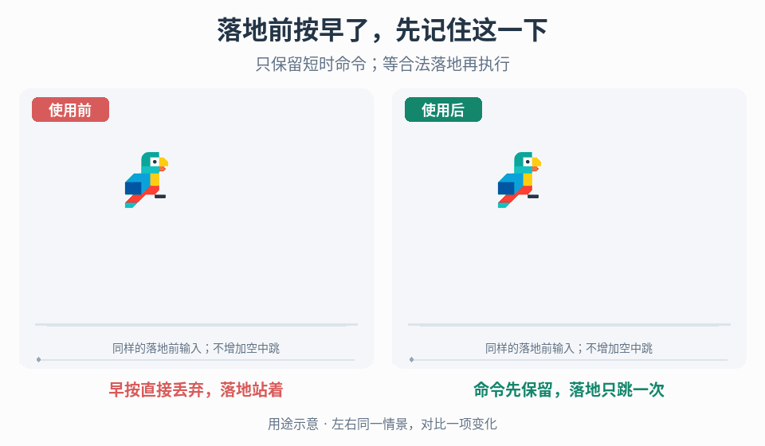

# 落地前跳跃输入缓冲

## 效果预览

同样落地前短按跳；左侧丢弃，右侧显示待执行命令并在落地后按原跳跃流程执行一次。

左侧为使用前，右侧为使用后；4 秒循环，用途示意（非引擎实测）。

## 触发与输入

用于落地前略早按跳被丢弃，或缓冲命令过期后仍触发。取得按下/保持/松开事件、合法起跳条件、输入与物理更新顺序、时钟、空中跳和中断规则。晚于离台按跳走[离地宽限](../gameplay-jump-forgiveness/SKILL.md)，撞顶角走[顶角修正](../gameplay-ceiling-corner-correction/SKILL.md)。

## 实施流程

1. 用日志记录按下、落地和实际起跳，复现窗口内、窗口外与落地后按跳。
2. 按下时保存一个带截止时间的待执行意图；明确后续按下是否替换、松开是否取消，以及落地时是否要求仍保持按键。
3. 在真实起跳条件满足时检查意图未过期，然后按原跳跃流程执行。命令有效不能创造接地、空中跳次数或控制权限。
4. 成功起跳后立即消费该意图；到期、死亡、传送或控制权切换按既定规则清除。定义同一更新里输入、落地、到期的顺序，避免帧率偶发差异。
5. 与离地宽限组合时分别计算“命令有效”和“动作许可”，两者同时满足只执行一次；保留独立开关便于定位。

## 调参

以目标输入延迟和落地节奏调有限时间窗，不直接复用离地宽限。比较过短造成丢跳与过长造成意外连跳；按选定时钟计算截止，不以渲染帧数隐式改变时长。

## 验收与失败处理

- 窗口内单按在合法时机跳，过期按键不执行，一个命令最多成功一次。
- 持续按住、松开、重复按、再次落地和空中跳符合声明规则。
- 边界时刻、不同帧率、暂停恢复及控制切换无残留命令。
- 若重复跳，查消费和事件重复；若丢跳，查更新顺序与许可，不先无界延长窗口。

## 组合

[离地宽限](../gameplay-jump-forgiveness/SKILL.md)延长许可，[落地反馈](../gameplay-landing-feedback/SKILL.md)表现接触，动画结束不能决定可跳时刻。

[按住高度](../gameplay-variable-jump-height/SKILL.md)控制已合法起跳后的顶点；[分段重力](../gameplay-asymmetric-jump-gravity/SKILL.md)控制项目声明支持的腾空阶段，也可包括走落平台。不要用它们新增或延长起跳许可。

需要核对机制出处、示例参数或证据边界时，读取[来源参考](references/sources.md)。

一次起跳已获准后若需调整横向惯性，使用[起跳水平动量](../gameplay-jump-horizontal-momentum/SKILL.md)；缓冲保留期间和被拒绝跳跃都不得提前改速。
