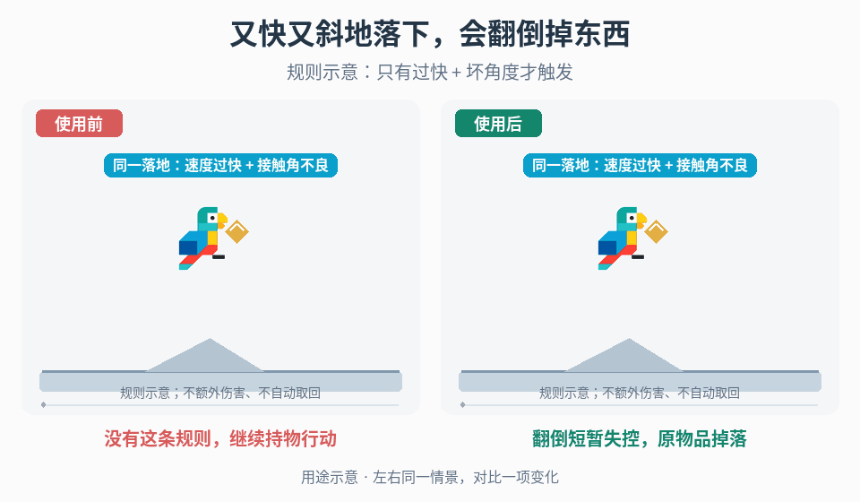

# 坏落地的翻倒、掉物与恢复

## 效果预览

相同过快且坏角落地条件，右触发一次翻倒和持物释放后站起；原物留在地面，需另行选择取回。

左侧为使用前，右侧为使用后；4 秒循环，用途示意（非引擎实测）。

## 触发条件

- 项目明确要求过快且角度不佳的落地导致失去控制、翻倒或布娃娃，并让持有物脱手。
- 已有该规则但同一次落地反复触发、控制器与布娃娃争夺姿态、持物复制/消失，或角色无法恢复操作。

只要求落地更有重量时使用[落地反馈](../gameplay-landing-feedback/SKILL.md)，不新增眩晕或掉物。是否有落地伤害、敌人反应或噪声传播是独立玩法决定，不因本入口自行启用。

## 输入与前置条件

取得一次离地后的真实接触事件、求解前角色与接触表面的相对速度、有效接触点/法线、项目定义的期望支撑方向、过快与坏角度判定、可触发状态，以及控制权管理接口。明确速度指标采用总相对速度还是沿法线的接近速度；明确“坏角度”比较什么，不将世界上方向强加给攀爬或重力变化角色。

另需：可用的布娃娃或翻倒表现、碰撞体切换规则、失控期间允许的输入、恢复计时/条件、可站起空间检测、持物身份与归属、释放/重新拾取接口、死亡/传送/重生的优先级。没有布娃娃资源时可在已确认规则下使用翻倒动画，但不得声称已经实现物理布娃娃。

## 实施步骤

1. 定义有控制、空中可判定、翻倒/失控、恢复中四类状态及转换许可。为每次有效落地分配事件身份或等效消费标记；只在允许状态处理首次真实接触，不把持续接地、布娃娃肢体碰撞或台阶上的多个回调当成新落地。
2. 在碰撞求解或控制器清零速度前保存相对运动量，排除传送和强制重定位。选定法线接近速度时可使用 max(0, −dot(v角色 − v接触表面, n))；移动或旋转平台应取接触点的表面速度。若玩法采用总相对速度，保持该定义，不在调参中悄悄换指标。
3. 对同一次接触同时计算“速度超过已定界限”与“接触角不良”。可按项目约定比较期望支撑方向与接触法线，或使用其他明确的角度定义；固定参考系与边界包含关系。仅两项同时成立且状态许可时触发；速度快但角度安全、角度不佳但速度低，都不得因此进入该惩罚。
4. 进入翻倒/失控时先消费该落地事件并取得状态所有权，停止正常移动控制器对姿态/速度的写入。物理布娃娃从当前姿势与适当运动状态接管，按项目碰撞过滤处理主胶囊与肢体，避免双重碰撞或双重施力；失控输入和计时由真实状态管理，不由特效结束决定。
5. 在入态事务中释放当时确实持有的物品一次：通过持物系统解除抓取约束与持有者引用，保留原物品身份，再切换到项目规定的世界物理/可取状态。未持物则无操作；释放失败或结果不明时先核对物品当前归属，不再次生成替代品。初始速度、抛出方向、再拾取时机和是否允许立即取回按既有规则配置。
6. 失控结束不等于立即在任意位置站起。满足项目恢复条件后，检查支撑与恢复姿势所需空间，选定合法根节点位置/方向，再完成布娃娃到恢复姿势的交接。清理旧速度/约束的方式由控制器契约决定；在恢复完成后只恢复一次正常控制。仍在跌落、滑动或空间不足时留在允许状态，使用项目明确的延后、重新检查或脱困策略，不能自动穿墙/传送。
7. 角色恢复与物品取回是两件事。玩家可按既有交互选择追取，领取成功后才恢复持物归属；不因角色站起就把物品吸回，也不重复结算奖励。可选落地视觉读取已确认状态，单独关闭它不能取消或重复真实失控/掉物。
8. 死亡、切场、传送、重生和对象复用有明确优先级：取消旧恢复流程、释放旧状态订阅并恢复正确的控制/碰撞配置，按物品系统结算归属。中断后到达的旧事件不能再次掉物或把新角色拉回旧姿势。

## 调参顺序

先固定速度与角度定义，以相同运动条件验证四种组合；再分别调整速度界限和角度界限，最后调失控时长、恢复条件与姿态过渡。若需防止临界接触反复抖动，优先修正事件消费和再触发条件，不用延长眩晕掩盖重复入态。掉落速度与取回许可单独调节，不让表现随机量暗中改变携带风险。

## 失败处理

- 普通落地也翻倒：检查两条件是否误写成“或”、速度采样时刻、法线符号和期望支撑轴。
- 瞬间弹飞或姿态拉扯：检查正常控制器是否仍写入、根胶囊/肢体是否重复碰撞及速度是否被重复施加。
- 连续掉物、物品复制或拾取后又脱手：核对落地事件身份、入态一次性事务、物品身份和旧回调，不靠隐藏模型处理归属错误。
- 无法站起或站起穿入物体：检查真实恢复许可、支撑/净空和根节点交接；若没有合法恢复方案，暴露阻塞并补足项目规则，不自行加入无敌、穿透或自动取回。

## 验收

- [ ] 规则变更已经明确；低速/安全角、低速/坏角、高速/安全角均不触发，只有高速/坏角且状态许可时触发。
- [ ] 同一次落地及其后布娃娃接触只入态一次；移动/旋转平台、坡面与项目支持的重力方向遵守相同判定定义。
- [ ] 有持物只释放原物品一次，无持物不生成物品；并发拾取、重复回调和恢复中断不复制、吞掉或错误重新绑定物品。
- [ ] 控制器与布娃娃/翻倒动画无同时争夺；安全支撑与净空下可恢复，持续跌落/空间不足按项目约定处理。
- [ ] 死亡、传送、重生、禁用重启和重复坏落地后控制与碰撞状态正确；旧事件不影响新生命周期。
- [ ] 关闭尘、镜头冲击或其他表现后真实规则保持一致；没有额外引入未要求的伤害、噪声传播、敌人感知或自动取回。

## 组合与边界

- [落地反馈](../gameplay-landing-feedback/SKILL.md)只表达着地与强度，本页拥有明确授权的控制和持物后果。
- [连续受击恢复](../gameplay-hit-recovery/SKILL.md)按攻击事件累计脱身，本页按单次坏落地入态，不复用其计数或保护规则。
- [掉落物拾取](../gameplay-loot-pickup/SKILL.md)管理取回请求与成功确认；本页只将持有物正确释放到世界，不新增奖励或默认吸附。

需要核对机制出处、作者场景或证据边界时，读取[来源参考](references/sources.md)。
