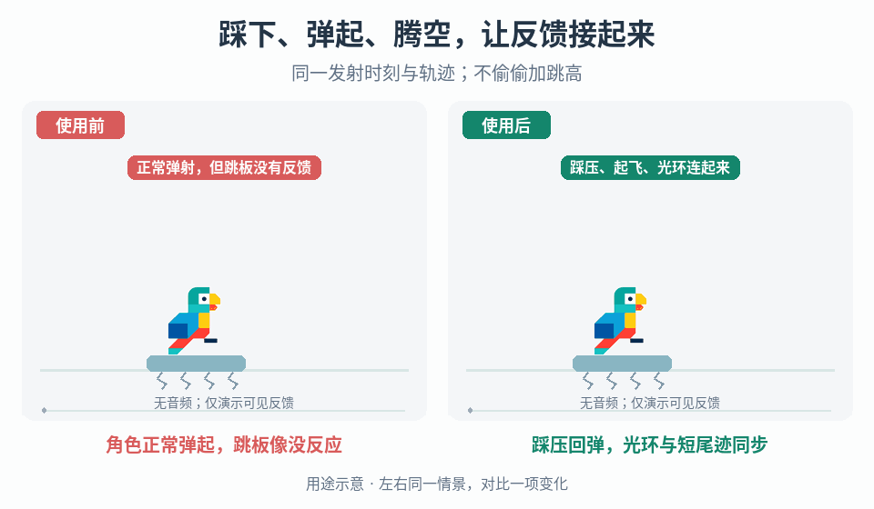

# 环境跳板的弹射与腾空反馈

## 效果预览

完全同发射曲线；右跳板压缩回弹、确认起飞时光环与上升短尾迹，左无这些视觉层。

左侧为使用前，右侧为使用后；4 秒循环，用途示意（非引擎实测）。

## 触发与输入

已有可弹射角色的环境跳板，但踩压、反弹、角色上升或返回落地之间缺少连贯反馈；或一次接触触发多次弹射/镜头。需要跳板与角色身份、有效接触条件、权威弹射事件及方向、离开/落地/中断信号，以及已有跳高和重复触发规则。先确认弹射本身由哪个系统负责，不由表现动画新增冲量。

## 实施流程

1. 将可用→有效踩压→弹射确认→离开/腾空→再次就绪列为本次交互的状态。以跳板、角色和本次激活标识关联事件；多碰撞体或持续接触不重复消费同一次激活。再次就绪条件由既有玩法定义，不擅自添加冷却。
2. 在已允许的接触上让跳板表面下压，再向上回弹；保持支点与表面关系，先调跳板本体，再加角色形变。若玩法没有弹射前等待，就用即时压缩/反弹配合原弹射时点，不为等动画结束延迟起飞。
3. 以权威弹射确认同步角色沿发射方向拉伸，以及从跳板扩散的光环。光环锚在跳板，角色拉伸锚在视觉层；两者都不改变碰撞、发射速度或作用范围。取消或资格失败时恢复踩压姿态，不播成功起飞。
4. 进入腾空段后按实际速度和方向驱动短尾迹，给现有相机一个有界的上升跟随偏移/目标；与原跟随系统约定唯一所有者，避免两套相机每帧争写。离开上升段、落地或中断时清理尾迹并归还相机，不能等待下一次跳板激活才恢复。
5. 收到真实着地边沿后复用落地压缩/回弹与强度分级。跳板本体可按自己的合法重置条件先恢复；不要因角色还在空中就永远锁住跳板，也不要为复位额外施加一次弹射。
6. 如需声音层，将弹簧音放在回弹/起飞确认，将上升风声与腾空速度对应，实听后校对同步与混音。悬浮跳板或空中翻转只作为另选造型/动作；更高发射必须先有明确玩法配置，不以双翻转推导额外跳跃次数。

## 调参顺序

固定物理轨迹，先调跳板下压量与回弹时长，再调角色拉伸/落地压缩、光环范围和寿命、尾迹长度，最后调相机上升偏移与恢复时间。逐层开关比较，保证起飞方向和落点可读。没有一套通用弹射高度、压缩比例或相机阻尼；实际发射速度只在独立玩法任务中调整。

## 验收与失败处理

- 一次有效激活只有一次权威弹射；多碰撞体、持续站立与快速重新进入按已定义规则处理。发生重复冲量先查激活消费和事件订阅，不靠延长动画掩盖。
- 成功起飞、资格失败和中途取消有不同结果；弹射前等待不因纯表现改动增加，关闭全部特效后轨迹、跳高与碰撞不变。
- 原地、斜向发射、连续跳板和正常落地中，光环留在跳板、尾迹跟角色、形变不移动物理根节点。
- 角色死亡、传送、切场或跳板销毁后清理两端关联，恢复相机与形变；新合法进入不会继承旧激活标识。
- 强化上升表现后仍看得到路径和落点；相机抖动先查双重控制，过冲先回退偏移而非改物理轨迹。

## 分流与组合

- [事件形变](../gameplay-motion-deformation/SKILL.md)：跳板下压/回弹、角色起飞拉伸；这里仅负责事件顺序。
- [冲击视觉](../gameplay-impact-visuals/SKILL.md)：扩散光环与局部爆发；光环不是伤害判定。
- [速度表现](../gameplay-speed-camera/SKILL.md)：腾空速度层与视野预算；不要求自动使用模糊或动态 FOV。
- [落地反馈](../gameplay-landing-feedback/SKILL.md)：真实落地后的表现；普通落地请求不需要跳板状态。
- [踩踏连击](../gameplay-stomp-combos/SKILL.md)处理敌人命中反弹，[移动接续](../gameplay-traversal-transitions/SKILL.md)处理停留/释放选择；它们不是环境弹射流程。

[按住高度](../gameplay-variable-jump-height/SKILL.md)控制已合法起跳后的顶点；[分段重力](../gameplay-asymmetric-jump-gravity/SKILL.md)控制项目声明支持的腾空阶段，也可包括走落平台。不要用它们新增或延长起跳许可。

需要核对案例、参数出处或证据范围时，读取[来源参考](references/sources.md)。
