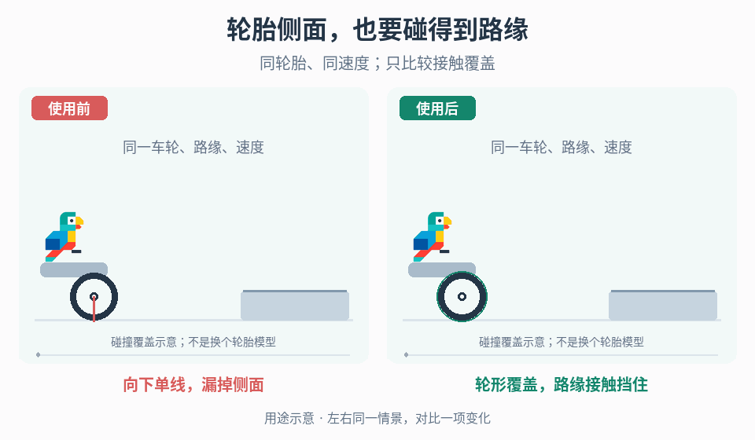

# 移动部件的接触表示

## 效果预览

轮胎向同一路缘行进，左侧向下采样漏掉侧接触而穿入，右侧轮形覆盖在外侧挡住。

左侧为使用前，右侧为使用后；4 秒循环，用途示意（非引擎实测）。

## 触发条件

轮胎等移动部件漏掉侧面/路缘接触，或复杂形状带来卡边、抖动和成本。

## 输入与前置条件

要求覆盖的接触方向、部件尺度、地形测试集、现有形状/采样、固定物理步长、悬架、吸震、摩擦与控制辅助。

## 实施步骤

1. 用平地、路缘和侧面沟渠重现失败，显示真实采样/碰撞形状，先分清视觉网格与物理覆盖。
2. 根据底部或侧面需求选择单线、轮周多线或圆柱形体积表示作为替代候选，不默认全部叠加。圆柱候选按轮胎轴向与半径覆盖侧面；使用目标引擎支持的查询/形状或可验证的近似表示，不由形状名称指定碰撞 API。
3. 固定尺度、地形、速度、悬架、摩擦和辅助，仅替换接触表示，记录漏接触及额外接触。
4. 测试高速、斜向、重复接触的稳定性和每物理步成本；保留满足覆盖要求的最简单方案。
5. 响应材质、损伤网格和转向映射独立试验；物理表示变化作为玩法变更，不当纯美化。

## 参数调整

多线方案调采样方向/数量，体积方案调尺寸与允许边界；覆盖改善但卡边时先检查形状突出和重复接触，不能靠增阻尼掩盖全部问题。

## 验收与失败处理

- [ ] 相同条件覆盖平地、路缘、沟渠及斜向高速，不异常弹起或陷住。
- [ ] 物理步成本符合预算，比较时吸震/摩擦一致。
- [ ] 视觉与接触关系可解释；承载面变形和角色攀附分别交独立入口。

## 按需组合

- [接触响应诊断](../gameplay-contact-response/SKILL.md)
- [交互承载面](../gameplay-deformable-support/SKILL.md)
- [车辆转向辅助](../gameplay-steering-assistance/SKILL.md)
- [窄边缘支撑估计](../gameplay-surface-adhesion/SKILL.md)

需要核查出处、示例参数或证据限制时，读取[来源参考](references/sources.md)。
