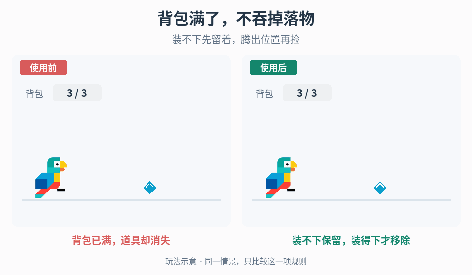

# 掉落物吸附与拾取确认

## 效果预览

背包满时，左侧未入账就移除掉落物；右侧先保留物品，腾出容量并确认入账后才移除。

左侧为使用前，右侧为使用后；4 秒循环，用途示意（非引擎实测）。

## 触发与输入

用于掉落来源、可取状态或领取结果不清。取得权威生成事件、物品 ID/归属/价值、接收者、拾取资格、背包限制与成功/失败事件。只有既有或明确要求吸附时，另取得启动范围、路径和障碍规则。

## 实施流程

1. 分开生成、可拾取、吸附中、提交中与已领取状态。表现只接收既有物品，不能再次生成奖励。
2. 让生成位置可追踪，待可拾取条件满足后再表达可取状态；不把出现粒子当作已入账。
3. 启用吸附时将运动绑定实际目标与启停条件，持续检查目标有效性。路径是否绕障/穿障由玩法决定，不由视觉曲线自行选择。
4. 到达领取条件后请求一次权威领取；成功才回收物品并播放闪光、声音或数值确认，失败按规则返回等待或取消。
5. 用物品身份防止重复请求，目标丢失、背包满、对象复用或切场时清理旧追逐和待确认表现。

## 调参

分别调吸附启动条件、趋近速度/加速与确认强度。运动太快看不清来源时延长可追踪段，不能延迟真实入账或增加价值。密集掉落限制粒子/声音并发，保留明确结果。

## 验收与失败处理

- 生成、可取与入账各有真实事件，视觉抵达不自行加分。
- 两接收者、重复请求和池化复用只领取一次；失败不播放成功。
- 障碍、接收者移动/销毁、背包满和中断不永久追逐。
- 关闭表现后经济结果不变；状态不明时等待权威结果，不猜成功。

## 组合

[破坏产物](../gameplay-breakables-loot/SKILL.md)与[奖励揭示](../gameplay-reward-reveal/SKILL.md)解释来源，[冲击视觉](../gameplay-impact-visuals/SKILL.md)与[浮字](../gameplay-floating-numbers/SKILL.md)只表达已确认结果。

需要核对机制出处、示例参数或证据边界时，读取[来源参考](references/sources.md)。
