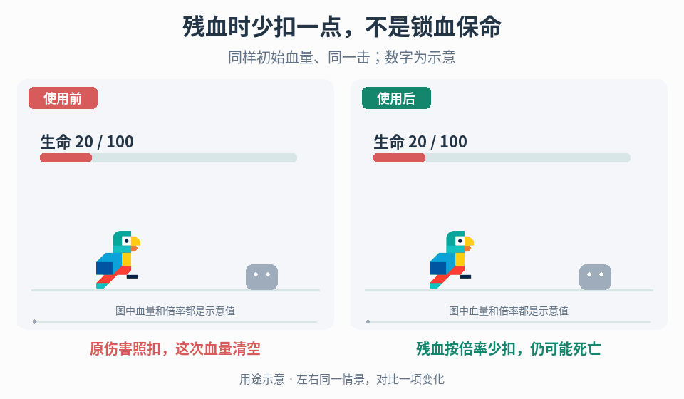

# 低血量伤害缩放与生存余量

## 效果预览

两侧都20血面对原始24伤害；左扣24到0，右按示意倍率扣12剩8，展示真实伤害缩放而不是血条延迟。

左侧为使用前，右侧为使用后；4 秒循环，用途示意（非引擎实测）。

## 触发条件

- 残血后的普通命中总是立即结束尝试，项目明确希望通过实际减伤增加生存机会。
- 已有残血减伤，但临界血量、连续命中或治疗后结算不一致；仅需让血条更易读时不要修改伤害。

## 输入与前置条件

真实 HP/最大 HP、低血量条件、原始伤害及伤害类别、缩放系数、伤害结算顺序与取整规则。另明确以命中前还是其他指定时点的 HP 判定，以及跨过阈值的一击、必杀/环境伤害是否适用。若规则有次数或持续时间限制，须由项目另行定义，不能从演示补出。

## 实施步骤

1. 固定初始 HP 与攻击序列确认问题是实际生存余量，而非显示延迟。只有任务明确要求规则改变时启用减伤。
2. 定义残血阈值、边界是否包含，以及读取命中前还是其他时点 HP；明确一击跨入残血区是否享受减伤。
3. 在真实伤害结算阶段按条件应用倍率，固定护盾/护甲/其他减伤的顺序、取整和最小伤害。例外环境/必杀伤害单独分类。
4. 每次伤害重新读取规定时点的真实生命状态；治疗、最大 HP 变化、死亡/重生后不得沿用过期条件。
5. 将最终扣血传给血条/浮字并回放相同攻击序列。倍率降低伤害不保证存活，不额外钳制到 1 HP，也不自动附加时间免疫。

## 调参顺序

分别调阈值与倍率，保留未减伤基线；记录残血区能承受的具体攻击序列而非承诺多活固定次数。先验证取整与最小伤害，再微调生存余量。

## 失败处理

小伤害被取整成永久零伤时按既定最小伤害规则修正；治疗后仍减伤查条件缓存；跨阈值结果不一致查结算时点与叠加顺序，不用 UI 血量作规则输入。

## 验收

- [ ] 阈值外、恰在阈值和阈值内分别结算正确；跨阈值的一击符合事先选定的判定时点。
- [ ] 连续命中、取整及最小伤害结果可重复；真实 HP 与浮字/血条一致，没有额外的 1 HP 钳制。
- [ ] 治疗、最大生命变化及死亡/重生后重新判定，减伤不错误延续。
- [ ] 普通伤害、例外致死伤害及其他减伤叠加遵循明确规则；对照测试记录生存机会及风险变化，而非保证多活固定次数。

## 组合与边界

- [生命血条与损失残影](../gameplay-health-damage-ui/SKILL.md)只显示实际 HP，不拥有减伤判定。
- [受击后的短时保护](../gameplay-post-hit-protection/SKILL.md)按时间阻挡后续命中；需要联用时单独定义结算优先级，不把两者合成一个“残血保护”。

需要核对案例、参数出处或证据边界时，读取[来源参考](references/sources.md)。
