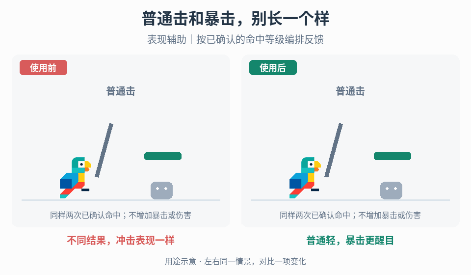

# 近战命中、受击与暴击编排

## 效果预览

不同结果，冲击表现一样；普通轻，暴击更醒目；表现辅助｜按已确认的命中等级编排反馈。

左侧为使用前，右侧为使用后；4 秒循环，用途示意（非引擎实测）。

## 触发与输入

用于已有近战判定但普通击、暴击、致命击缺少层次，或同一命中多次播放反馈。取得攻击相位、权威命中 ID、位置/方向、受击者、普通/暴击/致命结果及已有击退/恢复规则。

## 实施流程

1. 串起前摇→接触→受击→恢复，命中反馈只绑定已确认接触；挥空保留动作表现但不播放成功冲击。
2. 为普通击选择短停顿、局部闪光、定向粒子与受击姿势，各交给共享 owner。受击方向来自事件，不从当前镜头角度猜。
3. 为暴击/致命结果选择更强但更稀有的冲击帧、金色火花、CRIT 标记或角色特写；建立反馈等级表，避免普通击也占满强度。
4. 由一处编排器按命中 ID 派发，攻击者、受击者和相机不独立重复监听同一效果。浮字只展示已结算伤害。
5. 多目标与连击时合并/限流镜头和全屏层，局部反馈仍定位各接触；取消、死亡与重开调用各表现层清理。

## 重武器重量分支

需要重锤等武器显得沉重时，先定义武器反馈配置，不把全部阶段统一减速：

1. 准备段将武器举到清楚的高位并放慢提起，让玩家看懂重量和将要落下的方向；保留实际蓄力/预警窗口，输入后立即可见的起势不等于立即生效。
2. 在权威接触事件汇合停顿、武器对应的镜头强度和局部冲击。地面接触可加贴合接触点的冲击波与飞石；挥空不造地面裂纹，击中非地面目标时换适合该目标的局部表现。调用共享 owner，不在这里重写震动或停顿算法。
3. 用缓慢、重落后的收势完成重量表达，但将视觉收势与实际恢复/取消分开。既定可移动或可取消时刻到达后，允许表现按当前规则退出，不让动画播放完毕成为新增操作门槛。
4. 用同一目标比较轻、重武器的准备姿态、接触峰值和收势；分别调整配置，不按武器模型尺寸直接推出通用震动倍率，也不改变伤害或射速来伪造重量。

## 调参

先保证局部接触可读，再分别调停顿、闪光、粒子方向和镜头。用普通击与暴击相邻发生的序列检验对比；高频攻击降低单次强度或并发，不通过改伤害、击退或恢复时间换观感。

## 验收与失败处理

- 挥空、普通击、暴击和致命击分类正确，一次结果只结算/表现一次。
- 多目标、连击、打断后各表现层可恢复；关闭表现后伤害和位移不变。
- 重武器高举、命中冲击与收势各自可读；挥空/空中挥动不生成假地面接触，慢收势不意外延后输入、取消或下一次攻击。
- 重复反馈先排查事件订阅和 ID 去重；输入响应慢转[动作时序](../gameplay-action-timing/SKILL.md)，不要整体倍速掩盖。

## 分流与组合

[攻击方向](../gameplay-attack-direction/SKILL.md)、[剑刃轨迹](../gameplay-blade-trails/SKILL.md)、[弹反](../gameplay-parry-feedback/SKILL.md)、[踩踏](../gameplay-stomp-combos/SKILL.md)、[受击恢复](../gameplay-hit-recovery/SKILL.md)各有独立规则。

复用[停顿](../gameplay-hitstop/SKILL.md)、[冲击视觉](../gameplay-impact-visuals/SKILL.md)、[镜头](../gameplay-camera-feedback/SKILL.md)、[形变](../gameplay-motion-deformation/SKILL.md)、[浮字](../gameplay-floating-numbers/SKILL.md)、[血条](../gameplay-health-damage-ui/SKILL.md)与[攻击预警](../gameplay-attack-readability/SKILL.md)，不在本页复制实现。

需要核对机制出处、示例参数或证据边界时，读取[来源参考](references/sources.md)。
