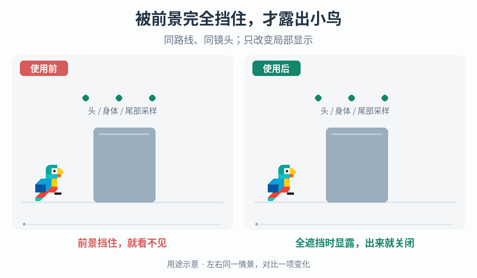

# 角色遮挡检测与局部显露

## 效果预览

同一路线经过不透明前景；头身尾三样本均被遮时右侧开启局部窗口，出遮挡后关闭。

左侧为使用前，右侧为使用后；4 秒循环，用途示意（非引擎实测）。

## 触发条件

- 前景遮住玩家，需保持位置、朝向和与环境关系可读。
- 单点遮挡在小边角就触发大面积透视，角色仍有可见部分却频繁开效果。
- 已有遮挡提示在移动、姿势变化或退出遮挡后抖动/残留，需要区分查询、聚合和渲染状态问题。

## 输入与前置条件

实际相机与需要保护可见性的角色、采样点及其随姿势/尾部变化的位置、可遮挡物集合、透明物/自身碰撞体的查询策略、聚合条件、现有显露效果与退出状态。先确认允许显示的信息，不把玩家提示扩成隐藏敌人/资源透视或改变潜行判定。

## 实施步骤

1. 固定路线与相机复现全遮、部分可见和小角落误开，调试显示相机到角色采样点的查询线与命中对象。
2. 按角色体型选择代表性采样点，例如头、身体、尾部；定义遮挡层、透明对象规则及无效/视野外采样处理。采样点必须跟随姿态而不是留在旧位置。
3. 选择聚合规则。需要避免小边角误开时可使用代表点全部被挡才显露的方案；任何一点清楚则保持正常显示。它是启发式，不等同每个像素都被遮挡。
4. 将聚合状态驱动局部透视窗口或角色轮廓，按能否定位角色和辨认方向选择表达，不强制两者同时使用。
5. 对边缘移动检查反复切换；必要时加入单独可调的滞回/防抖，并测新增迟滞。角色/相机切换、退出遮挡和对象失效时恢复原显示。
6. 判定测试与可读性测试分开：样本规则正确但仍看不清关键轮廓时，调整点位/规则或表达，不把逻辑通过当视觉验收。

## 调参顺序

分别调采样点分布、窗口范围/轮廓宽度与切换稳定化。先调检测再调表现；增加样本前测成本和漏显/误开，不把固定三点视为任意角色最优解。

## 失败处理

无效采样不能默认当遮挡，按显式回退处理。部分可见仍难定位时重审聚合目标；闪变查状态稳定化；窗口残留查对象失效清理，不通过移动相机或改变碰撞来掩盖问题。

## 验收

- [ ] 按所选聚合规则复现全遮、部分遮挡和小边角；采用三点 ALL 方案时，任一点清楚则不触发、三点均挡才触发，另测无效样本，不用它替代轮廓可读性判断。
- [ ] 头/尾/身体动作、细遮挡物、长形角色、画面边缘和多个前景物体下，样本与角色仍对应；剩余可见片段足以定位/辨认朝向，否则调整方案。
- [ ] 同路线/相机对比原判定与新判定，分别记录误开、漏显及状态切换；小幅移动无不可接受闪变。若使用稳定化，记录它引入的显露延迟。
- [ ] 角色/相机切换、离开遮挡及对象销毁后不残留窗口/轮廓；效果不额外显露未授权隐藏对象，不影响物理碰撞、相机位置或潜行检测。
- [ ] 局部窗口与轮廓方案分别检查位置/方向/环境关系可读性，保留实际测试结论，性能按项目测量。

## 组合与边界

- [世界目标发现性](../gameplay-world-readability/SKILL.md)选择资源/交互点的发现提示，不拥有本页遮挡采样和显露状态。
- [镜头反馈](../gameplay-camera-feedback/SKILL.md)改变临时画面偏移，不替代角色遮挡判断，也不要求为了显露自动移开相机。
- [接触视觉与遮挡预算](../gameplay-impact-visuals/SKILL.md)处理装饰效果遮住角色时的删减；别先制造过多粒子，再用透视补救。

需要核对案例、参数出处或证据边界时，读取[来源参考](references/sources.md)。
