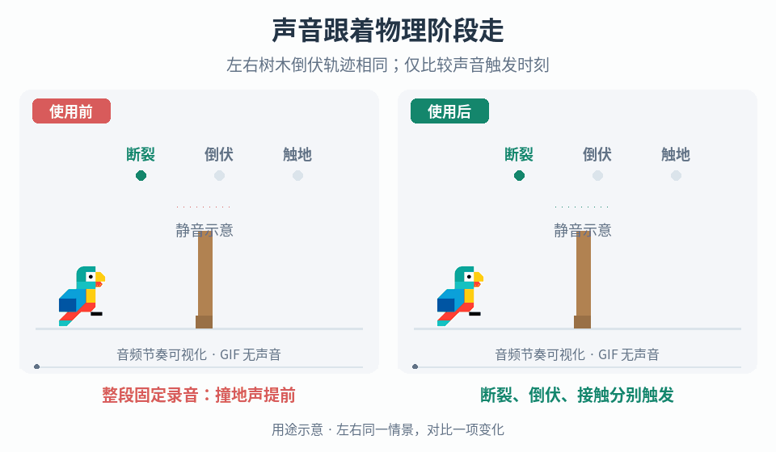

# 物理阶段驱动的分层音频

## 效果预览

同一断裂和倒伏轨迹；固定录音的撞地声在落地前播放，右侧按真实合格接触事件触发对应音层。声音变化以图形示意。

左侧为使用前，右侧为使用后；4 秒循环，用途示意（非引擎实测）。

## 触发条件

- 树木或道具的断裂、倒伏、撞地使用一条长音频，物理速度变化后撞击声提前、滞后或被硬切。
- 需要阶段录音变体及随受力、断裂速度变化的裂响，而不是仅替换一个音效文件。

## 输入与前置条件

已有物理/破坏系统的对象身份、生命周期与断裂/释放/接触事件；受力或应力代理量及断裂速度的定义与单位；可独立播放的裂响、倒伏、撞击音频及变体；空间发声位置、音频实例控制接口、暂停/卸载约定和并发声部预算。先确认哪些量确实可读，不把斧头动画、音频播放结束或首次任意碰撞当成真实断裂与撞地事件。

## 实施步骤

1. 列出事件来源并保留物理系统的决定权：裂响来自受力/断裂过程；倒伏来自真实支撑释放或既有倒伏状态入口；主体撞地来自符合项目接触对象、主体部位及强度条件的碰撞事件。分别记录物理时间、接收时间和音频启动时间，先排查事件路由，再处理播放延迟。若缺少可靠阶段事件，补只读适配或调试观测，不用长音频时间轴代替物理判定。
2. 每个对象维护独立音频上下文，包含对象/生命周期标识、当前阶段、已消费事件标识、所选变体和活跃音频句柄。阶段可用“受力/断裂中 → 倒伏中 → 主体撞地后 → 完成”；允许受力中止而未倒伏、生成时已倒伏或直接碰撞等项目真实路径，不强行补播缺失阶段。对象池复用时更新生命周期标识，拒绝旧回调。
3. 拆开三类素材与触发：断裂过程驱动裂响，进入倒伏时启动倒伏层，合格接触到达时立即启动撞击层。不要等待前一段播放完才进入下一阶段，也不要在首次受击时预约一个固定延迟的撞地声。对于持续时长不定的倒伏，选择可延展素材、可循环段或按需收尾方案；无合适素材时允许自然静默，不拉长或加速物理下落来迁就音频。
4. 将受力/应力代理和断裂速度分别接入裂响参数。先记录实际范围、单位、更新频率和峰值，再选择归一化、限幅与必要平滑，建立可独立试听的响应曲线。项目决定它们影响层强度、密度、音高还是变体分组；不要把施加的力、碰撞冲量、角速度和断裂速度视作可互换输入。缺少可靠量时使用明确的离散阶段回退，不伪造测量值。
5. 每次阶段入口从该阶段的合法变体池选择一次，缓存到本生命周期。可按材质/尺寸过滤，再使用项目选定的权重或近期不重复策略；持续参数更新和重复物理回调不重新抽样。需要复现时保存种子和选择结果，不为凑组合数量复制同一素材。
6. 明确重叠与中断：新阶段到达时允许前一层自然尾音或按素材设计淡出，同时及时启动新层；暂停、卸载、取消倒伏、再次受力各有明确保持/淡出/清理规则。主体首次撞地按事件去重，后续反弹是否另发轻碰撞交给接触音策略，不反复重放完整落地重击。
7. 按对象与全局预算管理声部，分别设置持续层和瞬态撞击的优先级、距离裁剪及抢占规则。高并发时可淡出低优先级持续层，但不可让某树的阶段更新停止另一棵树的声音。对象销毁后仍需尾音时转交有独立寿命的位置发声实例，否则清理句柄与订阅，避免悬挂循环。

## 调参顺序

先固定一组素材，验证真实阶段与去重；再调倒伏层延展和阶段衔接；随后分别调受力与断裂速度响应；最后加入变体权重、响度一致性和并发预算。阈值、曲线、淡出时间和预算按项目素材与物理范围选择，不用统一常数掩盖错事件或错单位。保留物理轨迹不变，做有声回放与事件日志对照。

## 失败处理

- 撞击声早于真实触地：移除固定时长预约，检查接触筛选是否误用了斧头、树枝或邻近道具碰撞。
- 裂响跳变或不停重启：查输入单位、采样噪声与阶段重入；平滑连续参数，不反复创建实例。
- 快速倒伏吞掉撞击声：允许跨阶段消费同一物理步中的有序事件，不等待上一段结束；查声部抢占。
- 慢倒伏出现突兀截断：调整素材延展/收尾和层间重叠，不改质量、重心或施力来配合录音。
- 多对象互相切声或重复撞击：查全局参数误用、生命周期键、重复订阅与接触去重，不仅增大音频预算。

## 验收

- [ ] 慢速、延迟释放、快速及中途受阻的倒伏中，撞地声仅在合格接触发生后触发；未倒下的受力过程不会自动播放完整倒伏序列。
- [ ] 同一物理步跨阶段、重复回调及反弹不会丢失首次撞击或重复重击；阶段衔接无意外硬切，也不强制延后真实撞击。
- [ ] 分别改变受力与断裂速度，日志能说明裂响采用的输入与映射；极端/缺失输入有受控回退，不污染物理状态。
- [ ] 同时倒下多个对象时状态、变体和句柄互不串扰；达到预算时按约定降级，无孤立循环或卸载后持续漏声。
- [ ] 暂停恢复、取消、销毁及对象池复用不触发过期事件；固定种子可复现变体，重复参数更新不重新选音。
- [ ] 在目标项目实际核听不同倒伏时长、参数与素材组合，确认衔接和响度；仅日志通过不算听感验收。

## 组合与边界

- [破坏与采集过程](../gameplay-breakables-loot/SKILL.md)拥有受击到终态、产物一次性生成；本页只消费其断裂/释放事件，音频结束不触发产物结算。
- [倒伏重心与施力诊断](../gameplay-prop-toppling-dynamics/SKILL.md)拥有首次触地前的真实姿态与动力学；本页跟随其结果，不为同步声音调整重心、质量或下落速度。
- 本页拥有阶段音频实例、衔接与变体选择，不覆盖通用混音、物理求解或新增枝条独立断裂检测。枝条断裂声若另有需求，需先有相应真实事件，不能凭主体倒伏推定。

需要核对作者说明、观察范围和工程建议出处时，读取[来源参考](references/sources.md)。
