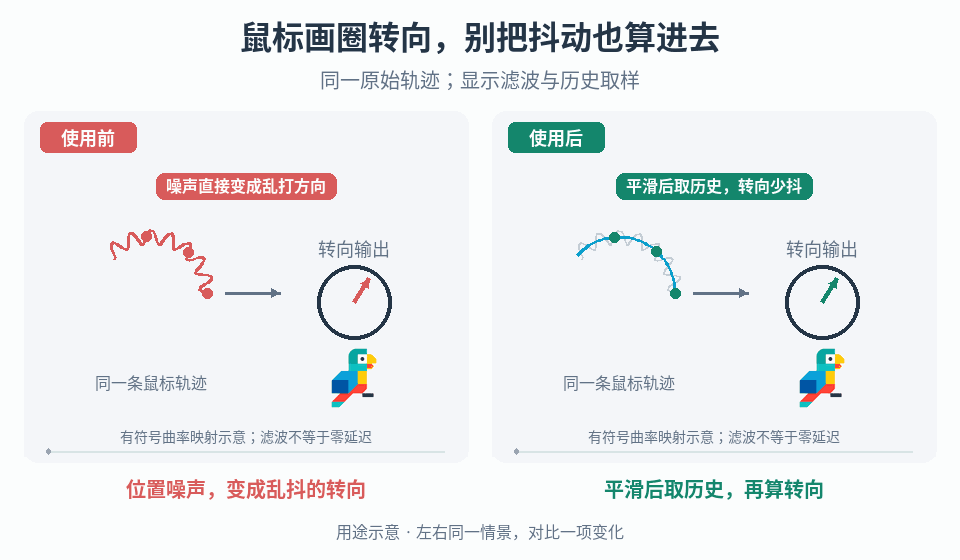

# 鼠标轨迹曲率到转向输入

## 效果预览

原始带噪圆弧一致；右侧显示平滑轨迹与三个历史样本，映射到较稳定转向表，左直接受噪声影响。

左侧为使用前，右侧为使用后；4 秒循环，用途示意（非引擎实测）。

## 触发与输入

仅用于已经选择鼠标画圈/弯曲轨迹驾驶的项目。取得带时间戳的位置、坐标空间、灵敏度、滤波状态、历史取样阶段、曲率定义/符号及输出范围；不要替换直接指针瞄准或左右按键。

## 实施流程

1. 同时可视化原始位置、各滤波路径和转向输出，标清图例；定位噪声从位置、历史样本还是映射出现。
2. 将两级位置平滑作为可开关候选，使用项目选定滤波器；每级保留独立状态，先验证单级再叠第二级，不能默认两次更好。
3. 从明确的阶段保存带时间戳历史，按两个可调回看间隔取得位置样本。历史不足时按声明的初始化策略输出中性或保留有效状态，不读未初始化位置。
4. 使用项目选定的有符号曲率估计，将结果映射到转向范围；先测试顺/逆时针符号，再处理近零移动、共线、停止和反向，避免除零及瞬间满舵。
5. 用同一输入记录回放无滤波、单级与两级，比较噪声、方向保留、反向响应和停止残留；固定车辆物理与镜头。
6. 失焦、坐标/设备切换、传送指针或控制权变化后清空并重建历史，不把位置跳变解释为急转弯。

## 调参

按顺序调滤波强度、历史间隔、曲率灵敏度、死区与输出限幅。回看间隔不是总延迟，更不能相加当端到端延迟；单独记录输入变化到实际转向的时间。过度滞后先减少滤波，不增加转向增益硬追赶。

## 验收与失败处理

- 直线、顺/逆圈、停起和急反向输出有解释，无符号反转或无限残留。
- 不同采样率/帧率、历史不足、共线及近零输入无无效值/满舵。
- 失焦恢复后无旧历史突变；异常时输出项目安全中性值并重建状态。

## 组合

[车辆转向辅助](../gameplay-steering-assistance/SKILL.md)是独立车辆状态贡献，联用时分别记录；[轮胎接触](../gameplay-locomotion-contacts/SKILL.md)不能修复输入噪声。

需要核对机制出处、示例参数或证据边界时，读取[来源参考](references/sources.md)。
