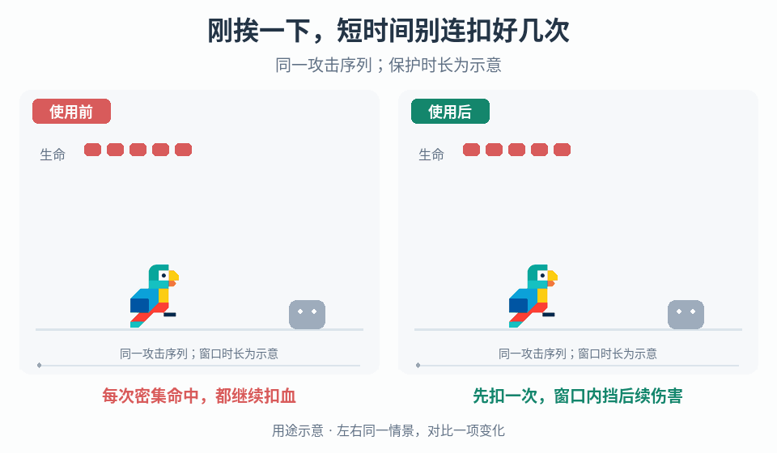

# 受击后的短时保护

## 效果预览

同一四次攻击；右首次受击开启可见保护环，窗口内拒绝两击，到期后第四击仍扣血。

左侧为使用前，右侧为使用后；4 秒循环，用途示意（非引擎实测）。

## 触发条件

- 多个攻击紧接着命中，玩家还未能响应就连续损失生命；项目明确需要首次有效受击后的保护窗口。
- 已有受击保护，但同帧命中、计时到期或视觉提示与实际免疫不同步。只想增加闪白效果时，不自行改变伤害规则。

## 输入与前置条件

已接受的受击事件、触发保护所需的伤害条件、免疫适用的攻击类别、窗口时长与计时时钟、同帧事件顺序，以及保护状态的表现入口。另明确被阻挡的命中是否续期、特殊伤害是否穿透，以及暂停/慢动作、死亡/重生和场景切换时如何计时或重置。

## 实施步骤

1. 定义有效受击：是否必须扣血、护盾吸收是否算入、哪些伤害类别触发保护。接触候选与已接受受击事件分离。
2. 建立可受伤与保护中状态。首个符合条件的命中结算一次后进入保护，并记录结束条件；同帧后续事件按明确顺序读取新状态。
3. 保护中拒绝适用的后续伤害，例外伤害按独立规则处理。明确被阻挡命中是否续期，并检查持续重叠不会造成未设计的无限保护。
4. 使用单一指定时钟判定到期，定义恰在边界的结果；暂停、慢动作和帧率变化遵循该时钟，死亡/重生按项目约定重置。
5. 闪烁、透明或环形提示读取真实保护状态，到期/重置同步结束。伤害免疫不自动解除硬直或授予移动许可。

## 调参顺序

分别调保护时长、适用攻击范围和续期策略。以密集攻击回放检查玩家获得的响应空间；不要同时把固定秒数和固定帧数当等价条件，表现闪烁周期不决定规则有效期。

## 失败处理

同帧多次扣血查事件顺序与状态写入；永久保护查续期和时钟暂停；提示结束但仍免疫查状态绑定。若需脱离围困而非只免伤，另用阈值脱身流程。

## 验收

- [ ] 无保护时首个符合条件的命中只结算一次并触发窗口；同帧多个命中的结果符合选定顺序。
- [ ] 窗口内适用伤害被阻挡，例外伤害遵循明确规则；被阻挡事件是否续期及持续重叠结果均可重复。
- [ ] 到期前、恰在到期边界和到期后的命中分别符合规则；项目支持的帧率、暂停与慢动作下，窗口按指定时钟工作。
- [ ] 死亡/重生和场景切换后无残留保护；状态提示与实际免疫同步结束，未擅自改变可操作状态或硬直。

## 组合与边界

- [连续受击阈值脱身](../gameplay-hit-recovery/SKILL.md)累计窗口内的命中后恢复间距，不是每次有效受击后的伤害免疫。
- [低血量伤害缩放](../gameplay-low-health-damage-reduction/SKILL.md)按 HP 改伤害量；[受伤区域容差](../gameplay-hurtbox-tolerance/SKILL.md)按空间决定是否相交。联用时分别定义各阶段事件，不将被免疫的接触误记为已扣血。

需要核对案例、参数出处或证据边界时，读取[来源参考](references/sources.md)。
