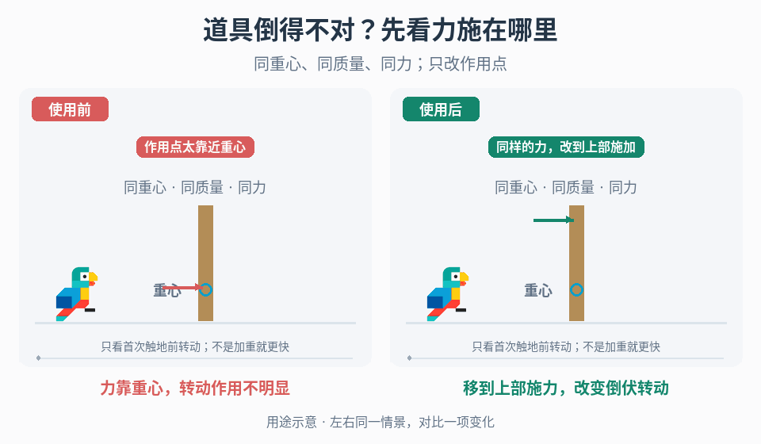

# 道具倒伏的重心与施力诊断

## 效果预览

可见相同低位重心，左力靠重心、右力施于顶部；在首次触地前比较转动路径，不混改质量与重心。

左侧为使用前，右侧为使用后；4 秒循环，用途示意（非引擎实测）。

## 触发条件

- 树木等道具已能倒下，但首次撞地前的转动方向、姿态或作用位置与预期重量感不符。
- 项目明确允许调整真实倒伏动力学，需要分清重心、施力点和触地响应，而不是一律加大质量或加快倒伏动画。
- 若接触前运动已符合目标、只需调整落地回弹，直接使用[接触响应](../gameplay-contact-response/SKILL.md)。

## 输入与前置条件

初始姿态、支撑/释放条件、物体质量与当前重心参照、施力方向/大小/持续方式及作用点、首次接触时刻、既有碰撞表示和规则。重心位置、总质量和施力点分别记录。

## 实施步骤

1. 将释放、首次接触前和触地后分段记录，先确认问题位于真实倒伏动力学。仅缺倒伏演出时不强加刚体系统。
2. 可视化实际重心及其局部/世界坐标，记录总质量和现有支撑；重心偏移与总质量分别控制，不把二者视为同一参数。
3. 显示施力点、方向、大小和施加方式，核对相对重心的作用关系。对需要表现基部较重、由上部带动倾倒的树状道具，可测试“重心向底部偏置 + 在上部施力”这一组合候选：先只改重心，再只改作用点，最后检查组合。它不是所有道具的默认解，不增加总质量也不保证倒得更快。不同姿态下转换到正确坐标，避免本地上方误当世界上方。
4. 固定施力测试不同重心位置，再固定重心测试作用点；每轮重置姿态、支撑、线/角速度和累积力。记录首次接触前的转动方向、姿态和时间。
5. 选定符合项目目标的组合后测试不同朝向；触地后回弹/稳定交给接触响应，枝条穿地交给局部覆盖，不用整树重心补救所有接触问题。

## 调参顺序

分别调重心相对位置、施力点和力/冲量幅度，先确认施加方式与单位。将方向、翻转节奏和首次接触姿态作为目标，不预设所有道具都要基部重心和顶部施力。

## 失败处理

实验结果不可重复时先查重置是否完整；方向随朝向出错查坐标；触地后弹飞先回到接触配置。若修改重心必须改变惯量处理，按项目引擎明确验证，不能宣称增重就更快下落。

## 验收

- [ ] 使用同一初始姿态/支撑/释放条件重复实验，重心与施力点可分别查看和修改，不将两者或总质量混为一个参数。
- [ ] 首次接触前的转动方向、姿态和节奏符合项目约定；能区分接触前问题与触地后的弹跳/稳定问题。
- [ ] 改一项时记录其余条件，重置后不残留上次速度/施力；换朝向或姿态不会误用坐标参照。
- [ ] 接触后的弹飞、反复抖动或不收敛由接触 owner 检查；不以局部演示承诺所有物体都更重、更真实或更稳定。

## 组合与边界

- [接触响应](../gameplay-contact-response/SKILL.md)独立拥有落地材质/回弹诊断，本页不复制其调参流程。
- [破坏与采集过程](../gameplay-breakables-loot/SKILL.md)管理倒伏何时进入/结束及产物一次性生成，不因出现倒伏就必须调整动力学。
- [突出部接触](../gameplay-prop-appendage-contacts/SKILL.md)处理枝条等局部覆盖与部件响应，不由主体重心替代。
- 只改视觉时使用[事件形变](../gameplay-motion-deformation/SKILL.md)；输入后准备/主体/收势问题使用[动作相位](../gameplay-action-timing/SKILL.md)，不是本页的物理诊断。

需要核对案例、参数出处或证据边界时，读取[来源参考](references/sources.md)。
