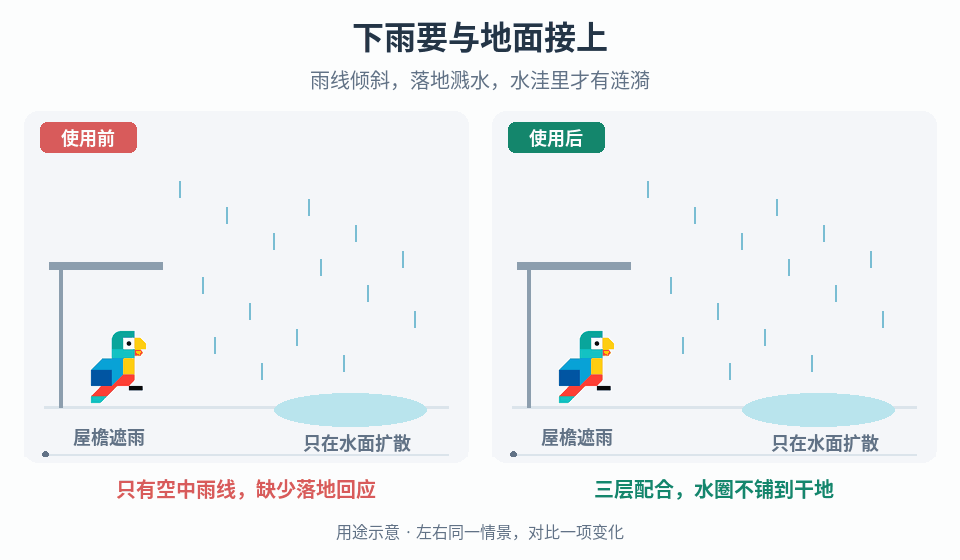

# 雨线、落点水花与水洼涟漪

## 效果预览

相同屋檐、地面、水洼和角色；右雨线斜向，硬地短水花、水洼内部扩散圈；不改变碰撞或湿滑。

左侧为使用前，右侧为使用后；4 秒循环，用途示意（非引擎实测）。

## 触发与输入

雨景只有空中直线，落地没有回应；水花悬空、屋内下雨，或水圈出现在草地和水洼外时使用。

先取得相机与可见降雨范围、世界单位、雨向/速度与强度、承载层和遮雨规则、水洼表面及其边界掩码、粒子/查询预算。明确本次只改表现，不自动增加湿滑、伤害或积水碰撞。先选一个同时含草地、水洼边缘和遮挡顶面的测试区。

## 实施步骤

1. **分别建立三个可单独开关的通道。** 空中雨线持续发射；有效落点发短促水花；水洼落点再发扩散水圈。保存雨强、雨向和活动区域作为共享输入，不把一次粒子接触当成战斗命中事件。水花与水圈各有发射率、寿命和实例上限。
2. **先让雨线方向成立。** 用向下速度加横向风速得到雨向，雨线长轴沿速度而非固定屏幕竖直方向。设置有限发射体积，补足斜雨上风侧的覆盖；在近景调雨线长度、宽度与透明度，再检查相机移动时是否露出空白边。移动发射体积不应拖走已经产生的世界空间水花/水圈。
3. **明确落点路径，二选一后验证适用面。**
   - 需要近景单滴连贯接触，采用粒子碰撞或沿上一位置到当前位置的线段查询，取首个合法阻挡点、法线与材质标识。高速滴避免仅用帧末位置测试；同一雨滴首次接触后结束或标记已处理，不能每帧重复喷水。
   - 更重视大面积成本，采用独立的表面落点采样：在活动区域内抽样，沿实际雨向投射到首个阻挡面，再用承载分类筛选。它是统计配对，不承诺每条可见雨线都落在某个水花上；近景若接触断裂明显，局部切回逐滴路径。深度投射只适合其可见表面范围，离屏/遮挡数据不足时跳过或用项目可用的世界查询，不凭缺失深度生成落点。
4. **先处理遮挡，再处理材质。** 查询包含屋顶等遮雨阻挡，不能只过滤地面而穿屋顶投到室内。对首个命中分类：草地/硬地允许小水花，水洼允许水圈，墙面/禁用面按项目规则忽略或另配水花；无支撑则不生成。水洼分类来自真实水面对象、材质标签或覆盖掩码，不能仅凭表面发亮判断。斜雨下屋檐的遮蔽也沿雨向测试，不只垂直向下。
5. **将水花放到承载点。** 用命中位置加小法线偏移避免闪烁，短喷射沿表面法线并可混入雨滴入射方向；偏移只用于消除深度冲突，不用来掩盖错误高度。调水花高度、散布和寿命，让它表示轻小雨滴而非战斗爆炸。
6. **将水圈限制在水洼上。** 用水面位置和水面法线建立切平面基向量，在该平面放置环形贴片/材质，不将水圈永远朝相机。以归一化年龄驱动半径从起始值扩到终值，同时淡出；环宽单独控制。使用水洼的同一坐标变换采样掩码，裁去水圈越出边界的部分。无法裁切时只选能容纳终态圆环的内部落点，宁可减少边缘水圈也不铺到干地。水面和底部地面高度不同时，以水面为准；动态承载面需保存局部锚点并随其更新。
7. **把连续生成做成有界流。** 落点率按有效面积与雨强缩放，使用时间累加发射额度而非每帧固定数量；限制每帧查询数、补发数量及活动实例数。水圈数量近似由发射率乘寿命决定，先用该估算选预算，再量测峰值。超预算降低远处采样密度，不把积压集中到下一帧。停止降雨后停止新发射，已有水花/水圈自然淡出；重开和卸载归还池对象并清理计时器、锚点和回调。

## 调参顺序

- 固定相机与雨强，先调横向/向下速度比决定倾角，再调雨线长度和宽度；不要靠增加数量补救错误方向。
- 关闭雨线，只看落点调承载过滤、查询距离和法线偏移；屋顶、台阶和水面高度正确后再增加落点率。
- 单独调水圈终半径、扩散时间、环宽和淡出曲线。边界被裁得碎裂时先缩终半径或避开窄水洼，不要放宽水洼掩码到干地。
- 最后合并三层调雨强映射：空中密度增加时地面回应也增加，但不要求线性同比。记录各通道活动数、查询次数和更新耗时；在项目目标设备预算内保留角色轮廓与危险提示。

## 故障与验收

- [ ] 平地、斜面、台阶、屋檐、水洼中心和边界分别测试：无悬空水花，遮雨阻挡不被跳过；水圈贴合水面且不溢到草地。
- [ ] 逐滴路径的水花对应首次接触且不重复；统计路径在近景没有明显的雨地脱节。切换路径不把同一片区域发射两遍。
- [ ] 改变相机角度后，水圈仍在水面切平面而非随相机旋转；相机移动不会拖动旧落点。水圈闪烁先查深度冲突和法线，漂浮先查错误层或水面高度。
- [ ] 在项目最低/目标帧率下对照单位时间落点数，排除帧率依赖；持续强雨与发射区域移动时数量和查询开销不持续增长。
- [ ] 停雨后的剩余寿命内效果消退，卸载立即释放；重新启动不继承过期落点或集中补发。关闭装饰雨效不改变伤害、移动与地面碰撞。

## 职责边界

- 已有水洼不贴地或其网格穿过台阶/窄槽，交给[表面余效的贴地与边界适配](../gameplay-surface-aftermath/SKILL.md)；本技能消费水面及边界，不复制扩散采样或网格生成。
- 离散战斗碰撞的闪光、爆发和文字，交给[接触闪光、冲击帧与粒子](../gameplay-impact-visuals/SKILL.md)；连续环境雨不触发命中停顿或伤害确认。
- 不扩展为雷暴、冰雹、积雪、雾、风树、热浪或天气状态控制器。需要核对公开案例和工程选项的证据边界时，读取[来源参考](references/sources.md)。
