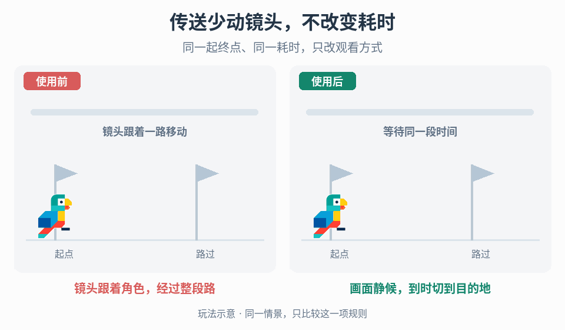

# 同目标、同完成时长的减少动态传送

## 效果预览

同一起终点与完成时长：左侧镜头沿路飞行，右侧静止等待后直接切到目的地，仅替换观看方式。

左侧为使用前，右侧为使用后；4 秒循环，用途示意（非引擎实测）。

## 触发条件与范围

已有传送能力通过高速移动镜头、拉伸或屏幕扭曲表现旅程，需要给玩家一个不展示该段强制运动的替代模式，同时保留普通表现。只关闭模糊但镜头仍高速飞越，不算完成本任务。

本入口拥有“同一传送计划的两种表现与共同完成门”，不决定能否传送、穿越途中会碰到什么，或玩家是否获得无敌。先确认项目允许替换表现；如果需求是改变路径碰撞、伤害或移动规则，先交给能力/移动规则 owner 明确决策。

## 必需输入与前置条件

- 已有传送入口、目标解析器、最终位置与朝向契约，以及普通模式成功、失败、取消的权威事件。
- 普通模式的计时起点、总完成时长来源和完成定义。分别标明位置提交、输入恢复、冷却/后继动作可用的里程碑，不能把“画面亮起来”误当能力完成。
- 能力使用的时钟和暂停/慢动作语义；若为联机能力，还需要服务器确认及预测纠正的归属。
- 角色实体与观察镜头的关系、镜头路径/跟随插值/运动模糊/扭曲通道的控制接口，以及安全的直接切换与渲染历史重置接口。
- 减少动态设置、可选淡化方式、目标失效/被占用处理、运行中重复请求与中断策略。

本流程需要开始时可共享的计划时长与许可里程碑。如果普通模式只能在沿途模拟结束后才知道耗时，且只有事后完成事件，先停在能力计时契约设计：由项目决定提供可共享计划，或另行设计两表现共用的事件驱动方案；不能直接套用下述期限流程。不要凭距离另估近似延时，也不从视频或动画长度猜普通模式时长。

## 实施顺序

### 1. 先建立共同传送计划

1. 在原能力确认可执行后创建本次请求标识，解析一次起点、目标位置/朝向、正常耗时和提交/完成里程碑。普通与减少动态分支读取同一份计划，不分别找落点或计算时长。
2. 以同一时钟记录开始时刻和完成期限，概念上为“完成期限 = 开始时刻 + 普通模式本次总时长”。普通模式若到达后仍有收尾锁定，总时长必须包含该段；以相同输入可再次被消费、后继动作可用的时刻逐项对齐，不只比较空间到达；这些许可里程碑可以不同，不强行合成一个解锁时刻。时长可以随距离或能力参数变化，但必须来自原计算路径，不从减少动态淡化长度反推。
3. 目标会移动时，复用原能力的快照或持续跟踪策略；不能一个分支锁定初始坐标，另一个分支追踪最新位置。目标失效时也复用同一权威结果。
4. 保留普通分支的原表现，先把完成、输入恢复和冷却等权威事件从视觉 Tween 完成回调中抽离。共同完成门检查请求仍有效、原能力成功且达到相同期限；视觉结束本身无权宣布成功。

### 2. 选择实体与镜头的衔接方式

- 原能力本来就是一次位置提交：沿用其提交时点和落点 API；减少动态分支不为“看起来瞬间”而提前写入实体位置，也不再模拟一条不同的玩法路径。
- 原能力实际沿路径移动：保留其权威移动与碰撞/伤害规则，仅为减少动态表现将观察镜头从自动跟随/路径驱动中分离。确认第一人称身体、持物和可见触发反馈如何跟随，不能只冻结相机节点却仍被父节点拖动。
- 如果镜头不能独立、途中实体行为会改变可见交互，或产品要求把真实沿途移动改成瞬移，先列出需要改变的规则，停在设计决策处。不能以“完成时长一样”批准额外玩法变化。

### 3. 编排减少动态分支

1. 取得本次镜头与效果层的控制权，记录进入时的有效视图及本次拥有的覆盖层。停止传送产生的路径推进、自动旋转、动态 FOV、径向模糊和画面扭曲；不要用全局重置抹掉其他系统仍合法持有的状态。
2. 在等待期保持观察位置不沿传送路线移动。是否允许手动观察由已有输入契约决定；即使允许，也不叠加自动转向或补间飞行。
3. 可使用简单暗角淡化提示开始和切换，也可不加淡化。淡出、等待、直接切换和恢复显示必须放在同一完成预算内，不能先完整等待普通耗时再额外播放整段淡化。
4. 按既定位置提交/相机交接里程碑，调用一次原能力的提交接口或读取已提交的权威目标；镜头直接设为目标视图，不从起点补间过去。清除本次跟随速度、相机插值和渲染运动历史，避免一帧长距离模糊、拖影或回弹到旧位置。
5. 恢复显示时确认目标位置与活动镜头有效。暗角不是完整遮蔽，不能假定它自动盖住所有跳变或未就绪画面；调节淡化只是表现选择，不替代目标有效性检查。
6. 如果原位置提交恰在共同完成期限，提交之后没有额外淡入预算，则采用不延长时长的直接恢复/省略淡入，或提交明确的两模式时序重设计请求。不要偷偷延长减少动态分支，也不要擅自提前角色提交以挤出淡入时间。
7. 输入恢复、后继动作与冷却等状态各按共同计划的对应许可里程碑推进，不新增表现专属输入锁，也不因画面提前可见而提前开放。到共同完成门清理本次仍持有的镜头/效果等控制权；若输入锁由原能力持有，交由原能力释放，表现层不抢先解锁或额外延后。

### 4. 将设置与运行时状态接好

- 每次开始记录选用分支，但两个分支始终共享本次目标与期限。提供普通表现和减少动态表现的明确选项，不用更低画质开关代替。
- 运行中开启减少动态时，立即停止本能力的强制镜头运动与扭曲，在当前有效视图进入静止等待，并沿用剩余期限和既定提交。不得重算完整时长或重发能力请求。
- 运行中关闭减少动态时，本次保持已进入的静止分支，下次再启用普通表现；不要补播错过的整段飞行。
- 暂停和时间缩放按能力时钟同步等待与表现。用绝对期限计算剩余时间，而不是把多段相对延时串起来累积误差；恢复后检查已经跨过的里程碑，只提交一次。

## 取消、重入与恢复

- 每次异步回调携带请求标识。新请求按原能力的拒绝、排队或替换策略处理；旧淡化/计时器回调不能再提交位置、恢复旧镜头或宣布成功。
- 提交前取消：走原能力取消路径，撤销本次计时与表现，恢复当前合法视图并释放本次控制权。不能伪造到达，也不能把原能力消耗/退款规则写进表现层。
- 提交后取消或中断：以权威位置为准清理表现，不为了恢复画面把角色送回起点；是否回滚只由原能力明确支持的事务决定。
- 目标丢失、位置无效或权威请求失败：发出原失败结果，退出等待并恢复可用视图。不要改为附近的另一个落点、自动重试普通飞行，或在黑屏中无限等待。
- 如果目标还需要加载，交给[切场就绪流程](../gameplay-scene-transitions/SKILL.md)。未满足其就绪条件不显露坏画面，也不宣称本次正常完成时长已达标；延迟和失败按能力契约处理，两分支使用同一规则。
- 死亡、重生、场景卸载、断线或相机被更高优先级系统接管时，清理本次资源并使请求失效。只释放自己的覆盖层，不能恢复已不存在的相机或强行解开其他系统的输入锁。

## 调参顺序与故障定位

1. 先不加淡化，验证同目标、同完成期限和没有自动镜头路径；成功后再加入可选淡化。
2. 再调淡化的时长分配、曲线、覆盖范围与明暗变化。短行程无法容纳完整淡化时压缩或省略表现，不扩展能力总时间。所有数值由项目配置和测试给出，不设通用默认值。
3. 保留易理解的静态等待提示，分别检查视觉偏好、目的地方向辨认和操作恢复；不能仅凭未见镜头运动判断用户体验已达标。
4. 替代模式提前结束：查完成门是否连在淡化结束上、是否跳过等待、是否用了另一套时长。替代模式更慢：查淡化是否被串接在完整等待之后或用了不同暂停时钟。
5. 仍有飞越或扭曲：检查镜头父节点、跟随器、自动转向与效果混合优先级。到达一帧拖影/长条残像：检查传送重置通知及相机/轨迹历史，不靠加深淡化掩盖。
6. 两模式同时间但遭遇、受击或可操作范围不同：记录具体规则差异，回到实体/镜头衔接决策，不把时序达标当玩法等价结论。

## 可观察验收

为同一组起点、目标和能力参数记录请求标识、模式、开始/提交/完成时刻、最终位置/朝向、输入恢复和冷却事件。时间比较容差由项目的模拟/渲染调度精度确定，不能任意放宽掩盖累计偏差。

- [ ] 固定、不同距离和动态目标案例中，两模式由同一计划解析落点与耗时；成功到达的位置/朝向符合相同目标契约，包含到达后锁定在内的输入恢复、后继动作可用及完成时差分别在约定容差内。
- [ ] 减少动态分支没有沿路径的强制镜头平移、自动旋转、拉伸/扭曲或传送速度模糊；直接切换后没有补间回扫、旧运动矢量拖影或残像桥接。
- [ ] 淡化开/关、最短/最长合法行程和不同帧率下，表现不额外增加完成时间，也不提前开放后继动作。短预算的降级行为可复现。
- [ ] 输入、碰撞、伤害、无敌和冷却分别核对既有契约；发现差异单独记录，不能用“同目标同时间”替代这些检查。
- [ ] 暂停/恢复、时间缩放、运行中切设置和重复触发不重置总时间，不提交两次，不触发旧回调。
- [ ] 提交前后取消、目标失效、死亡/重生和相机抢占后无永久遮蔽、残留输入锁或回到旧地点；联机项目额外覆盖拒绝和预测纠正。
- [ ] 普通模式仍可选择且原路径不被减少动态设置污染；减少动态失败时不会被强制回退到高速飞行表现。

## 独立边界与按需组合

- [移动交互的停留与接续](../gameplay-traversal-transitions/SKILL.md)决定边缘停住、抓杆和释放选择；本入口替换一个已经获准传送的展示，不增加或删减这些移动许可。
- [切场遮蔽与就绪恢复](../gameplay-scene-transitions/SKILL.md)等待加载/出生点/相机就绪；本入口以同一能力的完成时长为契约，不能用固定延时替代加载就绪。
- [冲刺路径与残像](../gameplay-dash-feedback/SKILL.md)强调真实移动路径；本入口取消该段强制观察运动，不能把关闭残像当作全部实现。
- [速度镜头](../gameplay-speed-camera/SKILL.md)提供可控的速度效果通道；本入口可撤销本能力相关通道，但不重写通用速度到 FOV/模糊映射。

需要核对出处、示例边界与新增工程决策时，读取[来源参考](references/sources.md)。
