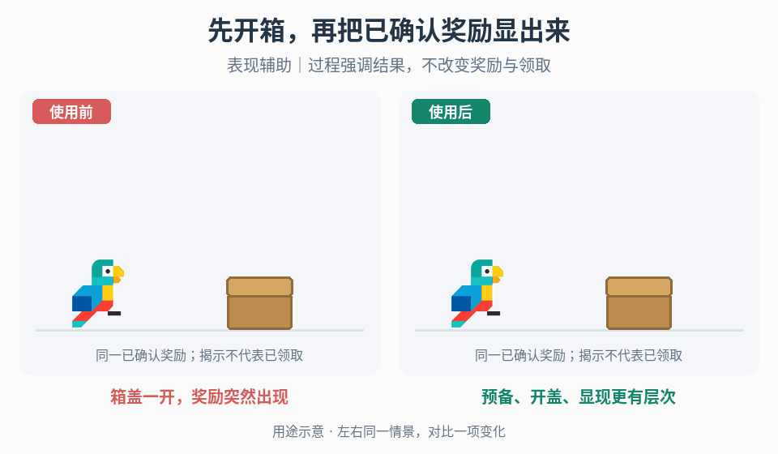

# 宝箱、卡牌与加工结果揭示

## 效果预览

箱盖一开，奖励突然出现；预备、开盖、显现更有层次；表现辅助｜过程强调结果，不改变奖励与领取。

左侧为使用前，右侧为使用后；4 秒循环，用途示意（非引擎实测）。

## 触发条件

- 已有宝箱开启、稀有卡揭示、物品合并或升级流程，但预备与结果重点不清。
- 需要结果演出，不是在设计卡牌选择/手牌交互、修改合成配方或实现金币吸附。

## 输入与前置条件

具体操作的开始/取消/成功/失败事件、已确认结果及归属、可重复性、显示参与者与清理条件。合并另确认素材消耗和结果入账事件；升级另确认处理中与真实完成条件。不要假设这些业务规则相同。

## 实施步骤

1. 选择宝箱、稀有卡、合并或升级分支，读取各自真实开始/成功/取消/失败与已确认结果，表现不自行扣素材或发奖励。
2. 宝箱：用摇晃/压缩建立预备，开盖时短促强调，再显示箱内光束、扩张环或上浮光点；选少量主层，保证物品显现后仍可辨认。
3. 稀有卡：围绕已确定结果组织升起、翻转、短停顿和符文/闪电，出框表现可强调重点但不改变获取概率与卡牌交互。
4. 合并：保留参与物品可辨认性，按成功事件汇聚视觉重点，随后清楚显示结果。素材消耗与入账使用业务事件，不由运动到中心或粒子结束推断。
5. 升级装置：分别把机械环、蓄能球、发光柱或电弧绑定项目启动/处理中/完成状态；失败与取消停止过程层并显示真实结果，不按固定视觉顺序假装成功。
6. 揭示后区分可领取与已入账；重复播放只重播表现。中断后恢复已确认结果和正确控制权，不因演出取消丢掉业务结果。

## 调参顺序

分别调预备时长、揭示停顿、结果停留和光效覆盖。先让结果形状/名称在低特效模式可读，再加稀有度强调；不同分支不套统一时序或固定帧数。

## 失败处理

重复发放先切断表现回调与业务结算；取消后仍闪光查过程层所有权；光束遮结果先压覆盖。未确认成功时停在处理中或失败态，不让动画播完自动确认。

## 验收

- [ ] 所选分支的开始、成功、失败/取消和重复请求按真实规则处理；演出不重复扣素材或发放结果。
- [ ] 宝箱打开、卡牌结果、合成物或升级完成信息清楚；降低光束/电弧/闪光后仍可读。
- [ ] 过程特效结束不自行宣告成功，已确认结果也不因演出中断丢失；显示与归属一致。
- [ ] 揭示、可领取、入账分别验证；未获准时不更改配方、奖励概率或经济数值。
- [ ] 退出/重开后不残留遮挡、高亮和控制归属。

## 组合与边界

- [形变](../gameplay-motion-deformation/SKILL.md)、[表现停顿](../gameplay-hitstop/SKILL.md)、[粒子与冲击](../gameplay-impact-visuals/SKILL.md)、[镜头反馈](../gameplay-camera-feedback/SKILL.md)提供组件。
- [对象破坏](../gameplay-breakables-loot/SKILL.md)负责终态/产物，[掉落物拾取](../gameplay-loot-pickup/SKILL.md)负责领取确认。
- [完成序列](../gameplay-completion-sequences/SKILL.md)只在还需结果界面、镜头交接与动作尾声协调时组合，不是每个揭示的必经步骤。

需要核对案例、参数出处或证据边界时，读取[来源参考](references/sources.md)。
