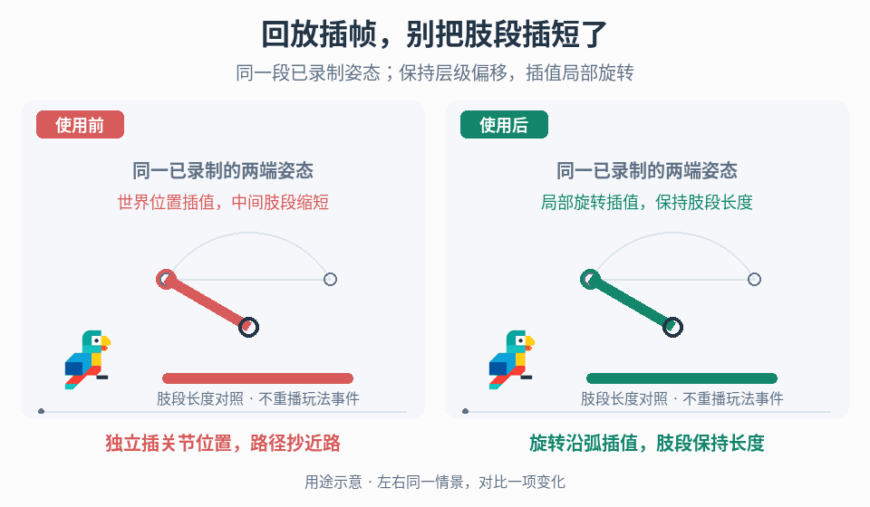

# 保留骨架结构的回放姿态插值

## 效果预览

原鸟旁独立肢段诊断图，两端角度及根点相同；左世界端点线性插值走弦而缩短，右旋转插值走弧保持段长。

左侧为使用前，右侧为使用后；4 秒循环，用途示意（非引擎实测）。

## 触发与输入

用于已有录制片段在采样点之间出现肢体缩短、快速扭转变形，或暂停、变速、倒放、跳转后姿态不一致。目标是修复同一段已有数据的姿态求值，不重新设计动作、玩法或视频输出。

先取得：片段时间戳及单位、骨骼稳定标识与父子关系、匹配的局部静止变换和蒙皮绑定、各通道的坐标/增量约定、根运动归属、已录制旋转及真正动画化的平移/缩放，以及片段切点和姿态模式切换信息。另确认回放对象、最终姿态写入阶段、现有动画/IK/物理驱动、播放时钟与 seek 接口。确定支持的速度、片段外行为和可接受的位置/角度误差。

若只留下各关节世界位置，没有足以恢复局部姿态的旋转或其他明确约束，先报告数据缺口。两端关节位置不能唯一恢复骨骼扭转或中间旋转路径；不要把猜测的 IK 姿态宣称为原姿态恢复。

## 实施流程

### 1. 固定骨架与姿态所有权

1. 给片段绑定明确的骨架版本和稳定骨骼映射，校验父关系、必要骨骼及静止偏移；同名不代表兼容。按父先子后的顺序求值，骨架改变时重新绑定，不按数组下标静默套到另一套 rig。
2. 将回放求值的输出限定到展示对象。优先用不参与玩法碰撞、输入和结算的回放副本；复用原实例时必须有明确的驱动交接与恢复接口。使动画状态机、IK、根运动、布娃娃和回放不会同时写同一姿态通道。
3. 选择一套明确表示：根变换处于世界或指定回放锚点空间，子骨骼使用相对父级的局部旋转；刚性连接保留匹配的局部静止平移。单独标记确实动画化的局部平移/缩放并保留它们，不用锁骨长删掉有意伸缩。局部旋转是完整旋转还是相对静止旋转的增量，必须明确乘法顺序，不能重复叠加静止姿态。
4. 根位移只应用一次。核对记录的根轨道、髋/骨架根的局部平移及播放对象父变换，防止根运动重复累加。已有完整世界变换需要转为局部时，在每个原始采样时刻按对应父变换转换，不在世界位置插值后反推；只存在世界位置时停止精确保真分支。非均匀/负缩放及剪切需按项目真实变换语义处理，无法可靠分解的区段拒绝或使用项目既有表示，不能强行压成无剪切的 TRS。

### 2. 按记录时间求值，不追赶上一显示帧

1. 校验时间戳、通道完整性和有限数值。时间戳应按片段定义递增；重复时刻按已有权威顺序选一条或拒绝冲突，不能用零时长作分母。空片段返回无有效姿态，单帧片段按约定保持该帧。
2. 用统一入口 EvaluatePose(片段, 回放时间) 查找包围该时间的相邻采样，计算区间比例，再求值全部需要的通道。同一个回放时间应得到同一姿态，不用“当前显示姿态逐帧靠近目标”的平滑器代替采样插值。所有保持/坏样本回退也必须由片段、区段和目标时间确定，例如选当前连续区段内最近的有效记录样本、等距取较早者；没有合法样本则返回失败。不得保持最后渲染姿态，否则直接 seek 与倒放会得到不同结果。
3. 在精确采样时刻复现对应姿态；有效区间内限制比例到两端。片段外选择已声明的端点保持、隐藏或停止，不默认外推。循环只在确认首尾兼容且定义了接缝时启用，不能跨片段尾首自动补一次旋转。
4. 为传送、骨架变化、已知断点及不兼容的动画/布娃娃模式交接切分区段。不要跨断点插值；边界采用明确的阶跃、保持或项目已有过渡。连续性未知的过大采样间隔需标记并选保守回退，不能靠更平滑曲线隐藏信息缺失。

### 3. 插值局部姿态，再沿层级组合

1. 平移只插值根及标记为动画化的局部通道；其余使用静止偏移。缩放按通道约定插值并保留有意伸缩，零值、符号翻转或退化变换需有单独的边界处理。不要独立插值每根骨骼的世界位置，再把这些点当作完整 rig。
2. 为旋转选择项目支持且可测试的插值方案。例如在允许相邻样本走最短旋转路径的区段，可选单位四元数球面插值；性能需要时评估归一化线性插值的角速度差异。不得直接把欧拉角逐分量线性插值当作任意三维旋转的等价解。
3. 使用四元数时先检查有限值与有效模长，归一化有效输入；零模长或损坏样本按上述确定性规则拒绝或选择区段内有效记录姿态，不默默变成单位旋转，也不依赖最后显示姿态。最短路径方案下，若两端点积为负，将一端取反以消除同一旋转的符号差异，并确保结果归一化。核对引擎 API 是否已做这些处理及近重合旋转的稳定分支，避免重复纠正。
4. 单独处理转数与路径歧义：同一姿态可代表零圈、一圈或多圈，最短路径插值不会自动恢复整圈。接近半圈、跨角度表示边界或快速多轴旋转时检查中间样本/已存路径信息；若记录含明确转数、角度展开或路径约束，使用其专用求值，不用最短路径覆盖它。缺少这些信息时标记不可保真区间，按项目选择显示离散采样或保守插值，并明确丢失的旋转无法还原；向上游提出补充中间姿态/路径信息的需求，而非在此补建录制器。
5. 从根到叶组合局部变换，向蒙皮系统提交一次最终姿态。在无伸缩的刚性链上检查段长；包含动画缩放、非均匀父缩放或平移的链要与其合法层级变换比较，不能要求所有世界空间段长恒定。姿态后仍执行的表现处理必须明确所有权；已有录制的次级运动不再额外模拟一遍。

### 4. 统一时钟、跳转与清理

1. 分开记录采样时间、播放控制时间与显示采样时刻。播放控制只把暂停、速度和起始偏移映射到片段时间；每次显示据该时间求值。先确认原记录的时间单位及时间缩放含义，不在渲染帧数中暗含采样频率。
2. 暂停重复求值同一时间；倒放与任意 seek 重新查找区间，不依赖前向游标残留或从头推进物理。切片段/跳转时使旧异步求值失效；应用前同时核对目标对象身份、生命周期/复用代次、回放会话、片段身份与请求版本。对象池重用不能因计数重新从零开始而接受旧结果，每次新生命周期或会话都获得不可与旧请求混淆的代次标识。
3. 姿态求值不得调用攻击、伤害、掉物、奖励或动画事件的业务入口。显示已有布娃娃姿态不等于重启布娃娃模拟；seek 也不遍历中间帧触发事件。已有声音/VFX 若需要单独回放，应交给项目现有事件回放契约，本入口不构建或补发未记录事件。
4. 退出、销毁、切场和对象复用时解除回放写入、取消旧请求并清理临时姿态；回到实时角色由权威控制器接管当前合法状态，不盲目恢复进入回放前的旧世界位置。提高显示采样频率只能更密地求值已有数据，不能补出未记录的旋转、接触或事件。

## 调参与诊断顺序

- 先逐个原始采样点对齐根与局部姿态，再检查中间时刻；原始点已错先修骨架、空间、增量约定或重复根运动，不先加平滑。
- 显示骨骼坐标轴、父子连线、区间索引/时间比例及姿态写入者。中间肢体缩短先查是否仍插值世界位置；扭转倒向先查符号、采样间距及转数歧义；seek 后抖动先查历史依赖和并行写入。
- 定义项目位置/角度误差、刚性段相对长度误差和允许的最大连续采样间隔。先保证端点与层级，再比较不同旋转插值的弧线和角速度；只有数据足够且确有需求时另评估高阶曲线，不以过冲换取主观顺滑。
- 固定片段时间比较多个播放速度和显示帧率，不比较不同时间的截图。保留原关键姿态离散显示作诊断对照；缺失旋转不靠高帧率掩盖。

## 验收与失败恢复

- [ ] 静止、根平移/旋转和逐关节单轴转动在原采样时刻匹配输入；刚性链中间段长不缩短，真实平移/缩放动画仍保留。不可兼容骨架或损坏样本返回可辨识错误/已声明回退，不污染其他骨骼。
- [ ] 快速多轴扭转、等价的 q 与 −q、角度跨界、接近半圈以及完整一圈/多圈分别测试。缺少转数证据的片段明确报告歧义，不能把最短路径或新增显示帧当作通过。
- [ ] 空/单帧片段、重复时间戳、首尾、片段外、大间隔、循环接缝和传送断点按声明策略工作；不会除零、外推飞离或跨断点拉伸。
- [ ] 正播到某时刻、直接 seek 到该时刻、倒放到该时刻及暂停重复采样得到相同姿态；不同显示帧率下同一片段时间的结果在容差内，速度只改变到达该时间的速率。
- [ ] 同骨架的动画与已录制布娃娃区段切换无双驱动；含动画缩放的片段不被“锁骨长”毁掉。不支持的剪切/变换组合明确降级，而非声称全部 rig 兼容。
- [ ] 回放、seek、倒放、反复进入/退出不造成伤害、掉物、奖励、物理碰撞或业务动画事件；旧请求不写入新片段或复用对象。
- [ ] 从多个视角检查肢体弧线和轮廓。旋转插值不保证脚锁地、持握接触或物理轨迹正确；若还需接触约束，单独暴露需求，不暗加 IK 改写录制姿态。保留实际测试记录，未执行的用例不标为已通过。

## 职责边界

- [事件形变](../gameplay-motion-deformation/SKILL.md)有意改变轮廓，[装饰跟随](../gameplay-secondary-motion/SKILL.md)推进实时次级运动；本页复现已有姿态，不为掩盖回放缺陷新增形变或模拟。
- [程序步态](../gameplay-gait-step-scheduling/SKILL.md)、[工具持握协调](../gameplay-tool-body-coordination/SKILL.md)及[移动方向动画](../gameplay-movement-feedback/SKILL.md)生成实时姿态，本页消费记录后的结果，不重跑这些输入/状态逻辑。
- [骨骼平面阴影](../gameplay-skeletal-planar-shadows/SKILL.md)可消费本页求值后的最终姿态，但投影与副网格管理仍由它负责。
- [坏落地恢复](../gameplay-landing-tumble-recovery/SKILL.md)拥有真实翻倒、掉物与控制恢复；回看其已记录姿态不得再次触发这些后果。

核对机制依据、作者表述和工程选择的来源边界时，读取[来源参考](references/sources.md)。

实时腾空中的动作速度规划走[腾空招式对齐](../gameplay-airtime-trick-alignment/SKILL.md)；回放只读取最终录制结果，不用当前环境重新预测历史落点。
