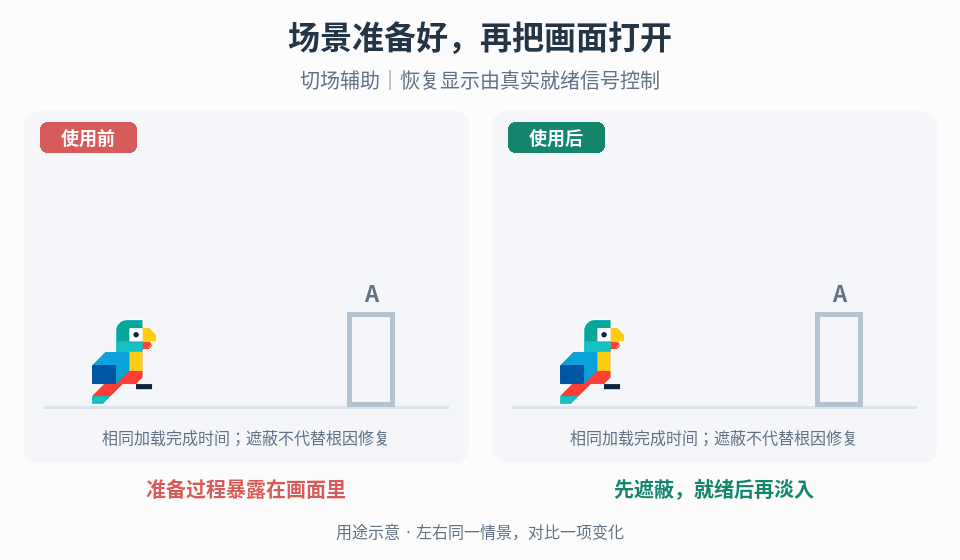

# 切场遮蔽与就绪恢复

## 效果预览

准备过程暴露在画面里；先遮蔽，就绪后再淡入；切场辅助｜恢复显示由真实就绪信号控制。

左侧为使用前，右侧为使用后；4 秒循环，用途示意（非引擎实测）。

## 触发条件

切场时暴露未就绪画面、出生点/相机跳变，或黑屏后无法恢复。

## 输入与前置条件

目标场景、出生点与相机就绪条件、失败/取消出口、输入归属与重入策略。

## 实施步骤

1. 先关闭遮蔽重现并修正出生点/相机错误，不能以黑屏代替根因修复。
2. 将遮蔽、切换准备、恢复显示划成独立状态；按风格选择立即遮蔽或淡出，但解除条件必须来自场景就绪。
3. 等待目标场景、角色位置与活动相机就绪后再淡入；动画播放完不代表加载完成。
4. 若锁输入，记录所有者并在正常/失败/取消出口释放；处理中请求按项目策略拒绝、排队或替换，不能重叠执行。
5. 加载失败时提供可结束的错误/回退状态，不永久停在黑屏；旧异步完成回调不得显露过期场景。

## 参数调整

淡入时长调视觉舒适度，不能承担加载超时逻辑；慢加载先检查真实就绪信号，短暂闪旧画面先查状态顺序与过期请求。

## 验收与失败处理

- [ ] 正常、慢加载、失败和取消不早显露或永久黑屏。
- [ ] 禁用遮蔽时出生点/相机仍正确。
- [ ] 反复切换、切换中再触发及持续按键无重复切场/残留锁。

## 按需组合

- [镜头反馈](../gameplay-camera-feedback/SKILL.md)

需要核查出处、示例参数或证据限制时，读取[来源参考](references/sources.md)。
