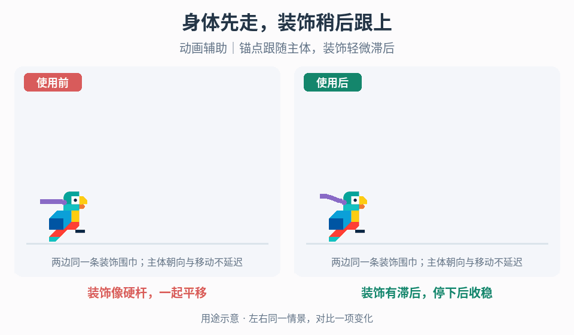

# 角色装饰的次级运动

## 效果预览

装饰像硬杆，一起平移；装饰有滞后，停下后收稳；动画辅助｜锚点跟随主体，装饰轻微滞后。

左侧为使用前，右侧为使用后；4 秒循环，用途示意（非引擎实测）。

## 触发与输入

用于头发、眼部等装饰过硬，或转身/传送后翻折、振荡。取得父运动/朝向、装饰锚点、基础形状及已有驱动；确认装饰不承担真实碰撞或控制方向。

## 实施流程

1. 保留无跟随基线，分别看行走、转身、跳跃与冲刺，确定需要滞后的部件。
2. 锚点跟随父节点，装饰相对锚点产生受控滞后；真实角色朝向不等待装饰追上。眼部可使用独立姿态通道，不强套链状解法。
3. 对头发等链状形体，固定根节点、定义段长与距离约束，再接入弹簧/阻尼或已有求解器；先保持连接，再调运动幅度。绘制形状从求解后的节点生成。
4. 按固定或有界步长更新，快速翻面时统一变换锚点与节点；传送时重建基础姿态并清空速度，不让旧位置产生巨大冲量。
5. 死亡、取消、切场和对象复用恢复基础形状并释放旧状态。

## 调参

先调链段数与段长满足轮廓，再调刚度/跟随速度、阻尼和运动限幅。过弹先降低能量或提高阻尼，拖尾过长再提高跟随；不能用更多节点解决错误锚点。眼部与头发分别校准。

## 验收与失败处理

- 行走/转身/跳跃/冲刺锚点稳定，不改变真实朝向、碰撞或操作结果。
- 快速翻面、传送、死亡和重进无反折、残留速度或永久振荡。
- 不同帧率保持段长与可接受运动；失稳时回到基础姿态并检查步长/约束，不能把错误传递给主体。

## 组合

[事件形变](../gameplay-motion-deformation/SKILL.md)处理接触回弹，[移动方向动画](../gameplay-movement-feedback/SKILL.md)负责朝向，不由装饰滞后接管。

需要核对机制出处、示例参数或证据边界时，读取[来源参考](references/sources.md)。
