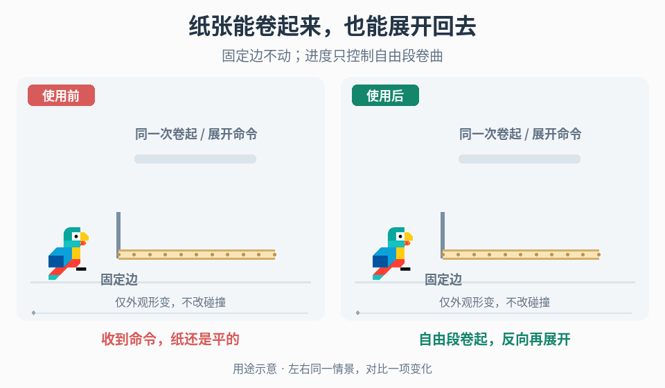

# 玩法驱动的薄片卷曲

## 效果预览

同一纸片、同一卷起再展开进度；右侧按长度阈值将自由段变为圆弧，左侧保持平面。

左侧为使用前，右侧为使用后；4 秒循环，用途示意（非引擎实测）。

## 触发条件

- 纸张或薄片要随揭示、收起或其他已定义交互逐渐卷曲，而不是整体旋转或缩放。
- 卷曲方向、固定边或中途反向不稳定，或现有材质动画只移动纹理而不改变轮廓。

## 输入与前置条件

取得未形变网格、物体空间长度轴与两端、固定边、宽度轴、卷曲朝向、正值卷曲半径、每实例玩法进度和更新时钟。长度轴必须有非零长度，网格沿该轴有足够细分以表达目标曲率。半径与网格长度使用同一局部单位；支持非零厚度偏移时要求所有 |z| < R，避免内层有效半径退化；明确非均匀缩放是允许的外观变化还是需预先烘焙。

本入口只改变渲染几何。碰撞、交互命中、遮挡或可通行范围若也必须随纸张变化，单列规则与实现，不假定顶点着色器会更新碰撞体。

## 实施步骤

1. 从原始顶点定义局部正交基：长度方向 a、宽度方向 b、片面法线 n，固定边原点 o。顶点写成 p = o + x·a + y·b + z·n；长度 L > 0，沿卷曲方向令 u = x/L，将固定端到自由端归一到 0–1。先用颜色显示 u，确认旋转对象不会改变轴向或锚点。
2. 将阈值 t 限定到 0–1。u ≤ t 的部分保持平直，u > t 才进入卷曲；增大 t 留下更多平直区，减小 t 扩大卷曲区。t = 1 应回到原网格，t = 0 从固定边开始卷曲，固定边本身不移动。
3. 在顶点阶段重建卷曲自由段，不累计上一帧形变。可选等弧长圆弧实现：令 q = x − tL、θ = q/R，R > 0；自由段中心面位置为 o + tL·a + y·b + R sin(θ)·a + sR[1 − cos(θ)]·n，s 为选定卷曲方向符号。薄片有局部厚度偏移 z 时，沿旋转后的法线 nθ = −s sin(θ)·a + cos(θ)·n 加回 z。这样 q = 0 处位置与切向衔接平直段；若改用其他距离到角度映射，仍须检查接缝连续性。
4. 明确圆弧允许的最大转角与可见重叠。固定半径绕行会重合，不等于有厚度的多圈卷轴或自碰撞；出现自穿时限制卷曲范围、调整半径，或将多层卷绕列为独立扩展。不要靠增加细分掩盖几何重合。
5. 由权威交互状态设置目标 t，以项目曲线或响应规则更新当前 t。中途停止、反向和重新触发从当前值继续；初始化、禁用重启及对象复用读取对应状态，不重放无关交互。用实例参数避免一张纸卷起时其他纸同步变化。
6. 需要飘动时再加入有界正弦位移，明确它在卷曲前还是卷曲后计算；用平滑权重令固定边位移为零，避免在平直/卷曲边界产生突跳。先关闭飘动校准基础卷曲，再单独调相位、幅度与频率。
7. 按形变更新法线/切线或相应着色计算，保持主渲染、阴影及项目使用的其他几何通道一致；为全部允许姿态配置包围盒。测试双面显示、边缘光照及镜头裁剪，不让卷起部分因原平面 bounds 被剔除。

## 调参顺序

先校准轴、固定边、阈值方向和半径单位，再决定曲率与允许转角，随后调整细分密度和阈值随玩法推进的节奏，最后添加飘动。半径越小曲率越大，也更容易产生折线与重叠；不能把提高细分或去掉骨骼直接宣称为性能提升，按目标平台测量。

## 失败处理

- 固定边漂移或阈值反向：检查原点、长度端点和 u 的方向，不用反向播放掩盖坐标错误。
- 边界折断：先检查 q = 0 的位置与切向，再检查正弦权重和厚度法线；不要混用世界距离与局部半径。
- 卷曲爆开或出现非有限值：拒绝零长度/非正半径及无效输入，保留安全平直状态并报出参数错误。
- 高曲率呈多边形、闪烁或消失：分别检查细分、圆弧重合、法线、双面材质和 bounds，别以更多随机摆动遮盖。

## 验收

- [ ] 阈值两端、中间值及边界附近符合“阈值前平直、阈值后卷曲”，固定边不漂移，圆弧衔接无裂缝。
- [ ] 正向、反向、中途停住和连续交互无累计形变；独立实例、重启与复用不串状态。
- [ ] 平移、旋转及项目允许的缩放下卷曲轴与半径语义一致；无效长度/半径有确定处理。
- [ ] 目标曲率下轮廓、光照、阴影与裁剪一致，允许范围内不出现未接受的自穿或重合。
- [ ] 关闭飘动仍有正确卷曲；关闭渲染形变不改变未授权的碰撞、交互或玩法状态。

## 组合与边界

- [事件形变](../gameplay-motion-deformation/SKILL.md)管理整体压缩、拉伸和回弹，本页按长度分段重映射顶点。
- [运行状态表面动画](../gameplay-state-driven-surface-motion/SKILL.md)移动 UV，不拥有薄片几何卷曲。
- [次级运动](../gameplay-secondary-motion/SKILL.md)可提供装饰响应思路，但不替代本页固定边和圆弧约束。

需要核对机制出处、示例参数或证据边界时，读取[来源参考](references/sources.md)。
