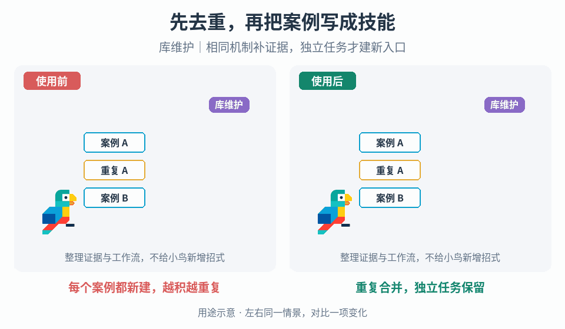

# 把案例转成可执行的游戏制作技能

## 效果预览

每个案例都新建，越积越重复；重复合并，独立任务保留；库维护｜相同机制补证据，独立任务才建新入口。

左侧为使用前，右侧为使用后；4 秒循环，用途示意（非引擎实测）。

## 触发与输入

新增游戏机制案例、补充已知机制或修正现有技能时使用。需要目标仓库及分支、已获得的公开材料、事实与未知项、要解决的游戏问题。先读 AGENTS.md、catalog.json、sources/posts.json 和相邻技能；不得把不能访问的仓库当空库。

## 实施顺序

1. 在来源层登记材料。用 scripts/validate.py 的 post_id_from_url 归一化来源 ID，同一内容的不同 URL 路由只占一条记录；没有已核 URL 时保留 null。分别记录观察、文字说明、代码静态阅读与执行结果，保留署名、限制和参数出处，不收录媒体原件或私人信息。
2. 先写出游戏 Agent 要完成的任务，而不是材料摘要：给出触发症状、已有系统、权威输入、可修改的表现或玩法范围、期望输出。没有足够信息支撑独立任务时，只补来源或 evidence_only 路由，不制造实施能力。
3. 对照 catalog 的 owner、task_routes 和相邻技能。比较触发、输入、状态推进及失败验收；相同工作流的新参数或风格更新原入口，独立任务才建入口。共享机制只由一个 owner 维护，组合流程用链接，不因同属 UI、移动或战斗而合并。
4. 编写 SKILL.md：从输入和前置条件开始，按依赖顺序落实事件、数据、状态和资源生命周期；明确需要选择的方案，给出本机制的可调参数、调试顺序、验收场景和失败回退。步骤应让 Agent 能开始实现，而非要求它“参考某帖”。不把通用工程建议冒充作者已实现的方法。
5. 把署名、转载链、帖子 ID、逐条观察、冲突数值和未证实现放入同目录 references/sources.md，并链接 sources/posts.json。SKILL.md 只保留按需阅读的参考链接；运行时必须遵守的规则写成工程约束，不反复解释研究经过。来源参数没有项目验证前不是默认值；原帖事实与新增实现方案在参考资料中分开。
6. 用真实请求演练：正向任务能否从正文确定首个改动和完成标准？相邻反例是否分流？缺少项目输入时能否停在正确边界？中断、重复事件、重入或清理失败时是否有适用的处理？按任务需要挑测试，不强加无关状态模板。
7. 同步 catalog 的 evidence_path、来源双向关系和 task_routes；独立边界登记 distinct_from，保留迁移导航。事实补齐用 evidence_updates，不能把别处步骤当原材料事实。更新来源索引并运行结构校验、单元测试和技能格式校验；逐项阅读 diff 和代表性请求输出。
8. 按已有授权提交/发布到已确认目标分支，保留现有历史，不强推。发布前重查远端基线；有并发变更先整合并复验。发布后比对提交与 tree，分别报告准备、本地验证、发布和远端验证，不把它们混成完成。

## 质量调节与失败处理

- 正文过泛：补具体事件/数据、机制决策和失败场景，不靠增加标题或重复通用建议凑完整。
- 正文过像研究笔记：将来源论证搬到参考资料，重写操作动词与依赖；不能只删平台名称。
- 方案缺关键输入：明确需查项目的坐标、时钟、状态或 API；仅提供可验证的候选方案，不编造原作者公式和通用数值。
- 出现重复 owner 或强并：按状态与验收边界回溯，保留真正独立入口；技能数量不是成果指标。
- 证据冲突：在参考层保留双方范围，正文给出需要项目测定的参数，不擅选一个当结论。

## 验收

- [ ] 不读来源材料也能按正文开始完成明确的游戏任务；触发、输入、实施、调参和完成/失败标准彼此一致。
- [ ] 执行正文没有来源 ID、转载叙事和研究免责段；引用证据时能定位完整署名、观察和未知项。
- [ ] 来源去重、机制唯一 owner、catalog 双向映射及独立路由有效；没有因新参数/作者增加技能数。
- [ ] 运行 python scripts/update_index.py、python scripts/validate.py、python -m unittest discover -s tests -v；另用可用的 skill-creator quick_validate 检查格式。自动检查不替代语义演练或引擎测试。
- [ ] diff 仅含授权目标，没有凭据、私人记录或媒体复制；未核远端不得报告发布成功。

维护方法的来源背景按需见 [案例依据](references/sources.md)。
