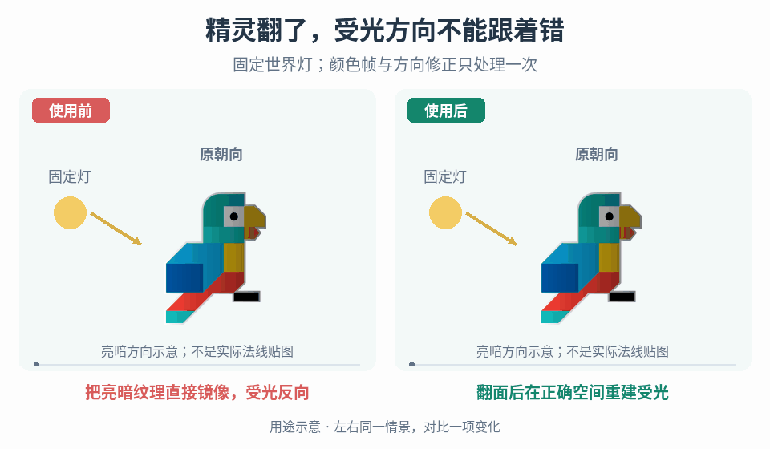

# 精灵朝向变化下的法线光照一致性

## 效果预览

同一原鸟水平翻面再恢复，固定灯在左；用原sprite上的标量亮暗诊断示意旧光照随纹理翻转与修正后世界方向一致。

左侧为使用前，右侧为使用后；4 秒循环，用途示意（非引擎实测）。

## 输入与边界

取得项目引擎/版本、实际渲染后端与材质路径、精灵颜色图和法线图、导入与采样设置、动画帧/图集对应、方向选择规则，以及灯的位置和光照计算空间。列出项目实际使用的翻面、UV 镜像、局部旋转、父级负缩放和换方向图方式，不能把这些视为同一个操作。

先确认法线纹理的空间、编码、轴向/绿色通道约定和渲染器解码方式；不明确时查项目 shader、导入器和匹配版本的引擎实现，并用已知方向的诊断纹理校准。无法确定时保留基线并报告缺项，不批量反相通道或生成方向资产。

只修正渲染表面的朝向与受光关系。角色移动、瞄准、灯控制、碰撞和命中规则保持原有权威来源；非镜像的不同方向原画可能代表不同表面，应按各自画面配法线，不能用向量变换制造缺失的表面信息。

## 实施流程

1. 建立最小检查场景：一张左右/上下不对称的精灵、配对法线图、一个有可见位置标记的固定灯。固定相机、曝光和环境光，暂时关掉其他灯、闪白等干扰。保存未修改材质的原朝向结果，同时准备无凹凸的平面法线对照和具有已知倾斜方向的诊断法线图。不要仅凭复杂原画的高光猜轴向。
2. 分开验证采样与方向。先显示颜色图、法线图采样区域及解码后的法线方向，确认同一帧、相同裁切/偏移、图集布局和有效 UV；再检查法线经哪一步进入光照空间。查清翻面改变了顶点、UV、切线基还是多个部分，以及引擎是否已经补偿。镜像 texel 位置与变换其中编码的方向是两件事，但最终可以由同一渲染路径正确完成。
3. 对每种实际朝向操作做未修改基线：原向、水平翻、垂直翻、双翻和支持的旋转。先逐项，再测旋转加翻面及负缩放父级；记录有效变换顺序，不将组合结果凭 XOR 或某个通道的符号猜出。保持灯不动检查表面相对灯的反应，再固定精灵移动灯到不同侧边。正确结果应符合变换后的表面方向，不要求所有姿态亮度相同。
4. 根据证据选择一条纠正路径，并明确唯一负责层：
   - 渲染器已正确处理：保留同一镜像可复用的法线资产，不加 shader 通道翻转；继续检查图集/动画配对或导入差异。
   - 内建路径存在缺失：先查项目版本适用的修复或受支持设置，在隔离场景验证，再决定是否采用；不要因历史修复存在就认定当前后端、材质和负缩放路径都已覆盖，也不为局部问题盲目升级项目。
   - 必须自定义 shader：在法线解码后，使用已确认的法线空间和有效朝向，将法线/基转换到灯计算所用空间；优先复用引擎的法线解码及变换接口。写清采样 UV、方向变换、父级变换的职责，补偿仅执行一次，变换后按管线要求归一化。任意旋转、非均匀缩放和反射组合不能套用未经验证的单通道反相；不明确适用矩阵或轴约定时停止扩展该路径。
   - 管线无法提供所需变换，或方向原画确实不同：选择显式方向法线资产，并定义它在选定 shader 中代表的朝向。仍要测试引擎是否再次变换，避免资产预补偿与 shader/渲染器重复修正。不要把新增贴图当所有镜像问题的必选解。
5. 将颜色帧、法线帧/区域、材质实例及纠正模式作为同一次显示状态提交。朝向或动画帧改变时从当前权威显示状态重建，不把上一帧修正继续累乘。贴图未就绪或缺帧时用项目批准的配对基线/无凹凸显示，并暴露缺失诊断，不借用另一个方向或上一对象的法线。异步加载完成时先核对显示代次、帧/方向标识及对象实例代次仍匹配当前状态；旧完成通知不直接安装其贴图，而是释放自己持有的过期引用并按当前状态重新解析绑定，不能覆盖后来换向或池化复用后的配对。用实例参数隔离不同角色，不随意改共享材质。
6. 在整套动画、运行时换装/换精灵、对象复用和重新启用中重复验证。显式清理旧方向资产与实例纠正参数，再按当前帧重建绑定。先验证普通单帧，再启用图集、压缩、批处理及项目实际光照层；若某一步才失败，定位该步骤，不同时改贴图和 shader 掩盖原因。
7. 最后恢复正式灯光和游戏画面，在实际显示比例/目标设备测轮廓、像素采样、亮暗可读性及帧耗。对比关闭法线与开启法线的同场景资源/渲染成本，再确定质量档与回退。若降低强度或关闭凹凸，保持颜色帧、朝向和玩法不变。

## 调参顺序

先调正确性：贴图配对 → 导入编码/轴向 → 渲染器已有变换 → 唯一纠正层 → 组合变换。全部正确后才调凹凸强度、灯高度/方向、过滤、压缩与图集边缘处理。像素画的颜色图与法线图应保持像素位置对应，但具体过滤/编码必须符合各自用途，不盲目复制颜色贴图的导入预设。没有统一的强度、灯距离、方向数或新增贴图数量。

## 验收

- [ ] 用已知倾斜方向的诊断图验证每个支持朝向、旋转/翻面顺序和父级负缩放；固定灯与移动灯两组结果均符合预期，不靠“看起来差不多”认定通过。
- [ ] 平面法线对照不产生无来源的局部凹凸；未翻面原态没有因修复镜像而变坏。对比内建基线与纠正路径，确认不存在双重纠正。
- [ ] 动画每帧、图集边缘和换装均配对，无错位、邻格采样、方向闪帧或旧法线残留；两个共享素材、不同朝向的实例互不污染；旧方向贴图在新方向或对象复用后才加载完成时，当前配对保持正确。
- [ ] 重启、复用、资源延迟/缺失都有确定显示与诊断；同一显示状态重复提交不积累额外旋转或反相。
- [ ] 各支持后端/质量档在目标画幅与设备下完成视觉和成本检查；记录实际覆盖范围，未测的旋转、缩放或后端不能写成已支持。纯显示变更不改移动、瞄准、灯控制与碰撞规则。

## 失败恢复

- 只有镜像受光反向：先查该翻面是否已变换法线基，再看 shader/资产有无二次补偿；逐层关闭自定义修正对照，勿先全图反色。
- 全部姿态都上下反向：先检查导入与法线轴约定；方向特例不是修复全局约定的办法。
- 单独翻面正确、旋转或父级缩放后错误：检查法线空间、变换顺序与反射处理；暂回已验证的表示方式并明确未支持组合，不篡改角色方向掩盖。
- 只有部分帧/图集错位：先定位帧配对、裁切、打包旋转和边缘采样；不要用光照强度抵消错图。
- 所有角色一起改变或复用后闪烁：检查共享材质写入、实例重置及帧绑定是否原子更新。性能超预算时比较法线通道、额外通道/纹理与层批次成本，选择已批准降级，不宣称额外贴图或 shader 修正免费。

## 按需组合

[移动方向动画](../gameplay-movement-feedback/SKILL.md)选择显示姿态，[分件瞄准](../gameplay-aim-pose/SKILL.md)管理持握与绘制层级，[面向相对灯控制](../gameplay-facing-relative-light-aim/SKILL.md)决定灯方向。本页只消费这些既有状态，校正表面受光。

[运行状态表面动画](../gameplay-state-driven-surface-motion/SKILL.md)拥有转速到 UV 相位的映射；[薄片卷曲](../gameplay-sheet-curl/SKILL.md)拥有几何形变后的法线更新，不能由本页精灵翻面流程替代。

需要核查出处、适用版本线索和证据边界时，读取[来源参考](references/sources.md)。
