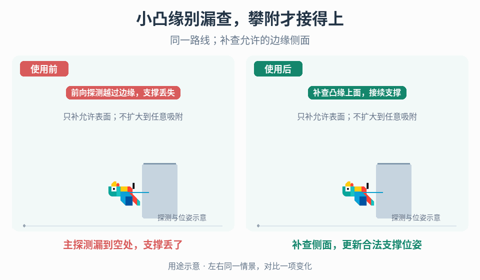

# 窄边缘攀附的支撑估计

## 效果预览

在窄凸缘路线显示主探针及右侧钩形补查，左丢支撑后脱落，右找到同一允许表面继续贴附。

左侧为使用前，右侧为使用后；4 秒循环，用途示意（非引擎实测）。

## 触发与输入

用于攀爬在小凸缘/转角丢失支撑，或多表面命中导致附着跳变。取得允许表面、有效命中位置/法线、当前支撑、探针布局、角色位姿、更新时钟与脱离规则；明确更新视觉节点还是碰撞主体。

## 实施流程

1. 固定窄边路线，显示探测、有效命中与选定支撑；分清覆盖缺失、选错表面和位姿更新问题，不先扩大吸附距离。
2. 对覆盖空缺增加朝边缘侧面补查的 hook-ray 探测候选，使主探测漏掉的小凸缘也能贡献命中；先用直角边缘验证覆盖，不假定需要递归或反射射线。探针起点、方向、长度与过滤必须在项目调试视图中可查。
3. 先筛选属于同一合理支撑候选的命中，再汇总位置与法线。平均之前处理不同物体、离群点和相反法线；归一化结果近零时视为无可靠方向，不继续计算姿态。
4. 用选定支撑位置、法线和角色偏移生成目标位姿，按项目插值方式更新；视觉贴墙与真实碰撞安全分别检查。
5. 为暂时无命中、支撑销毁/移动和主动离开定义保持期限、重新探测或脱离策略。过期支撑不能无限保留，也不能无条件切到另一表面。
6. 比较原探测与候选的覆盖、错误附着和开销；只有在允许表面/间隙范围内切换支撑。

## 调参

分别调探测覆盖、候选筛选、支撑偏移与位姿响应速度。射线更多不必然更稳；平滑太强会让碰撞主体滞后，吸附距离太大可能跨越不允许间隙。以窄边、内角、外角独立定位。

## 验收与失败处理

- 窄凸缘、内外角、曲面与不同厚度的候选可解释，无跳到无关表面。
- 相反法线、离群点、零命中与支撑销毁不产生无效姿态或永久吸附。
- 快慢移动、反向和表面切换无不可接受穿入/滞后；传送与离开后清理旧支撑。
- 不可靠估计按声明回退/脱离，不用外观补丁假装附着成功。

## 组合

[接触表示](../gameplay-locomotion-contacts/SKILL.md)与[接触响应](../gameplay-contact-response/SKILL.md)辅助诊断；[顶角修正](../gameplay-ceiling-corner-correction/SKILL.md)、[遮挡显露](../gameplay-occlusion-reveal/SKILL.md)、[相机 up](../gameplay-surface-camera-up/SKILL.md)、[承载面](../gameplay-deformable-support/SKILL.md)和[移动交互状态](../gameplay-traversal-transitions/SKILL.md)不替代本页支撑估计。

需要核对机制出处、示例参数或证据边界时，读取[来源参考](references/sources.md)。
