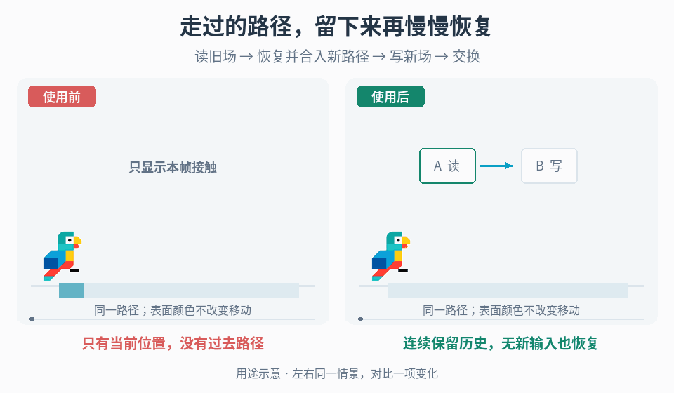

# 移动历史驱动的表面场

## 效果预览

同一路径、同一停下时刻；右保留格状历史强度并按稳定空间速率恢复，A/B读写角色交替。

左侧为使用前，右侧为使用后；4 秒循环，用途示意（非引擎实测）。

## 触发与输入

角色走过后，雪面、植被或其他表面需保留路径响应，并在没有新输入时继续演化。取得可记录的移动/接触事件、承载区域及楼层、路径形状与宽度、世界到表面的映射、目标纹素尺寸、响应材质、恢复时间尺度、暂停策略与预算。先确认跳跃是否记录、传送是否断开、静止接触是否持续刷新；不从角色投影位置自动推断接触。

只要求每块印记按绝对创建时间失效时，使用[时间戳地面效果](../gameplay-timestamped-ground-effects/SKILL.md)。这里维护可继续更新的历史强度，不新增减速、伤害、碰撞或资源消耗；若已有玩法系统需要响应，仍由其权威状态决定，不把显示纹理直接当玩法真值。

## 实施流程

1. **确定有限区域。** 为每个区域设置原点、方向、范围、允许表面与楼层，以及正整数分辨率与有限非零范围。写入和表面采样共享同一变换。先测四角与中心，范围外或错误楼层返回无响应，不把越界 UV 钳到边缘形成假轨迹；禁止环绕采样。非矩形区域另有可写/可采样掩码，掩码外状态为零。跨区域路径只提交到相交且有效的区域。移动区域原点时须重投影历史或清空重建，不直接把旧纹理套到新坐标。
2. **分配两个独立数据目标。** A、B 同尺寸、格式和映射；选择线性数据格式，关闭颜色空间转换。初始两张都清零，指定 READ=A、WRITE=B。单通道 H 表示 0–1 的历史响应强度，零就是无响应；几何有效性由区域掩码单独定义，不用强度推断是否有地面。精度须能保留每步恢复量，避免低精度量化令微小衰减永远被舍入。先关闭普通 mip 和时间方向的插值。
3. **收集本次路径印记。** 从上次已消费位置到当前有效位置构建线段/胶囊覆盖，或按世界距离补样，避免高速运动只留下零散端点。按约定断开传送和无接触段；事件只消费一次，多相机不能重复提交。每区域限制本次印记数与遍历纹素数；溢出先合并同一连续路径段或采用明确的粗化方案，不无界补点。把该批印记合成覆盖 S(x)，范围同为 0–1；采用最大覆盖时，同一位置多次覆盖取最大值，而不是增加强度。
4. **先恢复，再合并新输入。** 一个可直接落地的单层方案是：读取旧强度 H，算 D(x)=max(0,H(x)−r(x)·dt)，再令 WRITE(x)=max(D(x),S(x))。r 为有限的每秒恢复量，非负；需要最终恢复时取正值，r=0 只用于明确的永久历史模式。新覆盖会重新提升局部强度，重叠不无限变亮；若项目要求累积脚步次数或保存方向，须先改变数据布局和合并语义，不能把该方案当计数器。每次覆盖 WRITE 的整个有效区域，并将掩码外写零；不只改新印记附近，否则交换后旧内容会复活。没有新印记也执行恢复，S=0。
5. **完成更新后才交换。** 每个选定更新帧只安排一次上述 READ→WRITE 数据通路；本次旧场只从 READ 读，完整新场只往不同的 WRITE 写。保证 GPU 写入对随后的采样可见，然后交换角色，令表面读取新的 READ。多 pass 时显式管理中间依赖，不让表面采样尚未完成的目标。此流程不依赖原地读写能力；暂停或跳过更新时不交换未生成的目标。记录更新时间而非摄像机回调次数，避免多相机重复恢复。
6. **固定恢复时钟。** dt 使用所选游戏/真实时钟的有限非负实际间隔，按暂停约定决定是否推进。恢复量不能写成“每帧减固定数”。长帧用实际 dt 完成这一线性恢复；若添加非线性演化需子步，则设子步上限并明确积压时间的处理，不悄悄丢弃时间。需要可重复回放时固定输入消费时点、区域映射、步长与种子；普通浮点 GPU 结果不承诺跨设备逐位一致。
7. **由表面读取场。** 在材质中以同一坐标与有效范围采样 READ，把 H 映射到已有的覆盖、颜色或变形参数，保持基础表面 H=0 的结果。先用灰度调试确认历史位置、恢复与覆盖，再加外观。不要在显示 pass 中再次衰减并写回数据，也不要用颜色亮度反推历史强度。

## 可选外观与恢复模式

- **块状/像素对齐：** 以区域固定原点定义纹素网格，写入与显示使用一致的网格中心及最近点采样；项目需要开关式外观时，只在显示层用明确阈值切换，不把每步恢复后的 H 二值化，否则可能无法渐进恢复。按世界纹素尺寸调节块大小；相机移动时网格不随屏幕漂移。连续外观可在显示层双线性采样强度，但更新仍按精确纹素读取，避免每帧重采样累计模糊。有效区域边缘需屏蔽无效邻居，普通 mip 会混入别的区域，不直接启用。
- **散布式恢复：** 不必给每个像素调度一个随机事件。可令 r(x)=lerp(r_min,r_max,n(x))，其中 n 是由区域 ID、固定格坐标与种子产生的稳定 0–1 值，且 0<r_min≤r_max。同一区域每次更新保持 n 不变，让不同位置以不同速度恢复；先调空间尺度，再调速率范围。不要每帧重新抽样制造闪烁，也不要把噪声乘到最终颜色上冒充状态恢复。均匀恢复使用固定 r；二者都保留相同的新覆盖刷新规则。

## 验收与恢复

- 单次经过后停下，旧路径在多个交换帧间持续存在并按约定恢复；没有新输入也能归零。隔帧闪烁/复活先查是否清了两张纹理、是否完整覆盖 WRITE、显示是否绑到了旧角色。
- 连续与重叠路径、快移、静止刷新和传送符合约定；强度不超过 1，不因帧率改变而堆亮。用相同路径和经过时间比较不同帧率，允许项目定义的空间采样/精度误差，不把可见差异一概归为艺术效果。
- 四角、范围外、错误楼层、区域交界与掩码边缘没有环绕或边缘堆积。块状模式在相机移动后仍锁定世界网格；平滑模式长时间无新增输入不会自行扩散或模糊。
- 同一种子和输入时序复现空间恢复模式；换种子只改变分布，不改变覆盖约定。恢复卡住检查速率、dt、存储精度与显示阈值；先用浮点数据目标验证再决定压缩。
- 暂停/恢复、禁用后启用、区域回收和重开均符合时钟策略。清理时清零两张目标、待消费印记及路径起点；释放后重新绑定材质，重建未完成时显示基础表面，不继续采样失效资源。
- 在最大区域数、纹理尺寸和印记数下记录更新成本；超预算先减小区域/分辨率或合并路径。若降低更新频率，仍按累计经过时间恢复并处理跨步路径，不只把 dt 固定为原值。记录实际执行结果，未运行目标项目不报引擎验收通过。

## 相邻职责

[表面余效](../gameplay-surface-aftermath/SKILL.md)处理承载面采样、边界截断与贴地网格；本场不自动生成这些几何。[时间戳地面效果](../gameplay-timestamped-ground-effects/SKILL.md)保存局部创建时刻并按年龄到期；本流程读取前态并生成新态。两者都可能使用双缓冲，但不因共用缓冲技术而合并状态语义。[状态驱动表面动画](../gameplay-state-driven-surface-motion/SKILL.md)将设备状态映射到 UV 运动，不记录经过表面的路径历史。

核对出处、观察范围和候选工程实现时读取[来源参考](references/sources.md)。
