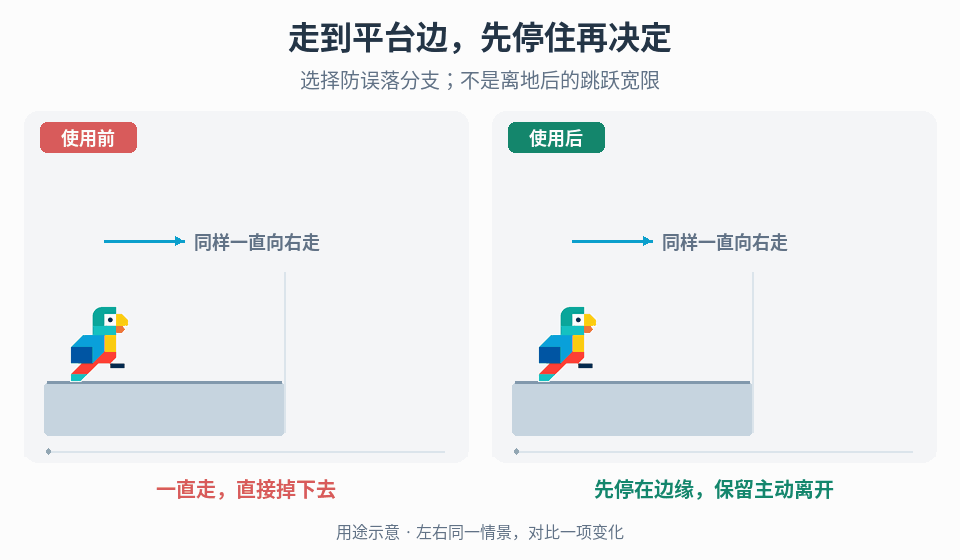

# 移动交互的停留与接续

## 效果预览

同样持续向右行走；右侧在允许边缘进入停留状态并显示主动跳离选项，左侧继续掉落。

左侧为使用前，右侧为使用后；4 秒循环，用途示意（非引擎实测）。

## 触发条件

- 玩家容易误走出平台，或自动停住后没有姿态/操作提示，不明白为何停下。
- 面向连续通过的路段被停挂、择时释放等状态打断，需要评估保留还是减少这些选择。
- 两种策略方向相反：防误落增加停留，连续接续减少停留。仅在“进入交互→停留/离开→恢复移动”的状态决策相同时共用此流程，不默认全部采用。

## 输入与前置条件

允许交互的场景与入口条件、停留/释放/换向/跳跃/恢复移动状态、实际键位、控制归属和关卡预期节奏。列出哪些选择必须保留，哪些可以自动完成。

## 实施步骤

1. 画出进入交互、停留、离开、恢复移动及中断状态，标注每个节点玩家可表达的意图。先选防误落还是连续接续目标，二者不是必须叠加。
2. 防误落分支：只在允许边缘/运动状态阻止行走离台，进入清楚的停留姿态并显示真实可用操作；若设计允许主动下落，保留明确表达方式。
3. 连续接续分支：按关卡目标减少停挂/择时释放，明确自动离开与玩家换向、观察、取消的优先级；不能只加速动画却保留隐性等待。
4. 为所选分支实现进入资格、退出条件、重复进入及异常中断。姿态与提示读取同一许可状态，键位来自项目绑定。
5. 同路线对照防误落减少的误落与有意离台受阻，或连续接续减少的等待与失去的自主择时。恢复常规移动时归还控制，不遗留锁停。

## 调参顺序

分别调边缘检测容差、进入/退出条件和接续时机，以斜向接近、窄平台和连续障碍为对照。先定哪些选择必须保留，再调自动化强度，不以越自动越好为目标。

## 失败处理

误锁停先检查进入范围和退出意图；抓取后卡死检查控制归属；自动摆出不符玩家方向时回退到可表达意图的状态。离台后的跳跃宽限属于独立时间许可，不拿本流程代替。

## 验收

- [ ] 防误落覆盖斜向接近、窄平台和连续边缘，比较误落次数与有意离台受阻；如允许主动下落，其意图仍能表达。
- [ ] 连续接续覆盖抓取、离杆、落地与连续障碍，记录等待和误操作；需要保留的观察、换向和择时仍可表达。
- [ ] 移动/跳跃/释放许可与姿态、提示一致；提示不以固定 SPACE 代替项目键位。
- [ ] 中断、重入、取消后恢复正确控制，不遗留停挂或锁停；只改表现时不得改变真实转换条件。

## 组合与边界

- [情境交互](../gameplay-contextual-ui/SKILL.md)：真实状态到提示，不复制提示机制。
- [移动方向动画](../gameplay-movement-feedback/SKILL.md)与[落地反馈](../gameplay-landing-feedback/SKILL.md)：状态确定后的具体表现。
- [离地跳跃宽限](../gameplay-jump-forgiveness/SKILL.md)：不同触发与许可生命周期。

[环境跳板](../gameplay-launch-pad-feedback/SKILL.md)负责环境接触后的弹射与腾空全过程，不在本入口复制该编排。

需要核对案例、参数出处或证据边界时，读取[来源参考](references/sources.md)。
