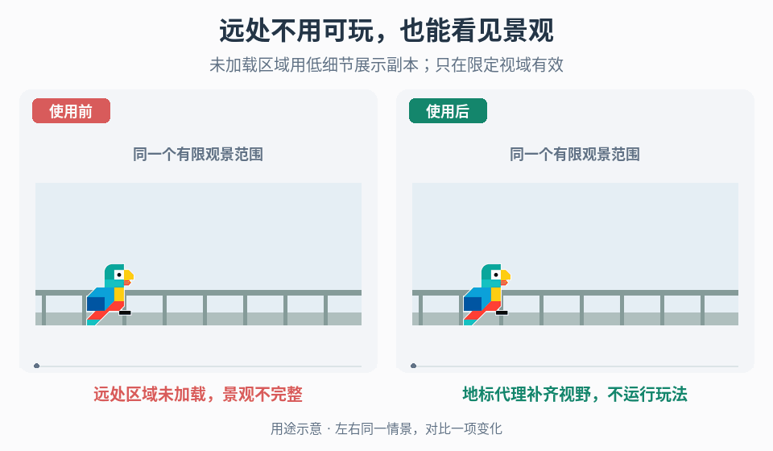

# 有限观察范围的远景场景代理

## 效果预览

相同观景台与轻微观察位移；右纯展示远区体块保持地标布局，不带AI/碰撞/交互，左未加载远区空白。

左侧为使用前，右侧为使用后；4 秒循环，用途示意（非引擎实测）。

## 触发与输入

玩家所在区域需要看见当前未加载的远处区域，而这些远景在观察期间不需要作为完整可玩场景运行时使用。若玩家可直接到达代理、需要实时交互或能任意绕看，先明确真实场景的加载与交接方案，不把视觉副本当可玩区域。

取得以下项目输入：

- 观景场景、权威可玩区域及其世界坐标关系；必须保留的地标、天际线、遮挡和空间方向。
- 合法相机位置体积、朝向、俯仰、缩放/视场角、画幅，以及移动、震动、过场可能扩展的范围。只给一个截图不足以定义可见集合。
- 哪些区域在观景期间不加载、哪些可能同时加载；现有进入/离开观景区域及场景就绪信号。
- 远处可变状态的要求：门、桥、破坏物、移动物、天气/昼夜是否必须一致，以及画面误差和性能预算。缺少状态约定时先标出冲突，不擅自冻结玩法可见结果。

## 实施步骤

1. **界定代理有效范围。** 在编辑器标出允许的相机体积与方向范围，建立中心、边缘、最高/最低和最大放大视图的检查点，并沿实际移动路径扫视。只为这组合法视图建立代理；需要更大范围时重新构建可见集合，而不是假定当前副本通用。
2. **建立同坐标副本。** 将各合法视图可见的区域对象复制到观景场景的独立代理根节点。保留源世界位置、朝向和缩放；跨场景原点不同时记录明确的坐标变换。先用完整外观副本对齐地标和地平线，再简化。记录源场景/对象标识、版本、变换及替换资产，禁止回写修改权威可玩区域。
3. **把副本变为纯展示。** 移除或禁用 AI、任务、交互、伤害、掉落、存档、网络身份和其他玩法更新路径。按项目决定保留哪些纯视觉动画、光照和阴影依赖；检查脚本停用后材质、姿态是否失效。代理不新增碰撞、导航或射线命中目标，不得复制活跃音源/灯光而造成双份效果。若确实需要交互或遮挡查询，由权威系统明确提供，不借装饰副本悄悄实现。
4. **按所有合法视图裁剪。** 删除在整个观察范围内都无贡献的内部、背面和遮挡后对象；不能只按中心截图删除。在删去隐藏几何前检查它是否仍影响投影、反射或阴影，必要时保留对应表示或调整受支持效果。每次按一组对象裁剪后，从边界位置移动检查露底、透空和遮挡改变。
5. **以屏幕外观替换远处细节。** 优先保留地标布局、外轮廓、主要体积、负空间和色块，再用低细节资产替换屏幕占比小的结构。对比最大放大和最接近的合法视图，按项目允许的屏幕误差逐步减细节；不要统一缩放整区来伪造距离或给所有对象套同一面数预算。保留足够视差深度，避免一移动就暴露错误前后关系。
6. **处理状态与边界。** 给可变地标逐项选择允许静态快照、读取权威状态的视觉变体，或不纳入代理；记录项目决定。同步只驱动展示，不在副本重跑伤害或任务。离开有效范围前，使用项目既有遮挡/过场/加载机制切到真实表示；真实区域已加载时明确可见性所有权，避免两个版本同时显示。目标表示未就绪时保持在有效范围或使用已批准的过渡，不让玩家进入空区域。若项目没有交接机制，停在有限观景交付，不扩建流送系统。
7. **建立更新路径。** 保存代理根、源映射、替换规则及验证视图。源布局、地标状态、相机范围或光照条件改动后，将相关代理标为待更新，重建对应部分并重跑视图检查；不要依赖手动副本永远保持一致。重建应替换旧代理而非叠加第二套，并保留明确的项目覆盖配置。

## 调参与失败恢复

- 地标错位：先查坐标变换和源版本，再查删减/替换资产；不要用雾遮住位置错误。
- 边缘露底或视差不对：恢复被删几何、扩大代理覆盖或经项目确认缩小观察范围。单张中心图通过不构成修复。
- 明暗/动态状态不一致：查材质、光照来源和所选状态策略；若无法满足要求，保留必要真实资源或取消该代理，不偷偷改变世界状态。
- 性能未改善：在相同视图、硬件和画质下测 CPU/GPU 时间、内存、材质/绘制提交与加载峰值。副本会增加资源，低细节不保证更少绘制调用或更快；按实际瓶颈调整，不承诺收益。

## 验收

- [ ] 在合法相机体积、方向、缩放和画幅组合中扫视：地标布局/轮廓、遮挡、视差和接缝满足项目误差，边缘没有漏面或突变。
- [ ] 可玩源区域未加载时远景仍完整；代理不产生玩法事件、命中目标、重复音效、掉落或存档实体。
- [ ] 真实区域同时存在、进入/离开边界、目标加载延迟及反复重入时，无双影、空洞或可触达假地形；不支持的自由相机路径有明确限制。
- [ ] 所选动态状态与昼夜条件符合约定；源地标移动或资产替换后能定位并更新代理，重建不叠加副本。
- [ ] 记录相同条件的项目性能对照；未测量时只交付视觉方案，不报告优化比例或容量保证。

固定参考视角的插画贴几何走[固定相机插画投影](../gameplay-fixed-camera-art-projection/SKILL.md)；可击中道具从静态转动态走[受击物理激活](../gameplay-impact-physics-activation/SKILL.md)。本入口只拥有有限视域内的装饰远景副本，不接管上述映射或物理状态。

需核对署名、观察与工程建议的依据时，读取[来源参考](references/sources.md)。
