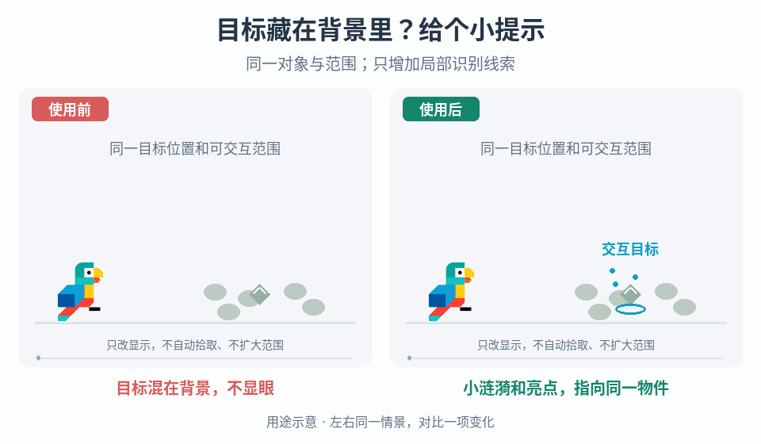

# 世界目标发现性与局部提示

## 效果预览

同一静态目标藏于低对比背景；右侧只增加锚定涟漪与局部亮点，不改变目标位置或鸟的行为。

左侧为使用前，右侧为使用后；4 秒循环，用途示意（非引擎实测）。

## 触发条件

应该可发现的资源/交互物混入背景，标记遮挡过重，或需要方向线索/临时识别模式。

## 输入与前置条件

允许显示的目标集合、距离/遮挡规则、观察相机、发现难度、锚点与输入提示；方向线另需端点/多目标预算。

## 实施步骤

1. 在实际视距定位是目标难发现还是提示过重，先确定允许揭示的信息范围。角色被遮挡走独立显露入口，不扩大资源发现规则。
2. 普通显示先单独比较屏幕尺寸、位置和背景对比，再试涟漪等局部提示。视觉放大不应顺带改碰撞；改变生成位置会影响可达性，须单列玩法验证。
3. 局部交互标记可用小范围粒子替代大箭头，保留明确对象锚点与实际按键提示；同背景比较定位和遮挡，不假设更小一定更易发现。
4. 临时识别作为另一方案：只对允许目标切换轮廓/环境调色，退出恢复原显示；目标被拾取或消失立即解除，不新增穿墙探测或自动收集。
5. 方向线方案先按资格/距离筛选，再连接目标与玩家并随端点更新；可用波形和烟风材质表达方向。若采用遇挡截断，明确它不是绕障寻路，也不代表目标不可达。
6. 多目标分配可读预算，移出范围/被领取/退出模式时回收提示；提示不承担实际交互提交。

## 参数调整

一次只改尺寸、对比、局部密度或线条样式；方向线调振幅/频率时先保持端点清楚。发现率不足时比较更强提示，而非无限增加粒子；模式调色不能抹掉危险信息。

## 验收与失败处理

- [ ] 同视距/背景的新玩家定位测试能发现允许目标，涉及位置/碰撞的改变另验规则。
- [ ] 局部提示不挡按键；低特效和非颜色识别仍有效。
- [ ] 模式反复开关无旧轮廓/调色，对象消失及时清理。
- [ ] 单/多目标移动、遮挡和范围边界不串线，不被误读为可走路线。

## 按需组合

- [角色遮挡检测与局部显露](../gameplay-occlusion-reveal/SKILL.md)
- [游戏内交互状态](../gameplay-contextual-ui/SKILL.md)
- [世界内操作指示](../gameplay-worldspace-indicators/SKILL.md)
- [接触闪光、冲击帧与粒子](../gameplay-impact-visuals/SKILL.md)
- [重力方向线索](../gameplay-gravity-orientation-cues/SKILL.md)

需要核查出处、示例参数或证据限制时，读取[来源参考](references/sources.md)。
