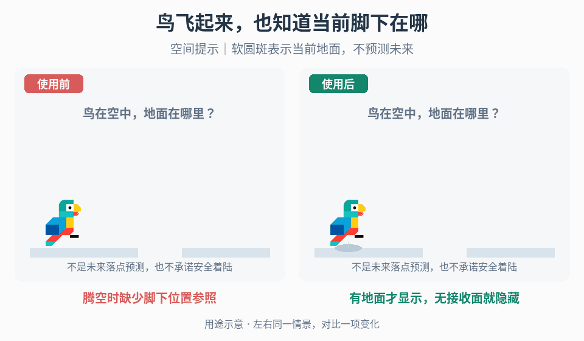

# 世界内位置参照与操作指示

## 效果预览

腾空时缺少脚下位置参照；有地面才显示，无接收面就隐藏；空间提示｜软圆斑表示当前地面，不预测未来。

左侧为使用前，右侧为使用后；4 秒循环，用途示意（非引擎实测）。

## 触发与输入

用于目标标记换视角后深度错位，或腾空角色缺少当前地面位置参照。取得参照对象、标记含义、相机投影、锚点和生命周期。目标分支另需真实输入/成功事件；地面分支另需接收面与无表面策略。

## 实施流程

先声明标记代表操作目标位置还是角色当前地面参照。两者分别选锚点/接收面，不把地面圆斑当未来落点或可站立证明。

### 世界内操作目标

1. 将目标环绑定真实目标空间位置，分别从侧视与俯视校对深度，不能只在固定相机下对齐屏幕坐标。
2. 在正确锚点基础上加入鱼影、涟漪、鱼钩或线条动画，避免动画让标记偏离真实操作对象。
3. 移动目标实时更新，取消/失败清理，只有真实成功事件才显示成功；标记靠近不能改变输入范围或判定。

### 当前地面参照

1. 按项目选择的方向/策略求当前接收面，再放置软圆斑或等效标记；求解表示可用射线、投影或其他实现，但须与项目空间含义一致。
2. 校对角色升降和水平移动时位置关系。多层表面、窄板和边缘需要明确接收规则，不能穿过近层投到无关远层。
3. 无有效面、超范围或遮挡时隐藏或执行已声明回退，不保留误导的旧位置。若支持墙/天花板或变重力，重新定义参照方向。
4. 对象/接收面销毁、传送和切场清除标记及缓存命中。

## 调参

先调接收范围与锚点偏移，再调圆斑大小、柔边、透明度和可选高度曲线。标记需可辨但不掩盖地形边缘；动画幅度不能破坏深度关系。目标提示与当前地面参照分别校准。

## 验收与失败处理

- 不同相机、目标深度、角色高度和屏幕比例下空间含义一致。
- 操作目标移动/取消/成功后正确更新，原判定不变。
- 地面参照覆盖上升、下落、水平运动、窄板边缘、坡面、多层与无接收面，不暗示未来安全落点。
- 错位先查坐标转换和接收面，不通过移动真实目标或修改跳跃轨迹补偿。

## 组合

[目标发现](../gameplay-world-readability/SKILL.md)回答哪里有目标，[交互状态](../gameplay-contextual-ui/SKILL.md)决定成功，[重力线索](../gameplay-gravity-orientation-cues/SKILL.md)表达向下，[落地反馈](../gameplay-landing-feedback/SKILL.md)确认接触，[攀附支撑](../gameplay-surface-adhesion/SKILL.md)决定物理附着。

需要核对机制出处、示例参数或证据边界时，读取[来源参考](references/sources.md)。
